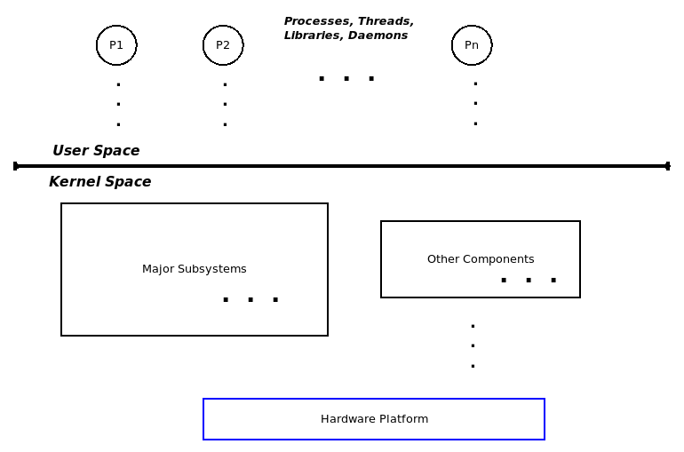
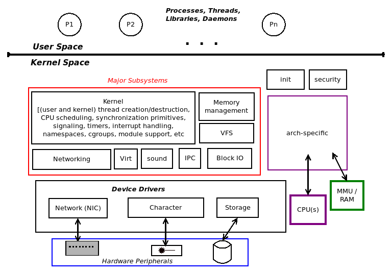

# 内核模块

## 1 理解内核架构

### 1.1 用户空间和内核空间

CPU 至少有两级特权，用来把普通程序和高权限的内核隔开。x86 管这叫 **ring**，一共 4 级；32 位 ARM 管这叫**执行模式**，最多 7 种，其中 6 种特权、1 种非特权。

不管哪个架构，操作系统真正用到的只有两级：

- **用户态**：应用程序待的地方，没有特权。
- **内核态**：内核和它的全部组件待的地方，特权全开。



### 1.2 库与系统调用

用户态程序干活靠 API，库就是 API 的打包——一套标准化、测试过的接口，省得自己造轮子，还顺带解决了可移植性。所有用户态程序都会自动链接 **glibc**，但库只活在用户态，**内核没有库**。

那问题来了：用户态和内核态分属不同地址空间、不同特权级别，程序怎么够得着内核？答案只有一条路——**系统调用**。它是用户态进内核的唯一合法入口，会把 CPU 从非特权切到特权模式。`fork`、`execve`、`open`、`read`、`write`、`socket` 这些都是。

### 1.3 内核空间组件

Linux 内核是个相当大的东西，内部是一堆子系统：

| 子系统 | 干什么的 |
| --- | --- |
| 核心内核 | 进程/线程的创建销毁、CPU 调度、同步原语、信号、定时器、中断、命名空间、cgroups、模块支持、加密 |
| 内存管理（MM） | 内核和进程虚拟地址空间（VAS）的建立与维护 |
| VFS | 对各文件系统（ext2/4、vfat、ntfs、iso9660、jffs2、ufs…）的抽象层 |
| 块 I/O | 从 VFS 一路到块设备驱动的文件 I/O 通路 |
| 网络栈 | 按 RFC 实现各层协议，TCP/IP 最出名 |
| IPC | 消息队列、共享内存、信号量（SysV/POSIX）等 |
| 声音 | 音频代码，从固件到驱动、编解码器 |
| 虚拟化 | KVM |

这些组件全挤在同一个内核地址空间里，这就是**宏内核**。



顺带说一句，这里讲的地址空间是**虚拟**的，不是物理的：内核用一张主内核页表把内核虚拟页映射到物理页帧，每个存活进程再用各自的页表映射自己的虚拟页，映射由 MMU/TLB/缓存按页粒度完成。

## 2 LKM 框架

**LKM**（Loadable Kernel Module，可加载内核模块）让你在内核源码树之外写一段内核代码，编译后在运行时插进内核内存跑，用完再拔掉。

- 源码就是 C 文件 + 头文件 + 一个 Makefile，用 `make` 构建。
- 编译产物是 **`.ko`**（Kernel Object），本质是目标文件，不是可执行文件。Linux 2.4 及更早叫 `.o`，2.6 起叫 `.ko`。
- `insmod` 插进去，`rmmod` 拔出来（后面再细说）。

宏内核为什么要留这么个口子？**模块化**有几个好处：

- 改代码只需重编模块、卸旧载新，不用重编整个内核、重启机器。
- 可以按需打包，一个脚本就能给不同价位的产品生成不同的镜像。
- 可以在现有产品上加载诊断模块生成调试日志（kprobes 干的就是这个）。

所以 Linux 不是纯粹的宏内核，也是**模块化的**。

### 2.1 .ko 和 .so：一个跑内核，一个跑用户态

**`.ko`** 和 **`.so`** 都能被动态加载，但一个住在内核态、一个住在用户态，生命周期完全不同：

| 维度 | .ko（Kernel Object） | .so（Shared Object） |
| --- | --- | --- |
| 运行空间 | 内核空间（Ring 0） | 用户空间（Ring 3） |
| 主要用途 | 扩展内核功能（设备驱动、文件系统、网络协议） | 用户态可复用代码库（libc.so、libstdc++.so） |
| 编译 | 内核 Kbuild（`make -C /lib/modules/... M=...`） | gcc/clang（`-fPIC -shared`） |
| 加载方式 | `insmod`/`modprobe`，走 `init_module` 系统调用 | 启动时 `ld-linux.so` 加载，或 `dlopen` 运行时加载 |
| 符号解析 | 内核符号表（`/proc/kallsyms`、`Module.symvers`），`EXPORT_SYMBOL` 导出 | ELF 动态链接器，经 `.dynsym`/`.dynamic` 段解析 |
| C 库 | 无（不能链 glibc，只能用 `kmalloc`、`printk` 等内核 API） | 有（glibc/musl，可用 `malloc`、`printf`） |
| 崩溃后果 | Kernel Panic，整个系统宕机 | Segmentation Fault，只有当前进程崩 |
| 内存管理 | 内核分配器（`kmalloc`、`vmalloc`），页错误处理不当就崩 | 用户态堆（`malloc`、`new`），支持按需分页 |

编译最容易搞混：`.so` 直接 `-fPIC -shared` 用 gcc 编就行；`.ko` 不行，必须走 **Kbuild**——先编成 `.o`，再由 modpost 拿 `Module.symvers` 校验符号在内核里有没有定义，最后链接成 `.ko`。`.ko` 不需要 `-fPIC`，因为它加载时会被重定位到内核地址空间。

加载也不一样：`.so` 是动态链接器读 ELF 的 `.dynamic` 段，把依赖 mmap 进进程地址空间再重定位；`.ko` 是 `insmod` 走 `finit_module`/`init_module` 系统调用，内核分配连续页、解析 ELF 头、重定位到内核地址空间，然后调 `module_init` 注册的初始化函数。

写内核模块最要命的是**稳定性**：`.so` 里野指针顶多触发 **Page Fault**，进程吃个 `SIGSEGV` 就完了；`.ko` 里野指针、栈溢出、死锁、在中断上下文里睡眠，直接 **Kernel Panic** 全机宕掉。所以内核开发对内存安全（边界检查这些）的讲究，远高于用户态。

什么时候该写 `.ko`、什么时候该写 `.so`？拿 Ascend NPU 举例：

- **写 `.ko`**：做 NPU 的 PCIe 驱动（寄存器映射、中断、DMA），或者自定义内核态调度/内存管理。特征是直接操硬件、要高权限，代码里全是 `ioremap`、`request_irq`、`kmalloc`。
- **写 `.so`**：做自定义算子的 CPU/GPU 实现，给 PyTorch/MindSpore 用 `dlopen` 加载；或者写通用数学/日志库给多个程序链接。特征是代码里全是 `std::vector`、`malloc`、`printf`，用 `extern "C"` 导出接口。

调试工具也差一档：

| 对象 | 工具 |
| --- | --- |
| **`.so`** | `gdb`、`ldd`（看依赖）、`nm -D`（动态符号）、`objdump -T` |
| **`.ko`** | `lsmod`（已加载模块）、`modinfo`（模块信息）、`dmesg`/`journalctl -k`（printk 日志）、`crash`（分析 panic dump） |

### 1.2 内核源码树的内核模块

内核模块不算新东西——第一篇编译内核时，凡是三态选项设成 `M` 的功能，都被编成了模块，再用 `modules_install` 装到暂存目录。

本机编译的 5.15.0-dirty（`defconfig`）一共出了 847 个模块：

```shell
$ cd /home/developer/kernel-rootfs-arm64/lib/modules/5.15.0-dirty
$ find . -name "*.ko" | wc -l
847
```

847 个驱动要是全编进内核镜像，镜像得撑爆，做成模块才能按需加载。模块按子系统分目录放：

```shell
$ ls kernel/
arch/  crypto/  drivers/  fs/  lib/  net/  sound/
```

其中 `drivers/` 最多（624 个），剩下 `sound` 108、`net` 65、`crypto` 26、`lib` 10、`arch` 9、`fs` 5。

模块用得最多的是设备驱动。拿 Synopsys STMMAC 以太网驱动看：

```shell
$ ls -l kernel/drivers/net/ethernet/stmicro/stmmac/stmmac-platform.ko
-rw-rw-r-- 1 developer developer 82056 Nov 10 17:39 kernel/drivers/net/ethernet/stmicro/stmmac/stmmac-platform.ko
$ modinfo kernel/drivers/net/ethernet/stmicro/stmmac/stmmac-platform.ko
filename:       /home/developer/kernel-rootfs-arm64/lib/modules/5.15.0-dirty/kernel/drivers/net/ethernet/stmicro/stmmac/stmmac-platform.ko
license:        GPL
author:         Giuseppe Cavallaro <peppe.cavallaro@st.com>
description:    STMMAC 10/100/1000 Ethernet platform support
depends:        stmmac
intree:         Y
name:           stmmac_platform
vermagic:       5.15.0-dirty SMP preempt mod_unload aarch64
```

`modinfo` 能读出 `license`、`author`、`description`、`depends`（依赖）、`vermagic`（编译它的内核版本）这些元数据。运行时用 `lsmod` 看已加载模块、`dmesg` 看 printk 日志，工具汇总见上一节。
