# 4 - 进程和线程

这一章要搞懂三件事：内核代码运行在什么上下文（进程上下文 vs 中断上下文）、进程的虚拟地址空间（VAS）长什么样、进程/线程的栈在用户态和内核态如何组织。理解"一个线程有两条栈（用户态栈 + 内核态栈）"这条主线，是理解内核并发、内存管理和同步的基础。

不过"进程"这个主题远不止这三件事。既然内核里到处都要和进程打交道，我们顺势把进程的整个生命周期补全：内核用什么数据结构描述一个进程（`task_struct`）、它存在哪、怎么用 `current` 快速拿到它、进程有哪几种状态、PID 怎么分配和查找、进程/线程是怎么 fork 和 clone 出来的、内核线程和普通线程的区别、进程最后怎么死、死后资源怎么被回收，以及藏在背后的等待队列、资源限制、进程切换这些底层机制。这一章内容多，但主线始终一条：**进程是内核里"正在运行的实体"，`task_struct` 是它在内存里的化身，理解它如何被描述、如何被创建、如何被调度、如何被销毁，就理解了内核最核心的一半**。

顺带说明一点：本章正文基于《深入理解 Linux 内核（ULK）》和《Linux 内核设计与实现（LKD）》第 3 章，原文都是 2.6 内核、大量 x86-32 的实现。凡是和 5.15 出入较大的地方，这里都用"2.6 → 5.15 更正"标注出来，并对照 `linux-5.15` 源码和 QEMU 实测结果做了修正。

## 一、进程上下文与中断上下文

进入内核态的方式不止系统调用一条。前面看到的都是进程**主动**发起系统调用、从用户态切进内核态；还有一条**异步**的通路——很多设备驱动的中断代码路径，就是由外部硬件中断触发、进入内核态执行的。这种情形下执行的内核代码处于**中断上下文（interrupt context）**。

因此，任何一段内核代码，要么从进程上下文进入、要么从中断上下文进入，只有这两种：

| 上下文 | 进入方式 | 特征 |
| --- | --- | --- |
| **进程上下文（Process context）** | 系统调用，或处理器异常（如缺页故障） | 同步的，自上而下 |
| **中断上下文（Interrupt context）** | 外设芯片的硬件中断 | 异步的，自下而上 |

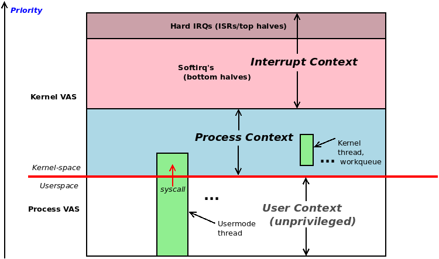

图 6.1 给出了概念视图：用户态进程和线程在无特权的**用户上下文**里执行；用户态线程通过发起系统调用，切到特权级的**内核态**。图里还展示了 Linux 中的**纯内核线程**——它和用户态线程很像，关键区别在于它只在内核空间执行，看不到用户的虚拟地址空间。

- 通过系统调用（或处理器异常）**同步**切到内核态后，任务执行的是进程上下文里的内核代码（内核线程跑内核代码也属于进程上下文）。
- **硬件中断**则不同：它**异步**地进入内核，所执行的代码（通常是设备驱动的中断处理程序）运行在中断上下文里。

再往细里说，进程上下文（process context）说的是这么一件事：程序代码从可执行文件被载入进程地址空间，正常情况下在用户空间跑；一旦它发了系统调用或触发了异常，就 **陷(trap)** 进了内核空间。此时我们称之为**内核代表进程执行**，处于进程上下文。

除非中途冒出了更高优先级的进程、调度器做了切换，否则内核退出时，程序回到用户空间继续跑。换句话说，系统调用和异常处理程序是内核明确定义好的入口，进程只能通过这些口子进入内核空间。

## 二、进程虚拟地址空间（VAS）基础

用户的 VAS(Virtual Address Space) 被划分成一段段同质的内存区域，称为**段（segment）**，更技术性的叫法是**映射（mapping）**。每个 Linux 进程至少有这么几段映射：

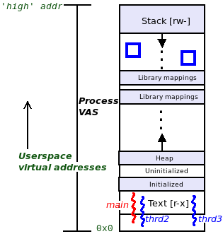

| 段 | 权限 | 说明 |
| --- | --- | --- |
| **Text 段** | `r-x` | 存放机器码，静态 |
| **Data 段** | `rw-` | 存放全局变量和静态变量，内部又分三小段（见下） |
| **库（text/data）** | `r-x` / `rw-` | 进程动态链接进来的所有共享库，由加载器在运行时映射进 VAS |
| **栈（Stack）** | `rw-` | 后进先出（LIFO），实现高级语言的函数调用机制 |

Data 段内部还细分成三个不同的段：

1. **已初始化数据段**：存放预先初始化过的变量，静态；
2. **未初始化数据段**：存放未初始化的变量（运行时自动清零），这块区域常被称为 **bss**，静态；
3. **堆段（Heap）**：`malloc` 一族的内存分配/释放 API 从这里取内存。不过这话不完全对——现代系统上，只有小于 `MMAP_THRESHOLD`（默认 128 KB）的 `malloc()` 才从堆里分配；更大一点的，则改为通过 `mmap` 系统调用，在进程 VAS 里单独开一块"映射"。堆是**动态**段，可伸缩，堆上最后一个合法可引用的位置称为**程序断点（program break）**。

栈是另一个**动态**段。它用 **后进先出（LIFO，Last In First Out）** 的语义来实现函数调用，专干三件事：

- **传参**：把调用者的实参压进栈；
- **局部变量的创建与销毁**：函数进来时在栈上给局部变量腾地方，返回时收回；
- **传返回值**：函数算完，把结果留给调用者。

这些东西具体怎么摆放，由每次函数调用分配并初始化出来的一个**栈帧**决定。栈帧的精确布局高度依赖 CPU——要查对应 CPU 的 ABI 文档才说得清。

然后是栈的**生长方向**。在所有现代处理器（包括 x86 和 ARM 家族）上，栈都朝**低地址**方向"生长"，这叫**完全递减栈**。`SP` 寄存器（或等价物）总是指向当前栈帧，也就是**栈顶**。

这里有个反直觉的点，值得单独拎出来说：正因为栈是朝低虚拟地址生长的，所以"栈顶"反而是整条栈里**最低**的虚拟地址——和"往上堆"的直觉正好相反，但确实如此。画出来就是这样（地址从上往下、由高到低）：

```text
      高地址（栈"底"，最早分配的空间）
   ┌──────────────────────┐
   │   帧 C(更早的调用)    │
   ├──────────────────────┤
   │   帧 B(funcB)        │
   ├──────────────────────┤
   │   帧 A(funcA)        │  ← 当前在跑的帧
   ├──────────────────────┤  ← SP 指向这里 = 栈顶
   │                      │
   │   (尚未使用的空间)    │  ← 下次调用往下长
   │                      │
   └──────────────────────┘
      低地址 = 栈"顶"，生长方向 ↓
```

看清楚了吗："栈底"在**高地址**，"栈顶（SP）"在**低地址**。每次新函数调用，SP 往下移，新栈帧压到更低的地址上——这就是"朝低地址生长"的直观含义。

顺带一提，进程能用的地址空间、栈、堆这些都不是无限的，内核用一套 **资源限制（resource limit）** 给它们封了顶。这个话题放到第十四节专门讲。

## 三、进程、线程及其栈的组织：用户态与内核态

传统的 UNIX 进程模型是 **一切皆文件** 的反面——"一切皆进程；不是进程就是文件"。

**线程是进程内的一条执行路径**。线程共享进程的所有资源（包括用户 VAS），唯独栈除外——每个线程都有自己私有的栈区域。

下一个关键点：**CPU 支持的每个特权级别，每条线程都要有一条栈**。现代操作系统（如 Linux）支持两级特权——无特权的用户态（用户空间）和有特权的内核态（内核空间）。因此，Linux 上每个存活的用户态线程都有**两条栈**：

| 栈 | 何时使用 |
| --- | --- |
| **用户空间栈** | 线程执行用户态代码路径时 |
| **内核空间栈** | 线程通过系统调用或异常切到内核态、在内核里执行代码（进程上下文）时 |

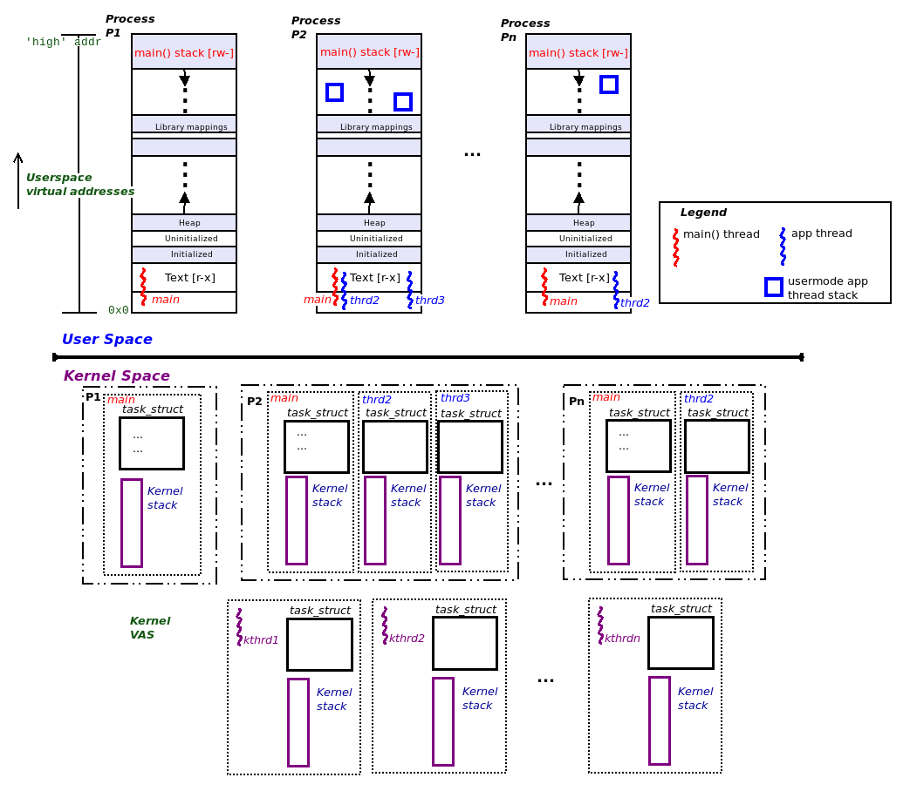

图 6.3 把地址空间切成两半——用户空间和内核空间。图上半部分是用户空间：若干进程和它们各自的用户 VAS；下半部分是内核空间：每个用户态线程都对应一个内核元数据结构（`task_struct`）和该线程的内核态栈。此外，最底部还有三个内核线程（`kthrd1`、`kthrd2`、`kthrdn`），它们同样各有一个 `task_struct` 和一条内核态栈。

用下面这个 Bash 脚本（`ch6/countem.sh`）数一下当前存活的进程和线程：

```shell
cd ../ch6
./countem.sh
```

```text
stem release info:
Distributor ID: Ubuntu
Description:    Ubuntu 24.04.5 LTS
Release:        24.04
Codename:       noble

Total # of processes alive              =       525
Total # of threads alive                =      1631
Total # of kernel threads alive         =       311
Thus, total # of usermode threads alive =      1320
```

### 3.1 用户空间的组织

每个进程至少有一条执行线程（`main()` 线程）。下面这张图展示了三个进程 P1、P2、Pn，分别含 1、3、2 条线程（均含 `main()`）。对照前面 `countem.sh` 的输出，Pn 的 n = 525。

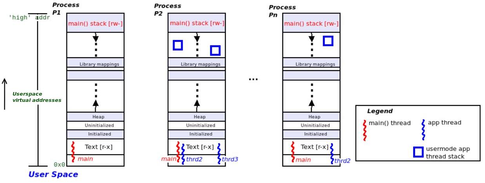

每个进程由若干段（技术上叫映射）组成。概括地说，用户态段（映射）如下：

- **Text**：代码，`r-x`；
- **Data 段**：`rw-`，由三个不同的映射组成——已初始化数据段、未初始化数据段（bss）、以及一个"向上生长"的堆；
- **库映射**：进程动态链接的每个共享库的 text 和 data；
- **向下生长的栈**。

上面样例运行显示系统里当前有 1320 个用户态线程存活，对应也就有 1320 条用户空间栈（每条用户态线程一条）。这些用户空间栈可分两类：

- **单线程进程**：`main()` 线程永远有一条用户空间栈，位于用户 VAS 的最顶端（最高地址处）。若进程单线程（只有 `main()`），就只这一条用户态栈；图 6.4 里的 P1 就是这种情形。
- **多线程进程**：每条存活线程（含 `main()`）各有一条用户态线程栈；图 6.4 里的 P2 和 Pn 属于这种情形。

那这两类栈分别是从哪冒出来的？一张"左右对照图"就清楚了：左边是进程老大的 `main()` 线程，右边是进程里后开的兄弟线程，两条路完全不同。

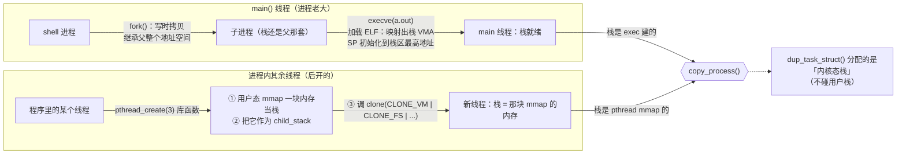

区别一目了然：`main()` 的栈是 **`execve` 加载程序时顺便建好的**——`fork` 从头到尾没给它新建过任何栈（只是写时拷贝继承了父进程那套）；而兄弟线程的栈是 **`pthread_create` 在用户态 `mmap` 出来的**，内核拿到 `child_stack` 后原样拿来用。

无论 `fork`、`vfork` 还是 `clone`（`pthread_create` 底层就是它），进了内核后都汇到**同一条创建任务（线程）的公共路径**。5.15 里的 API 链路长这样：

```text
sys_fork()  ──┐
sys_vfork() ──┤
sys_clone() ──┘     ← pthread_create 走的是这一条
        │
        ▼
   kernel_clone()        ← 2.6 时期叫 do_fork()，5.15 改名
        │
        ▼
   copy_process()
        ├─ dup_task_struct()    分配「内核态栈」（不是用户栈）
        ├─ copy_mm()            不带 CLONE_VM 时，COW 复制地址空间
        └─ copy_thread()        初始化子进程的线程上下文
```

看清楚两点：`dup_task_struct()` 真正"分配"的是**内核态栈**，用户态栈要么是 `exec` 建的、要么是 `pthread_create` 自己 `mmap` 的；`clone_flags` 决定 `copy_process()` 里哪些资源该共享、哪些该复制。

这些用户空间栈也是动态的：它们可以伸缩，上限是栈大小资源限制 `RLIMIT_STACK`。直接用 `prlimit` 看当前 shell 的这个值（`SOFT` 是软上限，`HARD` 是硬上限）：

```shell
prlimit --pid $$ --stack
prlimit --pid $$ 2>/dev/null | head -20; echo "=== 只看 stack ==="; prlimit --pid $$ --stack 2>/dev/null; echo "=== ulimit -s ==="; ulimit -s
```

```text
RESOURCE DESCRIPTION          SOFT   HARD UNITS
STACK    最大栈(stack)尺寸 8388608 无限制 字节
```

`SOFT` 列的 8388608 字节 = 8 MB，就是常说的"用户态栈默认 8 MB"；`HARD` 是"无限制"，表示普通用户还能把软上限往上提。用 `ulimit -s`（单位 KB）看同一个值，会显示 8192，换算过来同样是 8 MB。至于 `prlimit` 里那一整张资源限制表（`AS`、`DATA`、`NPROC`、`NOFILE`…），留到第十四节专门讲。

### 3.2 内核空间的组织

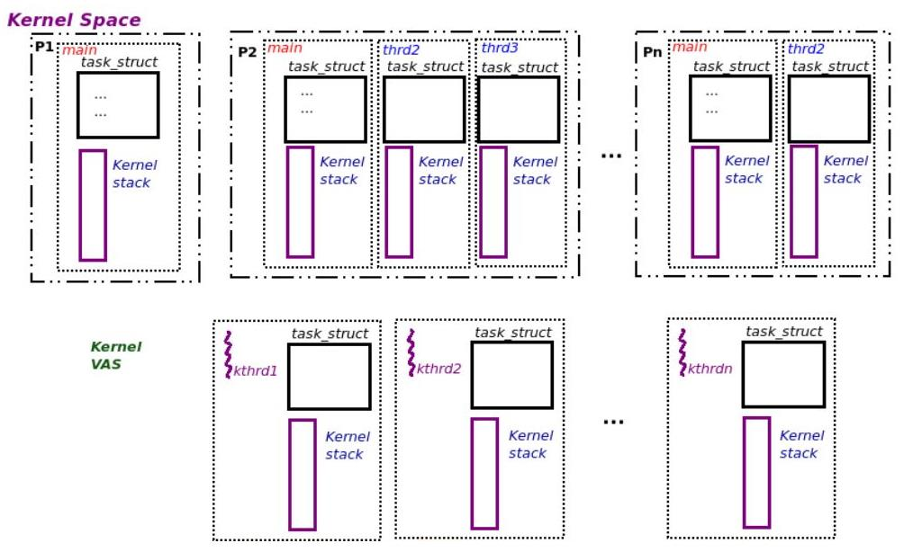

当前系统里有 1320 个用户态线程和 311 个内核线程存活。前面说过，每个用户态线程有两条栈（用户态 + 内核态）；而内核线程只有内核态栈、没有用户态栈——它不持有用户映射，看不到用户空间的"段"。所以内核空间里一共挂着 **1631 条内核态栈**：1320 个用户态线程各一条，311 个内核线程又各一条。

一句话概括：**每个存活的线程——不管用户态的、还是纯内核线程——都有一条内核态栈**。图 6.5 下半部分画的那三个内核线程 `kthrd1`、`kthrd2`、`kthrdn`（对照样例运行，kthrdn 的 n = 311）就是内核线程这批，每个新内核线程创建时同样会拿到一个 task 结构和一条内核态栈。内核态栈的特征如下：

- **大小固定且很小**：32 位系统上是 2 页、64 位系统上是 4 页（一页通常 4 KB）；
- **在创建线程时分配**：就在 3.1 说的 `copy_process()` → `dup_task_struct()` 里完成。

内核态栈在多数方面和用户态栈类似——每次函数调用都会建一个栈帧，CPU 用 SP 寄存器跟踪当前栈位置，栈朝低虚拟地址"生长"。区别只在于：用户态栈是动态的（可伸缩），内核态栈大小固定且很小。

另外，很多架构（包括 x86 和 ARM64）还支持一条**独立的中断处理栈（per-CPU）**。外部硬件中断发生时，CPU 控制单元立即把控制权转交给（很可能是设备驱动里的）中断处理代码；这条独立的中断栈用于承载中断代码路径的栈帧，避免给被中断进程/线程那条本就很小的内核态栈增加负担。

### 3.3 查看用户态栈与内核态栈

栈怎么"看"？内核通过它暴露内部信息的惯用机制——强大的 **proc 文件系统**——把栈展示给用户空间。

#### 3.3.1 传统方法：分两个工具看

**看某线程/进程的内核态栈**

Linux 内核通过 proc 接口把内核态栈暴露出来，直接读 `/proc/<PID>/stack` 即可。先在本机演示：`/proc/self/stack` 里的 `self` 指向当前进程，即这个 `cat` 命令本身：

```shell
sudo cat /proc/self/stack
```

```text
[<0>] proc_pid_stack+0xed/0x170
[<0>] proc_single_show+0x56/0xe0
[<0>] seq_read_iter+0x132/0x4b0
[<0>] seq_read+0x11c/0x160
[<0>] vfs_read+0xb4/0x3a0
[<0>] ksys_read+0x73/0x100
[<0>] __x64_sys_read+0x19/0x30
[<0>] x64_sys_call+0x1bf0/0x25a0
[<0>] do_syscall_64+0x7f/0x180
[<0>] entry_SYSCALL_64_after_hwframe+0x78/0x80
```

（注意：读 `/proc/<PID>/stack` 需要 root 权限，普通用户会被拒绝。）

输出里每一行都代表栈上的一个**调用帧**。读懂内核栈回溯，要记住几个要点：

- 要**自下而上**读（从底部第一行读到顶部最后一行）——底部通常是系统调用入口（`entry_SYSCALL_64_...`），越往上越接近此刻正在执行的函数，最顶行是调用链最深处；
- 每一行是一个调用帧，也就是调用链里的一个函数；
- 函数名显示为 `??`，表示内核对这一帧拿不准——这是无效的栈帧（残留的"杂音"），不用管它，内核的回溯代码基本是对的；
- 在 Linux 上，`foo()` 系统调用在内核里通常对应一个 `SyS_foo()` 函数；并且（常见但非必然）`SyS_foo()` 只是个包装，真正干活的是 `do_foo()`。内核代码里的 `SYSCALL_DEFINEn(foo, ...)` 宏就展开成 `SyS_foo()` 例程，后缀 `n` 取值 [0, 6]，表示该系统调用从用户空间传给内核的参数个数。

对照上面的真实输出，调用链就能读通：`cat` 进程正在读 `/proc/self/stack`，于是 `do_syscall_64()` 进入系统调用分发，`x64_sys_call` 命中 `read`，再到 `__x64_sys_read()` → `ksys_read()` → `vfs_read()` → `seq_read()` → `seq_read_iter()`，最后由 `proc_single_show()` → `proc_pid_stack()` 把 `/proc/<PID>/stack` 这个 seqfile 的内容读出来。

> 注意：最左列每个栈帧的 `[<0>]` 是该函数代码（text）地址的占位符。出于安全考虑（防止信息泄露），现代内核一律把它置零，所以这里显示的总是 `0`。
>
> 另一处新旧差异：原书里系统调用入口写的是 `SyS_foo()`，而 5.x 的 x86-64 内核（开了 `CONFIG_ARCH_HAS_SYSCALL_WRAPPER`）里已经变成 `__x64_sys_foo()` 的形式，如上面输出里的 `__x64_sys_read`。名字变了，但"一系统调用对应一个内核入口函数"的规律不变。

再看本机真实 Bash 进程。先 `ps -eo pid,comm,args | grep -w bash` 找到那个交互式 shell 的 PID（这里是 9914），再看它的内核态栈：

```shell
sudo cat /proc/9914/stack
```

```text
[<0>] do_wait+0x5c/0x110
[<0>] kernel_wait4+0xbd/0x170
[<0>] __do_sys_wait4+0xad/0xc0
[<0>] __x64_sys_wait4+0x1c/0x30
[<0>] x64_sys_call+0x1fbf/0x25a0
[<0>] do_syscall_64+0x7f/0x180
[<0>] entry_SYSCALL_64_after_hwframe+0x78/0x80
```

这样就清楚了：这个 Bash 此刻正在执行 `do_wait()`，它是经 `wait4()` 系统调用进来的，中间由 `x64_sys_call` 分发命中 `__x64_sys_wait4`。这很合理——shell 的工作方式就是 `fork` 出子进程，再调 `wait4` 等它结束。

**看某线程/进程的用户态栈**

在典型 Linux 发行版上，看进程/线程的**用户态**栈反而更麻烦。有个工具能干这个：`gstack`。它其实是个小脚本包装，让 `gdb` 以批处理模式跑 `thread apply all bt`（对每个线程做全回溯），再过滤掉 gdb 的杂音，只留干净的回溯。

```shell
sudo gstack 9914
```

```text
Thread 1 (Thread 0x7889fc18c740 (LWP 9914) "bash"):
#0  0x00007889fbf108d7 in __GI___wait4 (pid=-1, stat_loc=0x7fffa5892ae0, options=0, usage=0x0) at ../sysdeps/unix/sysv/linux/wait4.c:30
#1  0x00005d65208436f3 in ?? ()
#2  0x00005d6520790f38 in wait_for ()
#3  0x00005d6520773a62 in execute_command_internal ()
#4  0x00005d6520773c6e in execute_command ()
#5  0x00005d6520773272 in execute_command_internal ()
#6  0x00005d6520773c6e in execute_command ()
#7  0x00005d6520773e0f in ?? ()
#8  0x00005d652077106a in execute_command_internal ()
#9  0x00005d6520773c6e in execute_command ()
#10 0x00005d652076610c in reader_loop ()
#11 0x00005d6520759efb in main ()
```

同样自下而上读：Bash 执行这条命令的链路是 `main()` → `reader_loop()` → 层层 `execute_command()` → `wait_for()`，最终落到 `wait4` 系统调用（帧 `#0`）——和上面内核态栈里的 `do_wait/wait4` 对得上。帧 `#1`、`#7` 显示 `??`，对应前面说的"内核对这一帧拿不准"，无需理会。

#### 3.3.2 现代方法：[e]BPF 一次性看两条栈

**[e]BPF**（extended Berkeley Packet Filter）是 4.x 内核才引入的技术，让用户、工具或脚本能安全地把一小段字节码注入内核运行——不只用于抓网络包，也用于大规模的性能观测和追踪。上面的"传统方法"要用两个工具分别看内核态和用户态栈；用 BPF 一个工具就能同时显示两条栈。

围绕 eBPF 的两套常用前端是 **BCC** 和 **bpftrace**，都很实用。这里只用 BCC 里的 `stackcount` 做个快速演示——它对命中某个事件的调用栈计数。本机装的是 Ubuntu 的 `bpfcc-tools` 包，装好后命令名带 `-bpfcc` 后缀：`stackcount-bpfcc`。它默认持续采样、按 Ctrl-C 收尾打印，所以演示时用 `-D 6` 指定只采 6 秒，`-d` 会在内核态栈和用户态栈之间打一个 `--` 分隔符：

```shell
sudo stackcount-bpfcc -D 6 -d 'ksys_read'
```

```text
Tracing 1 functions for "ksys_read"... Hit Ctrl-C to end.

  ksys_read
  x64_sys_call
  do_syscall_64
  entry_SYSCALL_64_after_hwframe
    --
  [unknown]
  [unknown]
  ...（若干行 [unknown]）
    1
```

`-d` 打出的 `--` 就是内核态栈与用户态栈的分界线：上面四行是内核侧（`entry_SYSCALL_64_after_hwframe` → `do_syscall_64` → `x64_sys_call` → `ksys_read`，与 `/proc/<PID>/stack` 里看到的是同一条链路），下面本该是用户侧。用户侧之所以全是 `[unknown]`，是因为这台机器上执行 `read` 的进程没带帧指针（默认编译会省略），BCC 无法回溯用户栈；要解析出用户侧符号，得给进程加 `-fno-omit-frame-pointer` 重新编译，或用 `-v` 看原始地址。

原书那条 `stackcount -r ".*malloc.*"` 是用正则匹配 malloc 调用；注意这个模式既能匹配用户态的 `malloc`/`mmap`，也能命中内核里名字带 `kmalloc`/`vmalloc` 的函数（本机实测 `.*malloc.*` 匹配到了 75 个内核函数），不加别的过滤会输出一大片。

##### 在 QEMU 的 5.15 里用 bpftrace 等价验证

上面是在宿主机（Ubuntu 24.04 / 6.8 内核）用 BCC 的 `stackcount-bpfcc` 演示的。换到 QEMU 里的 5.15 内核，镜像里装的不是 BCC 命令行工具，而是 **bpftrace**（v0.14.0）+ `bpftool`——用 bpftrace 一行也能跑出等价结果。

一个前提：bpftrace 编译内联 BPF 需要内核头文件，而 QEMU 的 rootfs 没装 linux-headers，且内核是 `O=out/x86_64` 外部构建（generated 头文件在 out 目录），所以要先把内核源码树挂进 QEMU 再指给 bpftrace。启动 `qemu` 时额外挂一块 9p 盘（`tag=kernsrc`），进 shell 之后：

```shell
# mount -t proc proc /proc
# mount -t sysfs sysfs /sys
# mount -t debugfs debugfs /sys/kernel/debug
# mkdir /kernel-src && mount -t 9p -o trans=virtio,version=9p2000.L kernsrc /kernel-src
# export BPFTRACE_KERNEL_SOURCE=/kernel-src
```

一条 `kprobe:ksys_read` 就等价于上面的 `stackcount -d 'ksys_read'`——`kstack`/`ustack` 分别对应 `-d` 分出来的内核侧、用户侧：

```shell
# bpftrace -e 'kprobe:ksys_read { @[kstack, ustack] = count(); }' &
# sleep 2; cat /proc/cpuinfo >/dev/null; cat /proc/version >/dev/null   # 等 probe 挂上，再造点 read 流量
# kill -INT $!
```

实测输出（节选）：

```text
@[
    ksys_read+1
    do_syscall_64+59
    entry_SYSCALL_64_after_hwframe+68
,
    0x7fe5e1073b28
]: 10
```

对照宿主机那一版，两条结论原样成立：

- **内核侧**：`ksys_read → do_syscall_64 → entry_SYSCALL_64_after_hwframe`，还是 `/proc/<PID>/stack` 里那条链路；
- **用户侧**：只剩 `0x7fe5...` 这种裸地址、没有符号——QEMU 里的 `cat` 同样没带帧指针，bpftrace 解析不出函数名。BCC 会把这种帧显示成 `[unknown]`，bpftrace 干脆打印原始地址，本质是同一回事。

### 3.4 进程 VAS 的全局视图

除了前面看到的进程用户空间段、（用户态和内核态）线程、内核态栈，内核里还有大量元数据：task 结构、内核线程、内存描述符元数据结构等。它们都是内核 VAS（常叫**内核段**）的一部分。内核段里远不止 task 和栈，还有静态的内核（核心）代码和数据，也就是内核所有大大小小的子系统。

下面这张图把上述信息汇总在一起：

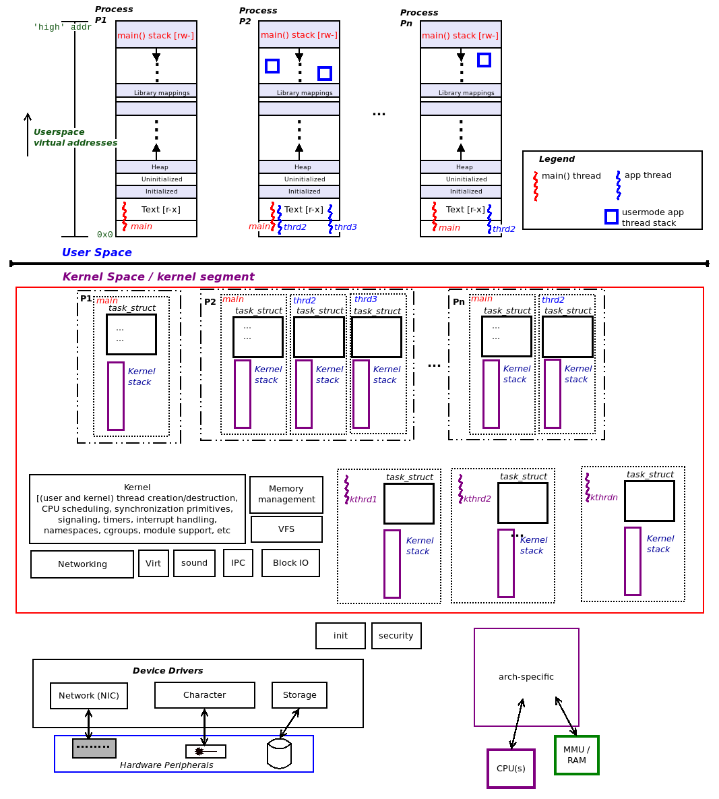

图里内核段中的红框圈住的是**核心内核代码与数据**——各大内核子系统，同时画出了 task 结构和内核态栈。红框之外算是"非核心"部分，主要是设备驱动。
## 四、理解并访问内核 task 结构

前几节提到的"内核给每个线程都配的元数据"，就是这一节的 **task 结构**（`include/linux/sched.h:struct task_struct`）。每个进程由一条或多条线程组成，每条线程都对应一个这样的内核数据结构。

它常被叫做"进程描述符（process descriptor）"，容易造成混乱；"task 结构"这个叫法更准确——它描述的是一个**可运行的任务（runnable task）**，也就是一条线程。

task 结构是线程的"根"元数据结构，保存了 OS 为这条线程维护的全部信息：内存（段、页表、用量等）、CPU 调度细节、当前打开的文件、凭据、能力位掩码、定时器、锁、异步 I/O（AIO）上下文、硬件上下文、信号、IPC 对象、资源限制，以及（可选的）审计/安全/性能剖析信息等。

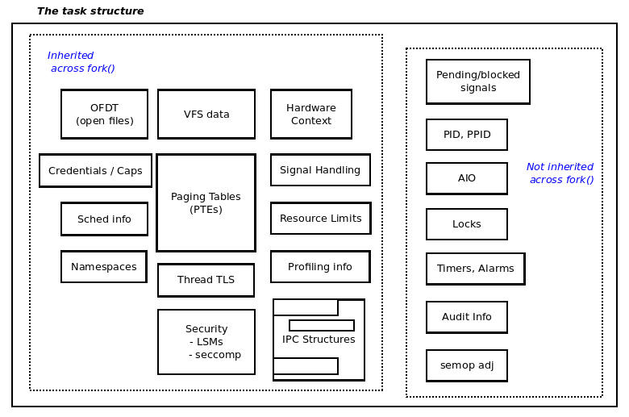

从图 6.8 能看到，task 结构装下了系统里每个存活任务（进程/线程，包括内核线程）的海量信息，图里用分格形式展示了它封装的各类属性。另外，有些属性会在 `fork`（或 `pthread_create`）时被子进程/子线程**继承**，有些则不会被继承、而是直接**重置**（内核态栈就是单独分配的）。内核能"识别"一个任务是进程还是线程，后面的内核模块（`ch6/foreach/thrd_showall`）会演示判断方法。

### 4.1 task 结构里装了什么

task 结构定义在内核头文件 `include/linux/sched.h` 里。下面是从本机 5.15 源码 `struct task_struct` 摘出的几组关键成员（字段行号均对得上，注释为后加），涉及内存管理（`mm`）、PID/TGID、凭据结构、打开的文件、信号处理等，这里不逐个讲透，合适之处后面章节再展开：

```c
struct task_struct {
    [...]
    struct mm_struct		*mm;		/* 内存管理信息 */
    struct mm_struct		*active_mm;
    [...]
    pid_t				pid;
    pid_t				tgid;		/* PID 和 TGID，见下 */
    [...]
    /* 上下文切换计数： */
    unsigned long			nvcsw;
    unsigned long			nivcsw;
    [...]
    /* 客观、真实的主观 task 凭据（COW）： */
    const struct cred __rcu		*real_cred;
    /* 生效（可覆盖）的主观 task 凭据（COW）： */
    const struct cred __rcu		*cred;
    [...]
    char				comm[TASK_COMM_LEN];	/* task 名字 */
    [...]
    /* 打开文件的信息： */
    struct files_struct		*files;	/* 指向"打开文件"数据结构的指针 */
    [...]
    /* 信号处理程序： */
    struct signal_struct		*signal;
    struct sighand_struct __rcu		*sighand;
    sigset_t			blocked;
    sigset_t			real_blocked;
    [...]
#ifdef CONFIG_VMAP_STACK
    struct vm_struct		*stack_vm_area;
#endif
    [...]
#ifdef CONFIG_SECURITY
    /* 供 LSM 模块做访问限制： */
    void				*security;
#endif
    [...]
    /* 该 task 的 CPU 相关状态： */
};
```

几个最常用的成员单独说明如下：

| 成员 | 含义 |
| --- | --- |
| `pid` / `tgid` | task 的 PID 与 TGID（线程组 ID），后文细讲 |
| `comm[]` | 任务名，长度上限 `TASK_COMM_LEN`（16 字节） |
| `mm` / `active_mm` | 地址空间描述符；内核线程的 `mm` 为 NULL，用 `active_mm` 借用 |
| `real_cred` / `cred` | 进程凭据（`struct cred` 指针）：`real_cred` 是客观/真实凭据，`cred` 是生效（可被覆盖）的主观凭据 |
| `files` | 打开的文件描述符表 |
| `signal` / `sighand` / `blocked` | 信号相关（共享信号结构、信号处理程序 `__rcu`、阻塞位掩码） |
| `stack_vm_area` | 只有 `CONFIG_VMAP_STACK` 时才有，指向 vmalloc 内核栈的 vm 区域 |

这个结构到底有多大？`task_struct` 是个相当大的结构。书里的 2.6 时代，32 位机器上大概 1.7 KB；到了 5.15 的 x86_64，它已经膨胀到 7 KB 出头。这个数值不是文献上抄来的，下面就用 `code/ch6/proc_desc/proc_desc.c` 这个模块在 QEMU 里亲手打一遍（第五节那个 `current_affairs` 模块也会打印同样的 `sizeof`）：

#### 4.1.1 自己跑一下：proc_desc 模块

它的 `init` 一次打印四样东西：进程状态常量、`sizeof(struct task_struct)` 和 `current` 各项、顺着 `parent` 爬到 `init_task` 的家族树，以及 `kthread_run` 拉起来的内核线程。

```shell
$ make KDIR=/home/linxi/DevKit/Projects/github_learning/linux-5.15/out/x86_64
$ cd linux-5.15 && ./shell_scripts/run_qemu.sh --debug
# mount -t proc proc /proc
# mount -t sysfs sysfs /sys
# mount -t 9p -o trans=virtio,version=9p2000.L host-shared /mnt
# insmod /mnt/proc_desc.ko
# dmesg | grep proc_desc
```

实测输出（`insmod` 时是 `insmod` 进程自己在进程上下文里跑的）：

```text
[   28.744870] proc_desc: inserted
[   28.744872] proc_desc: process state constants (include/linux/sched.h):
[   28.744873]   TASK_RUNNING         = 0x0000
[   28.744873]   TASK_INTERRUPTIBLE   = 0x0001
[   28.744874]   TASK_UNINTERRUPTIBLE = 0x0002
[   28.744874]   __TASK_STOPPED       = 0x0004
[   28.744875]   __TASK_TRACED        = 0x0008
[   28.744875]   TASK_WAKEKILL        = 0x0100
[   28.744876]   TASK_KILLABLE        = 0x0102
[   28.744876]   TASK_IDLE            = 0x0402
[   28.744880]   TASK_NEW             = 0x0800
[   28.744880] proc_desc: sizeof(struct task_struct) = 7104
[   28.744881] proc_desc: current (our task_struct) pointer = 0xffffa3ec0086db80
[   28.744882] proc_desc:   pid   = 106
[   28.744883] proc_desc:   tgid  = 106
[   28.744883] proc_desc:   comm  = insmod
[   28.744884] proc_desc:   __state = 0x0 (TASK_RUNNING=0 means runnable)
[   28.744884] proc_desc: walking UP the parent chain from current:
[   28.744885]     insmod (pid=106) -> parent sh (pid=1)
[   28.744886]     sh (pid=1) -> parent swapper/0 (pid=0)
[   28.744886]     reached init_task: swapper/0 (pid=0)
[   28.744887] proc_desc: children of current (insmod):
[   28.744887]     <none — current has no children>
[   28.745278] proc_desc: created kernel thread, kthrd=proc_desc_kthrd (pid=107)
[   28.745359] proc_desc: kernel thread [proc_desc_kthrd] running, pid=107
```

回到开头那个问题：`sizeof(struct task_struct) = 7104` 字节，塞下了管理一个进程所需的全部信息，这个大小其实不算夸张。顺带扫一眼后面几节会逐个展开的点：9 个状态常量的数值（第七节）、`init_task` 已经变成 `swapper/0`（pid 0）而非 init 进程（第八节）、内核线程名字带方括号（第十一节）。`rmmod` 时 `exit` 会 `kthread_stop` 掉那个内核线程，输出 `kernel thread stopped` 和 `removed`。

还有一点要记住：内核把所有 `task_struct` 串在一条**双向循环链表**上，叫**任务队列（task list）**。链表里的每一个节点，就是所谓进程描述符。这层组织让内核（常见如 procfs）能遍历它们，第六节会专门讲怎么遍历。

`task_struct` 是通过 **slab 分配器** 分配的——这么做是为了对象的复用和缓存着色（cache coloring），把之前"描述符放在每个进程内核栈末尾"的老做法替换掉了。5.15 里用 slab 分配 `task_struct` 的缓存叫 `task_struct` cache，`fork` 时通过 `dup_task_struct()` 从里面取一块。

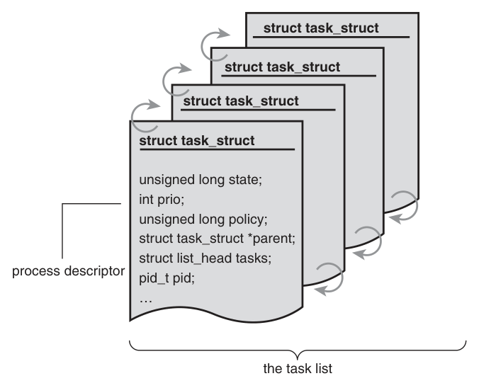

上面这张图就是进程描述符和任务队列的结构示意图：任务队列串起一串 `task_struct`，每个描述符里分门别类堆着这个进程的各种信息。

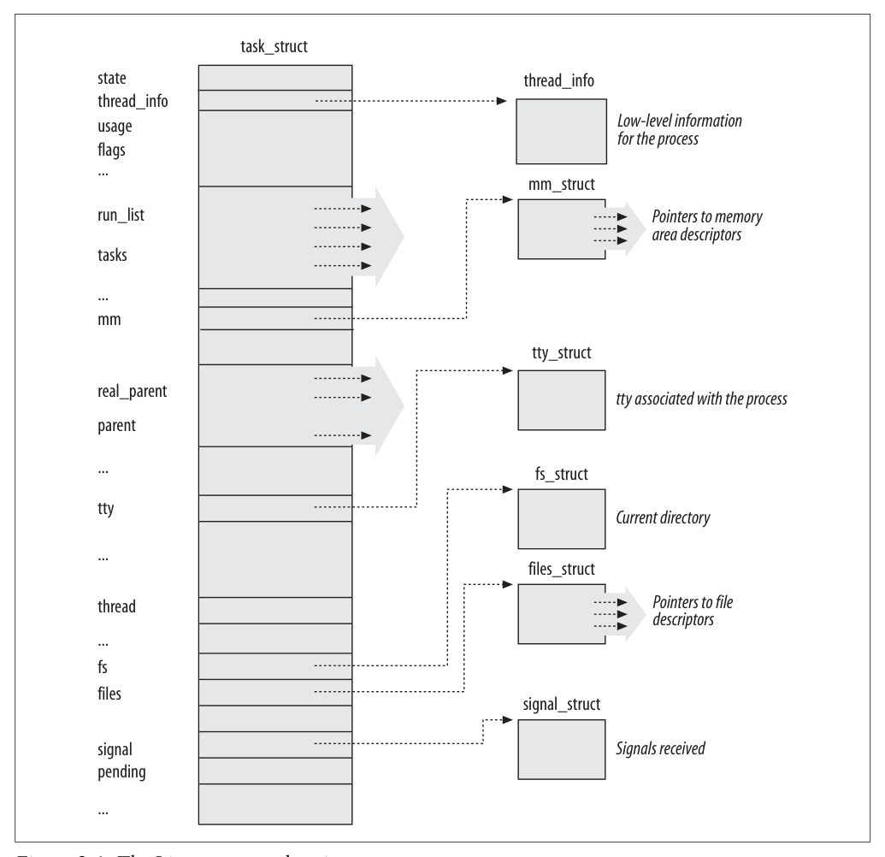

而这张画的则是 `task_struct` 的整体样子：它是"进程"在内存里的化身，又通过若干指针连到内存描述符（`mm`）、文件表（`files`）、信号描述符（`signal`）、tty 等外围结构。因为装了那么多信息，进程描述符相当复杂：不仅有很多描述进程属性的字段，有些字段还是指向其它数据结构的指针，一层套一层。

### 4.2 进程描述符放哪：thread_info 与内核栈

这是 2.6 和 5.15 差别**最大**的一处，值得单独拎出来说。

2.6 时代，各进程的 `task_struct` 直接放在各自内核栈的尾部。更准确说，对每个进程，Linux 把两个数据结构紧凑地放在一块单独为进程分配的内存区：一个是**内核态进程栈**，另一个是紧挨描述符的小结构 **`thread_info`**（线程描述符）。这块内存区通常 8192 字节（两个页框），为效率考虑，内核让这 8 KB 占据连续两个页框、且第一个页框起始地址是 8 KB（$2^{13}$）的倍数。

这套布局的动机是 x86 寄存器少：与其专门腾一个寄存器来存 `current`，不如从栈指针直接"算"出 `task_struct` 的位置。怎么算？`thread_info` 固定放在 8 KB 块的**最低地址**，栈从**最高地址往下长**，所以栈指针 `SP` 此刻一定落在这 8 KB 块内部。既然块起始地址是 $2^{13}$ 的倍数（低 13 位全 0），那把 `SP` 的低 13 位清零，剩下的"高几位"就是这个 8 KB 块的编号——正好是块起点，也就是 `thread_info` 的地址。

C 语言用下面这个联合结构方便地表示一个进程的线程描述符和内核栈：

```c
union thread_union {
	struct thread_info thread_info;
	unsigned long stack[2048];   /* 对 4K 栈，数组下标是 1024 */
};
```

下图画的正是这两样东西挤在 8 KB 内存区里的样子，还标了具体地址：

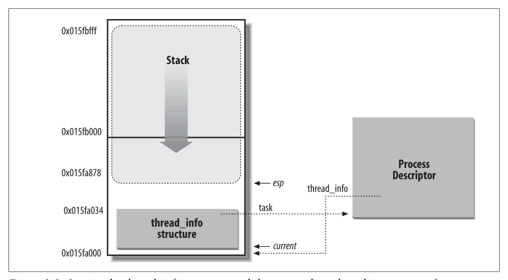

`thread_info` 在内存区开头（低地址 `0x015fa000`），栈从末端（高地址 `0x015fc000`）向下增长，`esp` 指向 `0x015fa878`（当前栈顶）；`thread_info` 长 52 字节，所以内核栈能扩展到 8192 − 52 = 8140 字节。图里还显示了分别通过 `task` 和 `thread_info` 字段让 `thread_info` 与 `task_struct` 互相引用。

这几个地址正好能验证上面的推算。8 KB = $2^{13}$ = 8192，所以"8192 的倍数"就是"低 13 位全 0"，用来屏蔽低 13 位的掩码是 `~8191 = 0xffffe000`。先把栈顶地址 `0x015fa878` 拆成两截看：

```text
高 19 位（第几个 8 KB 块） = 0x015fa878 >> 13 = 0x0afd   ← 第 2813 块
低 13 位（块内偏移）       = 0x015fa878 &  0x1fff = 0x0878   ← 块内第 2168 字节
```

做一次按位与，就把"偏移"抹掉、只留下"块号"：

```text
   0x015fa878 = 0b 0000 0001 0101 1111 1010 1000 0111 1000
 & 0xffffe000 = 0b 1111 1111 1111 1111 1110 0000 0000 0000
 ─────────────────────────────────────────────────────────────
   0x015fa000 = 0b 0000 0001 0101 1111 1010 0000 0000 0000
                                          ↑ 低 13 位被清零
```

结果 `0x015fa000` 正是 `thread_info` 的起点——这就是 4.3 节 `movl $-8192, %eax; andl %esp, %eax` 那两条指令在做的事。算出 `thread_info` 后，取它里面的 `task` 指针就拿到 `task_struct`。顺带说明：`thread_info` 里之所以要放 `task` 指针，正是因为 `task_struct` 早已从栈里挪出去、改用 slab 分配器了，得靠这个指针把它找回来。

到了 5.15，x86_64 干脆把这层也简化了。看 `arch/x86/include/asm/thread_info.h`，`thread_info` 已经瘦身成只有三个字段：

```c
struct thread_info {
	unsigned long		flags;		/* low level flags */
	unsigned long		syscall_work;	/* SYSCALL_WORK_ flags */
	u32			status;		/* thread synchronous flags */
};
```

里面**没有** `task` 指针了。而且它不再躺在内核栈底部，而是被**塞进了 `task_struct` 的开头**（`init/init_task.c` 里的 `init_task` 直接内嵌了一个 `.thread_info`）。所以 5.15 里拿 `thread_info` 反而简单粗暴：

```c
// include/linux/thread_info.h
#define current_thread_info() ((struct thread_info *)current)
```

顺带把内核态栈本身的大小也说清楚：2.6 的 8 KB `thread_union` 在 5.15 已经彻底废弃。开启 `CONFIG_THREAD_INFO_IN_TASK` 后，`thread_info` 被折叠进 `task_struct` 开头，内核栈**单独分配**。x86_64 上 `CONFIG_VMAP_STACK=y`，内核栈通过 vmalloc 分配，`THREAD_SIZE = 16 KB`（`THREAD_SIZE_ORDER = 2`），不再是 8 KB，`union thread_union` 也没了。这也呼应了前面 3.2 说的"内核态栈大小固定且很小"——到底多小、放哪，随架构和内核版本变化。

### 4.3 用 current 访问 task 结构

内核内存里所有的 task 结构对象，都串在一条**循环双向链表**上，叫 task list。这样各种内核代码（常见如 procfs）才能遍历它们。但问题来了：当某个进程或线程正在内核里跑（进程上下文）时，面对内存里成百上千个 `task_struct`，它怎么知道哪个是自己的？

答案就是 **`current`**：

- 取 `current` 得到的是"此刻正在这块 CPU 核上执行内核代码的那条线程"的 `task_struct` 指针，也就是当前运行中的那个进程上下文。
- `current` 类似于面向对象语言里的 `this` 指针（但不完全等同）。

2.6 的 x86 实现很省事：当前进程的内核栈大小固定（8 KB），于是直接屏蔽栈指针的低 13 位（`8192` 对齐）算出 `thread_info` 的位置，再取它的 `task` 成员，随后 `current` 再返回 `current_thread_info()->task`。汇编长这样：

```asm
movl $-8192, %eax
andl %esp, %eax
```

用栈存放描述符的另一个好处体现在多处理器上：对每个硬件处理器，仅靠检查栈就能获得当前正确进程。更早的 Linux 不把内核栈和描述符放一起，而是强制引入全局静态变量 `current` 标识运行进程；多处理器上就得把 `current` 定义成数组、每个元素对应一个可用 CPU。

5.15 的 x86_64 走的是另一条路——**per-CPU 变量**：每个 CPU 单独存一份"当前在该核上跑的任务"的指针，读它就完事，还免去了加锁的开销。ARM64 和 PowerPC 这种寄存器富余的架构，则干脆用专用寄存器（ARM64 用 `sp_el0`）直接存 `current`。

`current` 宏的实现因架构而异，这里不深究细节，只需知道它被设计得极快（通常 O(1)）就够了。想深入了解，可以自己去翻内核源码（在 `arch/<arch>/asm/current.h`）。下面是本机 5.15 源码里的三个典型实现，差异一目了然：

```c
// arch/arm64/include/asm/current.h —— 专门存进 sp_el0 寄存器，极快
static __always_inline struct task_struct *get_current(void)
{
	unsigned long sp_el0;

	asm ("mrs %0, sp_el0" : "=r" (sp_el0));

	return (struct task_struct *)sp_el0;
}
#define current get_current()
```

```c
// arch/x86/include/asm/current.h —— 用 per-CPU 变量保存（免去代价高昂的锁）
DECLARE_PER_CPU(struct task_struct *, current_task);

static __always_inline struct task_struct *get_current(void)
{
	return this_cpu_read_stable(current_task);
}
#define current get_current()
```

```c
// arch/arm/include/asm/thread_info.h —— ARM32 用 O(1) 计算从栈指针推出
static inline struct thread_info *current_thread_info(void)
{
	return (struct thread_info *)
		(current_stack_pointer & ~(THREAD_SIZE - 1));
}
```

总结各架构的做法：

| 架构 | current 的实现 |
| --- | --- |
| ARM32 | O(1) 计算：从当前栈指针按 `THREAD_SIZE` 对齐，推出 `thread_info`（内含 task） |
| AArch64 / PowerPC | 专门用一个寄存器（如 `sp_el0`）存 `current`，查询快如闪电 |
| x86_64 | 用 per-CPU 变量 `current_task` 保存，避开昂贵的锁 |

代码里只要 `#include <linux/sched.h>`，就能用 `current` 解引用 task 结构、从中读取信息。比如取当前进程/线程的 PID 和名字：

```c
#include <linux/sched.h>
current->pid;     // PID
current->comm;    // 名字（char [TASK_COMM_LEN]）
```

### 4.4 判断代码跑在什么上下文

前面已经知道，内核代码要么跑在进程上下文、要么跑在中断（原子）上下文——二者互斥，任一时刻只能取其一。

写内核/驱动代码时，第一步往往要弄清这段代码跑在哪个上下文，可用这个宏：

```c
#include <linux/preempt.h>
in_task()
```

它返回布尔值：`True` 表示跑在进程（task）上下文，此时通常**可以安全睡眠**；返回 `False` 说明代码处于某种原子/中断上下文里，那里**绝不能睡眠**。

本机 5.15 的实现（`include/linux/preempt.h`）是一整套宏，`in_task()` 只是其中一个：

```c
/*
 * 获取当前执行上下文的宏：
 * in_nmi()             - NMI 上下文
 * in_hardirq()         - 硬中断上下文
 * in_serving_softirq() - 软中断上下文
 * in_task()            - 进程（task）上下文
 */
#define in_nmi()		(nmi_count())
#define in_hardirq()		(hardirq_count())
#define in_serving_softirq()	(softirq_count() & SOFTIRQ_OFFSET)
#define in_task()		(!(in_nmi() | in_hardirq() | in_serving_softirq()))

/* 以下宏已废弃，新代码别用：
 * in_irq()       - in_hardirq() 的过时别名
 * in_softirq()   - BH 被禁用或正在处理软中断
 * in_interrupt() - 处于 NMI/IRQ/软中断上下文，或 BH 被禁用
 */
```

`in_task()` 就是"既不在 NMI、不在硬中断、不在软中断"的补集——排除所有原子上下文后，剩下的就是可睡眠的进程上下文。这也是判断"此处能否睡眠"的常用工具。

## 五、用 current 操作 task 结构：current_affairs 模块

上面只是零散地看 `current`，下面用一个完整的内核模块 `ch6/current_affairs` 演示怎么通过 `current` 直接解引用 task 结构的各个成员，并把它们打印到内核日志缓冲。核心是 `show_ctx()` 函数：

```c
// ch6/current_affairs/current_affairs.c（节选）
#include <linux/sched.h>	/* current() */
#include <linux/preempt.h>	/* in_task() */
#include <linux/cred.h>		/* current_{e}{u,g}id() */
#include <linux/uidgid.h>	/* {from,make}_kuid() */

static inline void show_ctx(char *nm)
{
	/* 用 helper 方法取 UID/EUID */
	unsigned int uid = from_kuid(&init_user_ns, current_uid());
	unsigned int euid = from_kuid(&init_user_ns, current_euid());

	pr_info("%s:%s():%d ", nm, __func__, __LINE__);
	if (likely(in_task())) {
		pr_info("%s: in process context ::\n"
			" PID         : %6d\n"
			" TGID        : %6d\n"
			" UID         : %6u\n"
			" EUID        : %6u (%s root)\n"
			" name        : %s\n"
			" current (ptr to our process context's task_struct) :\n"
			"               0x%pK (0x%px)\n"
			" stack start : 0x%pK (0x%px)\n", nm,
			/* 推荐用 helper 方法 */
			task_pid_nr(current), task_tgid_nr(current),
			/* ...而不是直接 current->pid, current->tgid */
			uid, euid,
			(euid == 0 ? "have" : "don't have"),
			current->comm,
			current, current,
			current->stack, current->stack);
	} else
		pr_alert("%s: in interrupt context [Should NOT Happen here!]\n", nm);
}

static int __init current_affairs_init(void)
{
	pr_info("%s: inserted\n", OURMODNAME);
	pr_info(" sizeof(struct task_struct)=%zd\n", sizeof(struct task_struct));
	show_ctx(OURMODNAME);
	return 0;		/* success */
}

static void __exit current_affairs_exit(void)
{
	show_ctx(OURMODNAME);
	pr_info("%s: removed\n", OURMODNAME);
}

module_init(current_affairs_init);
module_exit(current_affairs_exit);
```

`init`/`exit` 里都调 `show_ctx()`，所以插入和卸载时各打印一次。上面代码也确实演示了：有些成员可以直接 `current` 解引用拿到；但不是所有成员都该这么直接访问，内核给了一组 helper 方法来安全地取它们，下面接着讲。

### 5.1 内置 helper 方法与 likely/unlikely 优化

上面的代码用了几个内核内置 helper 来提取 task 结构成员，这也是**推荐做法**。为什么要用 helper、而不是直接戳字段？以 PID 为例，直接写 `current->pid` 并非不行，但内核推荐用 `task_pid_nr(current)`——helper 把字段的内部表示封装起来，代码更稳、也更好读。

凭据同理。4.1 节里 `task_struct` 的凭据是 `real_cred`/`cred` 两个 `struct cred` 指针，取 UID 别直接 `current->cred->uid`，而是用 `current_uid()`/`current_euid()` 这类 helper 取出（返回 `kuid_t`），再 `from_kuid(&init_user_ns, ...)` 换算成普通数字——上面代码里那两行就是这么写的。

类似的 helper 还有很多，都集中在 `include/linux/sched.h` 里 `struct task_struct` 定义的正下方，需要时去查即可。

还有个值得注意的细节：`likely()` 宏（展开成编译器内建 `__builtin_expect`）给编译器的分支预测一个提示，让指令序列更贴合 CPU 流水线，让代码始终走在"快路径"上。你在内核代码里会经常看到 `likely()`/`unlikely()` 成对出现——开发者"知道"某条路径大概率/小概率走时，就用它来提示编译器的分支预测。`likely(in_task())` 的意思是：大多数情况下都处于进程上下文，把这条路径当作默认的"快路径"。

### 5.2 运行模块：打印进程上下文信息

模块用 `build.sh` 编译出的 5.15 内核树来编译（`out/x86_64`，版本 5.15.0+），`KDIR` 指向它即可：

```shell
$ make KDIR=/home/linxi/DevKit/Projects/github_learning/linux-5.15/out/x86_64
$ modinfo current_affairs.ko | grep vermagic
vermagic:       5.15.0+ SMP mod_unload
```

编译出的 `.ko` 版本必须和运行它的内核一致，才能真正跑起来；本机是 6.8，所以把 `.ko` 放进 QEMU 的共享目录，用 `run_qemu.sh --debug` 启动 5.15 内核来加载。这个共享目录在宿主机是 `~/kernel-lab-x86_64/`（`run_qemu.sh` 里 `host-shared` 这个 9p tag 对应的目录），进 QEMU 后挂载到 `/mnt`，所以下面写 `/mnt/current_affairs.ko`（换个环境就换成你自己的共享目录/挂载点）。进 shell 后先挂载虚拟文件系统和共享目录，再 `insmod`：

```shell
$ cd linux-5.15 && ./shell_scripts/run_qemu.sh --debug
# mount -t proc proc /proc
# mount -t sysfs sysfs /sys
# mount -t 9p -o trans=virtio,version=9p2000.L host-shared /mnt
# insmod /mnt/current_affairs.ko
# dmesg | grep -A9 "process context"
[ 19.741064] current_affairs: inserted
[ 19.741886]  sizeof(struct task_struct)=7104
[ 19.742883] current_affairs: in process context ::
                PID         :    105
                TGID        :    105
                UID         :      0
                EUID        :      0 (have root)
                name        : insmod
                current (ptr to our process context's task_struct) :
                              0x00000000789ec63d (0xffffa27f0195eac0)
                stack start : 0x00000000cb464fb0 (0xffffb4ab80194000)
```

卸载（QEMU 里需先挂好 `/proc`、`/sys`，否则 kmod 库读不到 `/proc/modules`、`/sys/module/...` 会报错）：

```shell
# rmmod current_affairs
# dmesg | grep -A9 "process context"
[ 24.749540] current_affairs: in process context ::
                PID         :    109
                TGID        :    109
                UID         :      0
                EUID        :      0 (have root)
                name        : rmmod
                current (ptr to our process context's task_struct) :
                              0x00000000f52f4d7b (0xffffa27f0195cc40)
                stack start : 0x0000000074750966 (0xffffb4ab80184000)
[ 24.758907] current_affairs: removed
```

输出说得很清楚：运行 `current_affairs.ko:current_affairs_init()` 这段代码的进程上下文，是 **insmod 进程**（看 `name : insmod`）；而执行清理代码 `current_affairs_exit()` 的进程上下文，是 **rmmod 进程**。顺带看到 `sizeof(struct task_struct)=7104`——5.15 里这个结构有 7 KB 出头，对应于前面进程描述符的大小。

#### 看到 Linux 是宏内核

除了练习 `current` 的用法，`current_affairs` 这个模块还想说明一点——**Linux 是宏内核**。上面看到，`insmod` 把模块文件 `current_affairs.ko` 插进内核、init 代码随之运行，那这段代码是谁跑的？答案就在输出里：**就是 insmod 进程自己在进程上下文里跑的**——模块的代码直接并入内核、由现有进程执行，这正是宏内核的特征（`rmmod` 同理，清理代码由 rmmod 进程在进程上下文执行）。

#### 用 printk 安全打印地址：%pK

上面 `current_affairs.c` 里打印指针用了 `%pK` 这个"特殊"格式符，相关代码再贴一次：

```c
pr_info(
	[...]
	" current (ptr to our process context's task_struct) :\n"
	" 0x%pK (0x%px)\n"
	" stack start : 0x%pK (0x%px)\n",
	[...]
	current, (long unsigned)current,
	current->stack, (long unsigned)current->stack); [...]
```

为什么要用 `%pK`？打印指针（尤其是内核地址）时，别用普通的 `%p` 或 `%px`，而该用 `%pK`——它能在系统启用 `kptr_restrict` 时只输出一个哈希值，从而防止内核地址泄露；`%px` 则无论如何都打印真实地址。上面代码里 `%pK` 和 `%px` 一起用，纯粹是为了对照两者的差别。

看 5.2 的真实输出就一目了然：`%pK` 打出的 `0x00000000789ec63d` 是**哈希值**，`%px` 打出的 `0xffffa27f0195eac0` 才是**真实内核地址**，两者不同，说明 QEMU 里这个 5.15 内核是默认启用了 `kptr_restrict` 的。反过来，当 `kptr_restrict=0` 时，`%pK` 就不再做哈希，和 `%px` 打印出**一模一样**的值，即`%pK`的值是由内核的 `kptr_restrict` 配置决定的。

## 六、遍历内核的 task 列表

### 6.1 内核的双向链表：list_head 与 hlist

前面说过，任务队列（task list）是一条双向循环链表。内核里到处靠链表组织对象，进程只是其中一处；为了避免每个功能都各写一套"初始化、插入、删除、遍历"，Linux 把这些操作抽成一个通用的 **`list_head`**，它只有两个字段：

```c
struct list_head {
	struct list_head *next, *prev;
};
```

`next`、`prev` 分别指向前、后节点，就是普通双向链表的两个链指针。

但它跟普通链表里那种"一个节点里装一份数据"的链表有个**本质区别**，也是最容易绕晕的一点——普通链表是"节点包数据"，Linux 是"数据包节点"。

普通链表每个节点既有数据、又有指针，`next`/`prev` 指向下一个**节点**（数据和指针一起）：

```c
struct node {            /* 每种数据都要各写一套 */
    int data;
    struct node *next;
    struct node *prev;
};
```

Linux 反过来：`list_head` 本身不含数据、只有两个指针，它被当作一个**字段**嵌进要组织的数据结构里。以 `task_struct` 为例：

```c
struct task_struct {
    pid_t pid;
    char comm[16];
    ...
    struct list_head tasks;   /* 嵌在中间，就两个指针 */
};
```

链表串起来的是每个结构体里那个 `list_head` 字段**本身**，所以 `next`/`prev` 存的是"下一个结构体里 `list_head` 字段的地址"，而不是"下一个结构体的起始地址"（见图 3-3(a)）。好处是一套链表代码能复用于任何结构体。反过来，遍历时拿到 `list_head` 指针后要操作整个结构体，就得靠 `list_entry`/`container_of`，用"字段地址 − 偏移量"反推出结构体的起始地址。

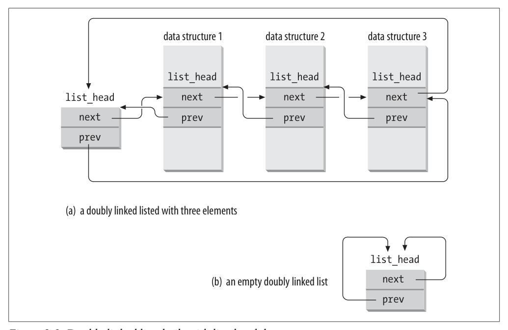

图 3-3(a) 是 `list_head` 的通用形态。新建链表用 `LIST_HEAD(list_name)` 宏——它声明一个 `list_head` 类型的变量 `list_name` 作链表头占位符，并让 `prev`/`next` 都指向自己，正是 3-3(b) 画的那种状态。几个实现原语的函数和宏见下表：

| 名称 | 说明 |
| --- | --- |
| `list_add(n, p)` | 把 `n` 指向的元素插到 `p` 之后（要插到链表头，就把 `p` 设为第一个元素的地址） |
| `list_add_tail(n, p)` | 把 `n` 插到 `p` 之前（要插到表尾，就把 `p` 设为第一个元素的地址） |
| `list_del(p)` | 删除 `p` 指向的元素（无需指定链表第一个元素） |
| `list_empty(p)` | 检查以 `p` 为第一个元素地址的链表是否为空 |
| `list_entry(p, t, m)` | 返回类型 `t` 的数据结构地址，其中 `t` 含名为 `m`、地址为 `p` 的 `list_head` 字段 |
| `list_for_each(p, h)` | 扫描以表头 `h` 指定的链表，每轮通过 `p` 返回指向链表元素的 `list_head` 指针 |
| `list_for_each_entry(p, h, m)` | 类似 `list_for_each`，但返回含 `list_head` 结构的整个数据结构的地址 |

这里先补两个概念。**散列表（hash table）**：一个数组外加一个散列函数，`hash(键)` 算出下标直接定位，平均 O(1)，不用从头扫。**桶（bucket）**：数组的每个格子；不同键可能算出同一个下标（叫**冲突**），所以每个桶里挂一条链表，把冲突的元素串起来。内核"按 PID 找 `task_struct`"就是散列表的典型用法：

```text
散列表（数组）                桶里挂的链表（冲突的元素串起来）
            +----------+             +------------+       +------------+
            |          |             |            |       |            |
            +----------+             | hlist_node |       | hlist_node |
            |          |             |  (PID 100) |       | (PID 2000) |
            +----------+             |            |       |            |
            |          |             +------------+       +------------+
            +----------+             |    next    |------>|    next    |------> NULL
    桶 0    |  first   |------------>|            |       |            |
            |          |◄────────┐   +------------+       +------------+
            +----------+         │   |   pprev    |◄──────|   pprev    |
            |          |         └───│            │       |            |
            +----------+             +------------+       +------------+
    桶 1    |  first   |───────────► NULL
            |          |
            +----------+
    桶 2    |  first   |───────────► NULL    （空桶）
            |          |
            +----------+
            |    ...   |
            +----------+
  桶 2047   |  first   |───────────► NULL
            |          |
            +----------+

  先由 hash(PID) 算出桶号，再挂到对应桶的链表头上；不同 PID 撞进
  同一个桶就叫"冲突"，冲突的元素用链表串在同一个桶里。
```

Linux 里的第二种双向链表 **`hlist`** 就是专为散列表这类场景设计。它和 `list_head` 的一个关键差别在**表头**上：散列表有一大堆桶，如果每个桶的头都像 `list_head` 那样带两个指针（`next` + `prev`），光表头就要吃掉不少内存，所以 `hlist` 的表头瘦身成一个指针：

```c
struct hlist_head {
	struct hlist_node *first;       /* 只指向第一个元素，空桶则 NULL */
};

struct hlist_node {
	struct hlist_node *next, **pprev;
};
```

```text
              散列表              数据结构1            数据结构2            数据结构3
             +----------+       +------------+      +------------+      +------------+
             |          |       |            |      |            |      |            |
             +----------+       | hlist_node |      | hlist_node |      | hlist_node |
             |          |       |            |      |            |      |            |
             +----------+       +------------+      +------------+      +------------+
hlist_head   |  first   |------>|    next    |----->|    next    |----->|    next    |
             |          |◄──┐   │            │◄──┐  │            │◄──┐  │            │
             +----------+   │   +------------+   │  +------------+   │  +------------+
             |          |   └───|   pprev    |   └──|   pprev    |   └──|   pprev    |
             +----------+       +------------+      +------------+      +------------+
             |          |       |            |      |            |      |            |
             +----------+       +------------+      +------------+      +------------+
             

  ----->  next ：指向下一个节点的 hlist_node
  ◄─────  pprev：指向「上一个节点 next 字段的地址」（首节点则指向 head.first 的地址）
                 pprev1 = &head.first    pprev2 = &node1.next    pprev3 = &node2.next
```

元素侧仍是两个指针，但第二个 `pprev` 是个**二级指针**，存的不是"上一个元素"，而是"上一个元素的 `next` 字段的地址"。这样删除时就不用区分"是不是第一个元素"了——不管在中间还是当头节点，`*(node->pprev) = node->next` 一行就能把自己摘下来。代价是它不再是循环链表：第一个元素的 `pprev`、最后一个元素的 `next` 都是 `NULL`。操作原语和 `list_head` 一一对应：`hlist_add_head()`、`hlist_del()`、`hlist_empty()`、`hlist_entry`、`hlist_for_each_entry`。

5.15 里 `list_head`/`hlist` 和 2.6一样都在 `include/linux/list.h`。唯一变的是写法：`list_entry` 本质上就是 `container_of` 的别名：

```c
// include/linux/list.h
#define list_entry(ptr, type, member) \
	container_of(ptr, type, member)
```

而 `container_of` 定义在 `include/linux/kernel.h`，负责"已知成员地址 → 反推整个结构体地址"：

```c
// include/linux/kernel.h
#define container_of(ptr, type, member) ({				\
	void *__mptr = (void *)(ptr);					\
	BUILD_BUG_ON_MSG(!__same_type(*(ptr), ((type *)0)->member) &&	\
			 !__same_type(*(ptr), void),			\
			 "pointer type mismatch in container_of()");	\
	((type *)(__mptr - offsetof(type, member))); })
```

中间 `BUILD_BUG_ON_MSG` 那行是编译期类型检查：`ptr` 的类型和结构体成员类型对不上就编译报错。真正干活的是最后一行——用成员地址减去成员的偏移量 `offsetof`，就得到结构体起点。既然 `list_entry` 只是 `container_of` 的一层包装，现在内核代码里大家更爱直接写后者，两者完全等价。

### 6.2 遍历所有进程：for_each_process

前面说的任务队列（task list），落到实现上就是**进程链表**， `task_struct.tasks` 的 `list_head` 字段就是它的节点。这条链表的头是 `init_task` 描述符，`init_task.tasks.prev` 指向链表里最后插入进程描述符的 `tasks` 字段。

内核提供了 `for_each_process()` 宏，可以遍历 task list 里的每一个进程：

```c
// include/linux/sched/signal.h
#define for_each_process(p) \
for (p = &init_task ; (p = next_task(p)) != &init_task ; )
```

宏展开成一个 `for` 循环：从 `init_task` 出发，沿 `next_task` 在循环链表上转一圈，直到又回到 `init_task`（既是起点也是终点），打印 Name/TGID/PID/RUID/EUID。

> 注意：在进程极多的系统里，从头到尾遍历所有进程代价很大，没有充分理由别这么干。

`ch6/foreach/prcs_showall` 模块用它遍历所有进程并打印。本机 5.15 QEMU 实际运行：

```shell
# insmod /mnt/prcs_showall.ko
# dmesg | grep prcs_showall -A4
[   19.729239] prcs_showall: inserted
[   19.730061]      Name       |  TGID  |   PID  |  RUID |  EUID
[   19.731395] sh              |       1|       1|      0|      0
[   19.732735] kthreadd        |       2|       2|      0|      0
[   19.734085] rcu_gp          |       3|       3|      0|      0
...
[   19.827309] insmod          |     105|     105|      0|      0
[   19.828528] prcs_showall: total # of processes on system: 76
```

遍历出 76 个进程：从 PID 1 的 `sh`（QEMU 的 init），到一堆内核线程（`kthreadd`、`rcu_gp`、`kworker/*`…），再到 `insmod` 自己（PID 105）。每个进程的 TGID 都等于 PID——因为这里都是单线程进程，TGID/PID 的区别下面再讲。

### 6.3 遍历所有线程：do_each_thread

要遍历系统里每一条存活的线程，用 `do_each_thread() { ... } while_each_thread()` 这对宏。`ch6/foreach/thrd_showall` 执行后在本机 5.15 QEMU 运行的关键片段（完整输出太长，只摘头和尾）：

```shell
# insmod /mnt/thrd_showall.ko
# dmesg | grep thrd_showall -A6
[   19.752244] thrd_showall: inserted
------------------------------------------------------------------------------------------
    TGID     PID         current           stack-start         Thread Name     MT? # thrds
------------------------------------------------------------------------------------------
        0        0   0xffffffffa8414940  0xffffffffa8400000 [       swapper/0]
        1        1   0xffff891f802a8000  0xffff9b72c0010000                sh 
        2        2   0xffff891f802a8f40  0xffff9b72c0018000 [        kthreadd]
        3        3   0xffff891f802a9e80  0xffff9b72c0020000 [          rcu_gp]
...
      105      105   0xffff891f80935b80  0xffff9b72c0194000            insmod 
[   19.894501] thrd_showall: total # of threads on the system: 77
```

几个观察点：

- **内核态栈起始地址都以 0 结尾**（第四列，如 `0xffffffffa8400000`、`0xffff9b72c0010000`），说明栈区总是页对齐（0x1000 = 4096）。
- 按惯例，**内核线程的名字用方括号括起来**（`[swapper/0]`、`[kthreadd]`），用户态线程不加（`sh`、`insmod`）。
- 第一条是 CPU 0 的 idle 线程 `swapper/0`（PID 0），它**不在** `do_each_thread` 的遍历范围内（`ps` 也看不到），是模块另外单独打出来的——具体怎么打的见 6.4 的 `disp_idle_thread()`。

#### 区分进程与线程：TGID 与 PID

内核用唯一的 task 结构表示每条线程，每条线程又各自有一个唯一的 PID——那同一个进程的多条线程，怎么才能共享同一个 PID 呢？这正是 POSIX.1b（pthreads）标准要求的，早期 Linux 没做到也不合规，因此带来了移植问题。

为解决这个问题，Red Hat 的 Ingo Molnar 在 2.5 内核系列合入了一个补丁——往 task 结构里加了 **TGID（Thread Group IDentifier，线程组 ID）**。规则是：

| 场景 | tgid 与 pid 的关系 |
| --- | --- |
| 单线程进程 | `tgid == pid` |
| 多线程进程的主线程 | `tgid == pid`（自己的 pid） |
| 多线程进程的其余线程 | 继承主线程的 tgid，但保留各自唯一的 pid |

QEMU 输出里全是单线程，所以每行的 TGID 和 PID 都相等。要看多线程进程的 TGID/PID 差异，先准备一个开 4 个子线程的 Python 进程 `code/ch6/mt.py`，在 QEMU 里后台把它跑起来（`python3 /mnt/mt.py &`），摘出它的 5 条线程：

```text
 TGID   PID   current             stack-start        Thread Name  MT?# thrds
  105   105   0xffff959700888000  0xffffb8cc00194000  python3       5
  105   106   0xffff9597003c1e80  0xffffb8cc002d0000  python3
  105   107   0xffff9597003c2dc0  0xffffb8cc0016c000  python3
  105   108   0xffff9597003c3d00  0xffffb8cc001a4000  python3
  105   109   0xffff9597003c4c40  0xffffb8cc001ac000  python3
```

第一列 TGID 全是 105，第二列 PID 各不相同。认主线程只记一条规则：**TGID == PID 的那行是主线程**（这里就是 105），其余同 TGID、PID 不同的是子线程（106~109）。TGID 整列相同，正说明它们属于同一个多线程进程；最右列的 `5` 就是这个进程的线程总数（1 主 + 4 子）。

用户空间用 `ps -LA` 也能看到内核的 TGID/PID 表示——`ps` 的 `PID` 列对应内核的 `tgid`，`LWP` 列对应每条线程自己的 `pid`（LWP 即"轻量级进程"，也就是线程）。下面输出里全是单线程进程，所以 PID 和 LWP 相等；多线程进程则会显示 PID 列相同、LWP 列各不相同。

```shell
  PID   LWP TTY          TIME CMD
    1     1 ?        00:00:00 sh
    2     2 ?        00:00:00 kthreadd
    3     3 ?        00:00:00 rcu_gp
    4     4 ?        00:00:00 rcu_par_gp
   ...
   95    95 ?        00:00:00 kworker/u8:7-events_unbound
  100   100 ?        00:00:00 kworker/3:1H
  101   101 ?        00:00:00 kworker/2:1H-kblockd
  103   103 ?        00:00:00 kworker/0:1H
  105   105 ?        00:00:00 ps
```

### 6.4 代码：thrd_showall.c

核心的遍历循环长这样：

```c
static inline void disp_idle_thread(void)
{
	struct task_struct *t = &init_task;

	/* 已知 swapper 是内核线程，名字用方括号 */
	pr_info("%8d %8d   0x%px  0x%px [%16s]\n",
		t->pid, t->pid, t, t->stack, t->comm);
}

static int showthrds(void)
{
	struct task_struct *g = NULL, *t = NULL; /* g: 进程指针；t: 线程指针 */
	[...]
	rcu_read_lock();
	do_each_thread(g, t) {           /* 遍历全部 task 结构 */
		task_lock(t);

		snprintf(buf, BUFMAX-1, "%8d %8d ", g->tgid, t->pid);
		[...]
		if (!g->mm) {                /* 内核线程：没有用户映射 */
			snprintf(tmp, TMPMAX-1, " [%16s]", t->comm);
		} else {
			snprintf(tmp, TMPMAX-1, "  %16s ", t->comm);
		}
		[...]
		/* 是多线程进程的主线程吗？看 (a) 是用户态、(b) TGID==PID、(c) 线程数>1 */
		nr_thrds = get_nr_threads(g);
		if (g->mm && (g->tgid == t->pid) && (nr_thrds > 1)) {
			snprintf(tmp, TMPMAX-1, " %3d", nr_thrds);
			snprintf(buf, BUFMAX-1, "%s%s", buf, tmp);
		}
		[...]
		pr_info("%s", buf);
		total++;
		task_unlock(t);
	} while_each_thread(g, t);
	rcu_read_unlock();

	return total;
}
```

关键逻辑：`g` 是进程（线程组）指针、`t` 是线程指针；`g->tgid` 给第一列、`t->pid` 给第二列，就能同时看清"属于哪个进程"和"是哪条线程"。用 `!g->mm` 判断是不是内核线程（内核线程没有用户地址空间映射），据此决定名字要不要加方括号。

关于这段代码，再补充几点：

| 要点 | 说明 |
| --- | --- |
| 拼接策略 | 先由 `tmp` 临时取一项数据，再 `snprintf` 追加进结果缓冲 `buf`，每轮循环打印一次 `buf`。不用 `strncat`（flawfinder 提示有风险）或 `strlcat`（会 `might_sleep()`，原子上下文不能用） |
| 取 TGID/PID/栈地址 | 这里直接 `current` 解引用即可；也可用本章前面的 helper 方法，图省事保持简单 |
| 打印地址用 `%px` | 刻意显示 task 结构和内核态栈的**真实**内核虚拟地址做对照，所以不用更安全的 `%pK` |
| 内核线程判断 | `!g->mm`：`mm` 是指向 `mm_struct` 的指针、代表整个进程的用户空间映射，为 NULL 就是内核线程 |
| 取线程名 | 不用 `get_task_comm()`（会死锁），直接读 `comm` 成员（死锁问题留到内核同步章节） |
| 线程数 | 用 `get_nr_threads()` 宏取进程的总线程数 |
| 清理 | 每轮递增总数计数器、`memset` 清零 `tmp`/`buf`，最后返回遍历的总线程数 |

## 七、进程状态

`task_struct` 的状态字段记录了进程此刻处于什么状态。2.6 里这个字段叫 `state`，5.15 已经改名成 **`__state`**（`include/linux/sched.h` 里 `unsigned int __state`）。

### 7.1 五种基本状态

五种基本状态互斥存在——严格说一次只能设置一种，其余标志被清除：

| 状态 | 含义 |
| --- | --- |
| `TASK_RUNNING` | 可执行：正在跑，或在运行队列里等着被调度。这是进程在用户态唯一能处于的状态，也能用于正跑在内核态的进程 |
| `TASK_INTERRUPTIBLE` | 可中断睡眠：因等待某条件达成而阻塞；条件一达成就被置回运行，期间收到信号也会被提前唤醒 |
| `TASK_UNINTERRUPTIBLE` | 不可中断睡眠：同"可中断"，但收到信号也不会被唤醒。常用于等待必须不受打扰、或事件很快会发生的场景（例如打开设备文件、驱动探测硬件时，探测完成前不能被中断，否则硬件会处于不可预知状态） |
| `__TASK_STOPPED` | 停止：进程不再执行，也不能被调度。通常由 `SIGSTOP`/`SIGTSTP`/`SIGTTIN`/`SIGTTOU` 等信号触发，调试过程中收到任何信号也会进入该状态 |
| `__TASK_TRACED` | 被其他进程跟踪，例如被 `ptrace` 调试 |

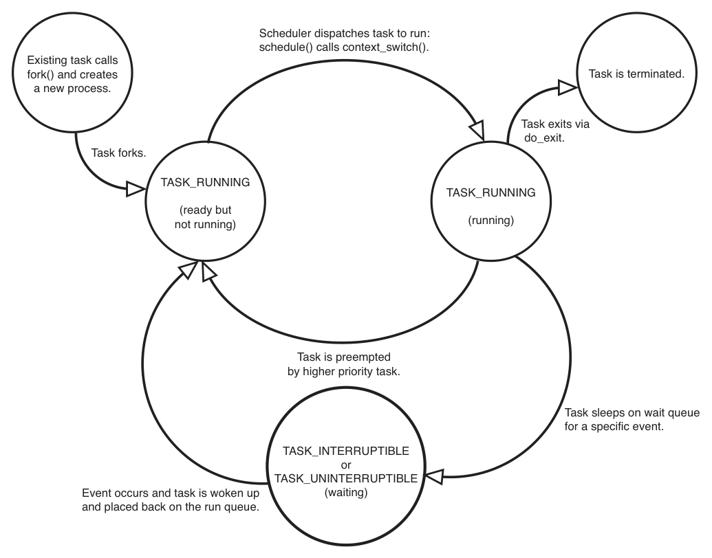

图 3-3 是这些状态之间的迁移图：进程在"就绪—运行—睡眠—停止"之间来回切换，最终走向终止。5.15 又额外加了几个标志位：

| 状态 |含义 |
| --- |  --- |
| `TASK_WAKEKILL` | 让"不可中断睡眠"也能响应致命信号。把它和 `TASK_UNINTERRUPTIBLE` 组合成 `TASK_KILLABLE`，解决了一个老大难——进程卡在不可中断睡眠里连 `kill -9` 都杀不掉 |
| `TASK_NEW` |  刚 fork 出来的子进程的初始状态（见第十节） |
| `TASK_IDLE` |  idle 线程专用 |

下面是 QEMU 里实测打印出的状态常量数值，和头文件里完全对得上：

```text
proc_desc: process state constants (include/linux/sched.h):
  TASK_RUNNING         = 0x0000
  TASK_INTERRUPTIBLE   = 0x0001
  TASK_UNINTERRUPTIBLE = 0x0002
  __TASK_STOPPED       = 0x0004
  __TASK_TRACED        = 0x0008
  TASK_WAKEKILL        = 0x0100
  TASK_KILLABLE        = 0x0102
  TASK_IDLE            = 0x0402
  TASK_NEW             = 0x0800
```

### 7.2 两个终止状态

还有两个进程状态，既可放在描述符的 `state` 字段，也可放在 `exit_state` 字段中；从字段名就能看出，只有当进程执行被终止时才会变为这两种之一：

| 状态 | 含义 |
| --- | --- |
| `EXIT_ZOMBIE`（僵死） | 进程执行被终止，但父进程还没发布 `wait4()` 或 `waitpid()` 来取回死亡进程的信息。发出 `wait()` 类调用前，内核不能丢弃死进程描述符里的数据，因为父进程可能还需要它（见第十二节"进程终结"） |
| `EXIT_DEAD`（僵死撤销） | 最终状态：父进程刚发出 `wait4()` 或 `waitpid()`，进程被系统删除。把进程从僵死态改为僵死撤销态，是为了防止其它执行线程在同一进程上也执行 `wait()` 类调用（那是一种竞争条件） |

注意这两个状态还引入了一个形容词——**僵死（zombie）**。第十二节会看到，僵尸态是进程终结流程里一个刻意设计出来的中间态。

### 7.3 设置当前进程状态

内核经常需要调整某个进程的状态，规范化写法是用 `set_task_state(task, state)`：

```c
set_task_state(task, state);   /* 把任务 task 的状态设为 state */
```

`set_current_state(state)` 和 `set_task_state(current, state)` 等价。5.15 里这两个宏的定义是：

```c
// include/linux/sched.h
#define __set_current_state(state_value)              \
	do {                                             \
		WRITE_ONCE(current->__state, (state_value)); \
	} while (0)

#define set_current_state(state_value)                          \
	do {                                                       \
		smp_store_mb(current->__state, (state_value));         \
	} while (0)
```

核心区别在一个屏障：`set_current_state()` 用 `smp_store_mb()` 加了内存屏障，保证"写状态"这个动作在和后面的"判定是否真的要睡"之间正确排序；这条顺序只在 SMP 上有意义。如果调用方不需要这个屏障（比如条件判定和唤醒已经由同一把锁保护），就用 `__set_current_state()` 省掉屏障。这也是内核里你常见的那套写法：

```c
for (;;) {
	set_current_state(TASK_UNINTERRUPTIBLE);
	if (CONDITION)
		break;
	schedule();
}
__set_current_state(TASK_RUNNING);
```

## 八、进程家族树与进程间关系

Unix 系的操作系统里，进程之间有明确的继承关系，Linux 也不例外：所有进程都是 PID 为 1 的 init 进程的后代（系统启动的最后阶段内核启动 init，由它读初始化脚本拉起其余进程）。每个进程必有父进程，可以有零到多个子进程；同一个爹的所有进程互为"兄弟"。

### 8.1 父子兄弟关系

这层关系就存在 `task_struct` 里：一个指向父进程的 `parent` 指针，加一个 `children` 子进程链表。描述给定进程 P 这些关系的字段如下：

| 字段 | 说明 |
| --- | --- |
| `real_parent` | 指向创建 P 的进程的描述符；若 P 的父进程已不存在，则指向进程 1（init）的描述符（所以用户跑后台进程后退出 shell，后台进程就成 init 的子进程） |
| `parent` | 指向 P 的当前父进程（这种进程的子进程终止时必须向父进程发信号）。值通常与 `real_parent` 一致，但偶尔不同，例如另一个进程发出监控 P 的 `ptrace()` 请求时 |
| `children` | 链表头，链表元素都是 P 创建的子进程 |
| `sibling` | 指向兄弟进程链表中的下一个/前一个元素 |

内核对"父进程"其实是**两条指针**——`real_parent`（真正的父亲）和 `parent`（追踪者/临时父亲）。平时二者相等；被 `ptrace` 调试时，`parent` 会临时指向调试进程，真正的父亲记在 `real_parent` 里。

5.15 里这个切换发生得很具体。`gdb` 这类调试器 `ptrace(PTRACE_ATTACH, ...)` 挂上目标进程时，走 `ptrace_attach()` → `__ptrace_link()`（`kernel/ptrace.c`）：

```c
void __ptrace_link(struct task_struct *child, struct task_struct *new_parent,
		   const struct cred *ptracer_cred)
{
	list_add(&child->ptrace_entry, &new_parent->ptraced);   /* 挂进调试器的 ptraced 链表 */
	child->parent = new_parent;                             /* 父指针临时改成调试器 */
	child->ptracer_cred = get_cred(ptracer_cred);           /* 记下调试器 attach 时的凭据 */
}
```

`child->parent = new_parent` 这一步，就是把被调试进程的"临时父进程"换成调试器——之后它退出或被暂停，先通知的是调试器。等 `ptrace(PTRACE_DETACH, ...)` 或调试器退出时，`__ptrace_detach()` → `__ptrace_unlink()` 又把它改回来：

```c
child->parent = child->real_parent;    /* 恢复真正的父亲 */
```

所以 `real_parent`（亲爹）从头到尾没变，变的只是 `parent`（谁负责收它的退出通知）。

用 `gdb` 也能直观验证这套切换：

```shell
$ sleep 300 &                # 假设 PID=1234，父进程是当前 shell（PID 1000）
$ ps -o pid,ppid,stat,cmd -p 1234
  PID  PPID STAT CMD
 1234  1000 S    sleep 300

$ gdb -p 1234               # 内部执行 PTRACE_ATTACH，parent 临时改成 gdb
(gdb) ...                   # 此时 sleep 的 parent 指向 gdb，real_parent 仍是 shell
(gdb) detach                # 内部执行 PTRACE_DETACH，parent 恢复成 real_parent
(gdb) quit

$ ps -o pid,ppid,stat,cmd -p 1234
  PID  PPID STAT CMD
 1234  1000 S    sleep 300
```

attach 前后 `ps` 的 PPID 纹丝不动，别误会成"没生效"——`ps` 的 PPID 读的是 `/proc/PID/status` 里的 `PPid`，它来自 `real_parent`（亲爹）；被临时改掉的是 `parent`。所以 shell 里看不到这个变化，但它确实发生了：调试期间 sleep 的退出和信号先通知 gdb，而不是 shell。

要拿当前进程的父进程描述符，可以这样写：

```c
struct task_struct *my_parent = current->parent;
```

依次访问子进程则是：

```c
struct task_struct *task;
struct list_head *list;

list_for_each(list, &current->children) {
	task = list_entry(list, struct task_struct, sibling);
	/* task 现在指向当前的某个子进程 */
}
```

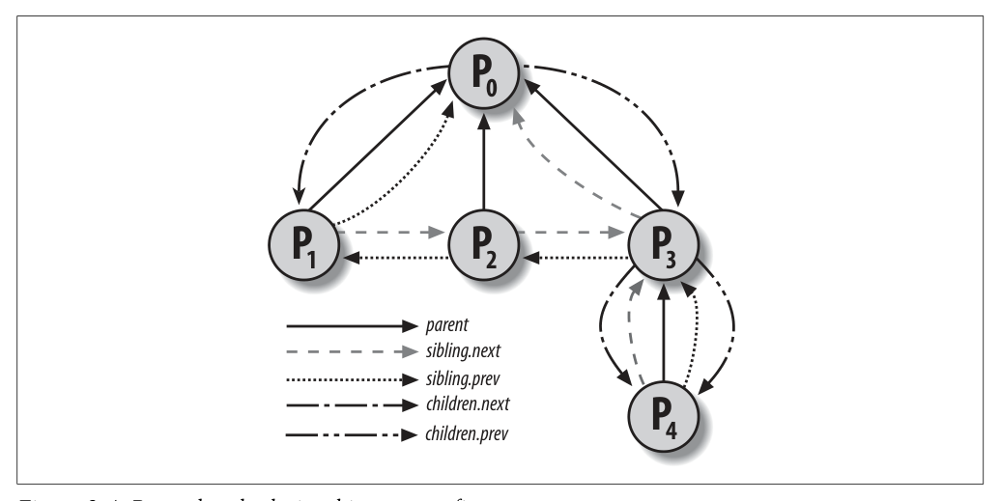

图 3-4 显示一组进程的亲属关系：P0 依次创建 P1、P2、P3，P3 又创建 P4。

### 8.2 进程组、会话与线程组

除了父子血缘，进程间还有几种"组织关系"。先理清三个概念：

- **进程组（process group）**：一组进程绑在一起整体管理。shell 里 `ls | grep a | wc` 管道串起的三个进程就是一个进程组，组里第一个进程是"组长"，组长的 PID 就是进程组 ID（PGID）。好处是 Ctrl-C 能给整个前台进程组发信号。
- **登录会话（session）**：比进程组更大一级，每登录一次就产生一个会话，登录 shell 是"会话首领"（session leader），它的 PID 是会话 ID（SID）。一个会话管着若干前台/后台进程组，跟控制终端 tty 绑定，用于作业控制。
- **线程组（thread group）**：前面 6.3 节讲过的多线程进程，组内线程共享 `tgid`。

这些"组"的头一个进程统称**领头进程（leader）**，它的 PID 顺便就当组 ID。进程还可能被调试器跟踪（前面 8.1 的 ptrace）。下表列出建立这些"非亲属关系"的字段：

| 字段 | 说明 |
| --- | --- |
| `group_leader` | P 所在线程组领头进程的描述符指针 |
| `signal->pgrp` | P 所在进程组领头进程的 PID |
| `tgid` | P 所在线程组领头进程的 PID |
| `signal->session` | P 的登录会话领头进程的 PID |
| `ptrace_children` | 链表头，含所有被 debugger 跟踪的 P 的子进程（5.15 里叫 `ptraced`） |
| `ptrace_list` | 指向所跟踪进程实际父进程链表的前/后元素（P 被跟踪时用；5.15 里叫 `ptrace_entry`） |

### 8.3 顺着父指针爬到 init_task

关于 `init_task`，2.6 时代 `init_task` 是 init 进程的静态描述符；到了 5.15，它不再是 init，而是 **0 号进程 `swapper/0`**——CPU 0 的 idle 线程。看 QEMU 里顺着父指针一路往上爬的实测结果：

```sehll
proc_desc: walking UP the parent chain from current:
    insmod (pid=106) -> parent sh (pid=1)
    sh (pid=1) -> parent swapper/0 (pid=0)
    reached init_task: swapper/0 (pid=0)
```

爬到头是 `swapper/0`（pid 0）。上面那串实测输出是 `code/ch6/proc_desc/proc_desc.c` 里的 `show_family_tree()` 打出来的，它爬父链的核心循环长这样：

```c
// code/ch6/proc_desc/proc_desc.c —— show_family_tree()（节选）
for (t = current; t != &init_task; t = t->parent)
	pr_info("    %s (pid=%d) -> parent %s (pid=%d)\n",
		t->comm, t->pid, t->parent->comm, t->parent->pid);
    pr_info("    reached init_task: %s (pid=%d)\n",
        init_task.comm, init_task.pid);
```

关键就在循环终点 `&init_task`：顺着 `parent` 一路往上，直到 `task == &init_task` 停，不会越界。

你可以从任意一个进程出发、靠着父指针爬到任何一个指定进程。但更常见的是遍历**全部**进程。因为任务队列本来就是双向循环链表，所以拿到下一个/上一个进程很容易：

```c
list_entry(task->tasks.next, struct task_struct, tasks);  /* 下一个 */
list_entry(task->tasks.prev, struct task_struct, tasks);  /* 上一个 */
```

正向的 `next_task(task)` 在 5.15 里是现成宏（`include/linux/sched/signal.h`）；但反向的 `prev_task` 并不存在——要拿"上一个"进程，得自己写 `list_entry_rcu(task->tasks.prev, struct task_struct, tasks)`，或用通用的 `list_prev_entry` 宏（`include/linux/list.h`）。

## 九、PID 与线程组标识

每个进程都有一个对应的进程描述符，二者严格一一对应。所以内核内部直接用描述符的**地址**（指针）来标识进程就够了——5.15 的 x86_64 上这个地址是 64 位。内核对进程的引用，绝大多数都是通过这个描述符指针进行的。

但对用户来说，用一个数字来指代进程更方便。于是类 Unix 系统又提供**进程标识符 PID**——一个存放在描述符 `pid` 字段里的编号。

### 9.1 PID 的分配与上限

PID 顺序编号，新进程的 PID 通常是前一进程的 PID 加 1。不过 PID 有上限，到了上限就必须开始循环使用已闲置的小 PID。默认最大 PID 是 32767（`PID_MAX_DEFAULT - 1`），管理员可以往 `/proc/sys/kernel/pid_max` 写一个更小的值来缩小上限；在 64 位体系结构上，可以把 PID 上限扩大到 4194303。

这里先认识 **PID 命名空间（PID namespace）**：它把进程的编号空间隔离开，每个命名空间独立编号。同一个进程，在宿主命名空间里有一个全局 PID，在它所属的容器命名空间里又有一个（通常更小的）PID——比如 docker 容器的 init 进程，宿主机上看是 PID 12345，容器里看就是 PID 1。所以"PID"这个数只有在指定"哪个命名空间"时才唯一，这层隔离也是容器技术的基石。

实机验证一下。用 `unshare` 创建新的 PID 命名空间并进入：

```shell
$ sudo unshare --pid --fork --mount-proc sh
# echo $$                 ← 新命名空间的第一个进程，PID 是 1
1
# ps -e -o pid,cmd        ← 只看得到自己命名空间里的进程，看不到宿主机
    PID CMD
      1 sh
      2 ps -e -o pid,cmd
```

同一个进程，在不同命名空间里的 PID 也不一样。容器里起一个 `sleep`：

```shell
$ sudo unshare --pid --fork --mount-proc sh -c 'sleep 8 & echo "容器内 sleep PID = $!"'
容器内 sleep PID = 2

# 宿主机另开一个终端，看同一个 sleep 的真实 PID：
$ ps -eo pid,comm,args | grep "sleep 8"
11934 sleep   sleep 8      ← 同一个进程，容器里是 2，宿主机上是 11934
```

5.15 里负责"分配/回收 PID"的是每个 PID 命名空间自带的一张 **`struct idr`**（`include/linux/pid_namespace.h` 里的 `struct idr idr` 字段）。

idr则是内核的"整数编号分配器"，底层是棵基数树，能高效地分配不重复的整数、并按编号快速查到对应对象。正因为每个命名空间独立编号，所以每个 PID 命名空间各带一个 `idr`，互不干扰地发号。

`alloc_pid()`（`kernel/pid.c`）调用 `idr_alloc_cyclic()` 完成分配。这个"循环分配"靠一个游标记住上次发到哪：

1. 每次 `fork` 分配 PID，就从游标当前位置往后找**第一个空闲号**发出去，游标跟着前进——所以新进程的 PID 通常是上一个 + 1。
2. 发到顶（`pid_max`）后，**绕回** `RESERVED_PIDS` 重新找。
3. idr 内部记录了哪些号还被占用，找空闲号时**自动跳过**这些已占用的号。

`RESERVED_PIDS` 默认是 300：0~299 这 300 个 PID 预留给系统（0 号 swapper、1 号 init、2 号 kthreadd……），普通进程只能从 300 开始拿，绕回也绕到 300、不是 0。所以实际可用区间是 `RESERVED_PIDS .. pid_max`，"顺序编号 + 循环复用 + 跳号"都交给 idr 自动完成。

```text
idr 维护一条 PID 号码条（0 ~ pid_max），用一个"游标"顺序发号：

   保留区 RESERVED_PIDS=300              普通进程可用区
 ┌──────────────────────────┬─────────────────────────────────────┐
 │ 0   1   2   ...   299    │ 300  301  302  303  304  ...  32767 │
 └──────────────────────────┴─────────────────────────────────────┘
     ▲   ▲        ▲               ▲
     │   │        │               └─ 游标 cursor：从 300 起发号，发一个前进一格
  swapper init  kthreadd  ...       发号顺序：300 → 301 → 302 → 303 → ...
  (PID 0)(PID 1) (PID 2)            若某个号已占用(如 302)，自动跳过接着发 303；
                                    发到 32767 后绕回 300，继续找第一个空号
```

2.6 的老实现是一张 `pidmap_array` 位图——一页框正好 32768 位，32 位机一张图装一页，64 位机按需加页而且一直不释放。5.15 已把它整个删掉，改用上面的 `idr`。上限这两个数字没变：`PID_MAX_DEFAULT = 0x8000`（32768），64 位机上 `PID_MAX_LIMIT` 是 `4 * 1024 * 1024`（4194304，即最大 PID 4194303）。

### 9.2 线程组与 tgid

线程组怎么来的、`tgid` 的规则，6.3 已经讲过（有对照表和 `mt.py` 实测）；`group_leader`/`tgid` 这些字段，8.2 也列过了。这里只补一个用户态行为：**`getpid()` 返回的是 `tgid` 而不是 `pid`**。所以多线程进程里所有线程 `getpid()` 结果相同；绝大多数进程是单成员线程组，此时 `tgid == pid`，`getpid()` 和普通进程没区别。

### 9.3 从 PID 查描述符：pidhash 与 struct pid

有些场景下，内核必须能根据 PID 反查出对应的进程描述符指针。以 `kill()` 为例：P1 要给 P2 发信号，调用 `kill(P2 的 PID)`；内核拿到这个 PID 后，得先把它换算成描述符，再从描述符里取出"记录挂起信号"的那块数据结构。反查要快，顺序扫进程链表、逐个比对 `pid` 字段就太慢了，于是 2.6 内核改用散列表来加速。又因为描述符里装着不同类型的 PID 字段， 给每种类型各配了一张散列表，一共 4 张：

| Hash 类型 | 字段 | 说明 |
| --- | --- | --- |
| `PIDTYPE_PID` | `pid` | 进程的 PID |
| `PIDTYPE_TGID` | `tgid` | 线程组领头进程的 PID |
| `PIDTYPE_PGID` | `pgrp` | 进程组领头进程的 PID |
| `PIDTYPE_SID` | `session` | 会话领头进程的 PID |

这 4 张散列表的空间在内核启动时按需分配，表头地址统一放进 `pid_hash` 数组。每张表多大由可用内存决定——比如 512 MB 内存的机器上，每张表占 4 个页框、共 2048 个表项。

`pid_hashfn` 宏把 PID 转成表索引：

```c
#define pid_hashfn(x) hash_long((unsigned long) x, pidhash_shift)
```

`pidhash_shift` 存的是散列表索引占用的位数，即 2048 个表项 = $2^{11}$，所以占 11 位。很多散列函数都靠 `hash_long()` 实现，在 32 位机上它基本等价于：

```c
unsigned long hash_long(unsigned long val, unsigned int bits)
{
	unsigned long hash = val * 0x9e370001UL;
	return hash >> (32 - bits);
}
```

> 这个魔鬼数字 `0x9e370001`（= 2654404609）到底怎么来的？这类散列的原理是：用表索引去乘一个很大的数，乘积在 32 位变量里自然溢出，剩下的低位就相当于做了取模。而那个"很大的数"不能随便取，要选一个接近黄金比例 $2^{32}$ 的素数。2654404609 正是接近 $2^{32} \times (\sqrt{5}-1)/2$ 的一个素数，而且用加减法和移位就能方便地算出来。

这样 `pid_hashfn` 的输出就落在 $0 - 2^{11} - 1 = 2047$ 之间。为什么偏偏用"带链表的散列"、而不是按 PID 做线性映射？因为散列是多对一——PID 取值空间 0~32767 共 32768 个，压进 2048 个桶，一一对应放不下这么多的元素；可真按 PID 范围建一张等长的表（32768 项）做到一一对应，系统里存活的进程数又远小于 PID 上限，绝大部分表项则会经常空闲造成浪费。所以宁可少建点桶，冲突直接交给散列表解决。下图就是带链表的 PID 散列表：PID 199 和 29384 散列到第 200 个元素，PID 29385 散列到第 1466 个元素。

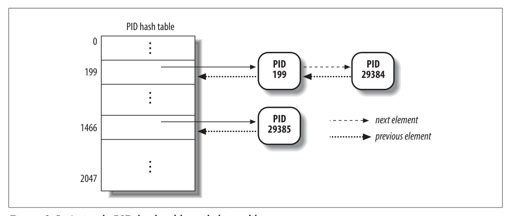

但散列表只管"点对点"——给定一个 PID，查到**一个**进程；内核还常要"点对一组"，一次拿到整组。拿 `tgid=100` 的多线程进程说：主线程 `pid=100`，线程 `pid=101`、`pid=102` 的 `tgid` 也都是 `100`。按 `tgid=100` 查表只命中主线程，`101`、`102` 挂在各自的 `PIDTYPE_PID` 表里、按 tgid 够不着。所以内核给每个"组"再配一条链表 `pid_list` 串起同组进程，查到主线程后顺藤摸瓜就能一网打尽。进程组、会话同理。

所以 `pid` 结构里其实有两条分工不同的链：`pid_chain` 管**散列冲突**（不同 PID 撞进同一桶），`pid_list` 管**同一组**（tgid/pgid/sid 相同的所有进程）。下表是 `pid` 结构的字段（概念上，2.6 在 `task_struct` 里放四个这样的结构，分别对应 PID/TGID/PGID/SID 四类）：

| 类型 | 名称 | 描述 |
| --- | --- | --- |
| `int` | `nr` | pid 的数值 |
| `struct hlist_node` | `pid_chain` | 链接散列链表的前/后元素 |
| `struct list_head` | `pid_list` | 每个 pid 的进程链表头 |

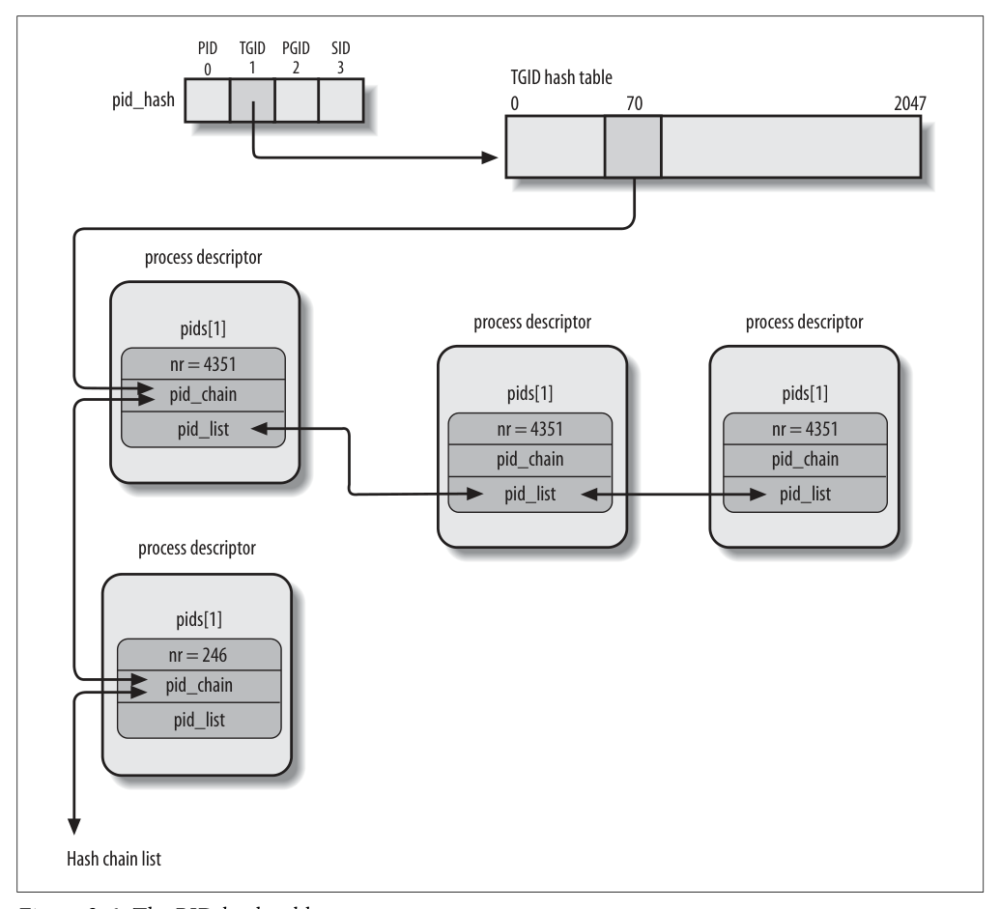

结合图看这两条链：hash(246) 和 hash(4351) 都落到第 71 项，所以这两个 `task_struct` 一起挂进第 71 个桶，靠 `pid_chain` 串成一条 hlist（图里的双箭头就是一对前后指针），各自的 PID 数值记在 `nr` 字段里。再看线程组 4351：领头线程的 `pid_list` 是组链表的头，组内其它线程顺着各自的 `pid_list` 一个接一个串起来。两条链互不相干——246 只是和 4351 撞桶的邻居，不属于这个组；真正"打包成一个进程"的，是 `pid_list` 串起来的那组 `tgid=4351` 的线程。

处理 PID 散列表的函数和宏：

| 函数/宏 | 说明 |
| --- | --- |
| `do_each_task_pid(nr, type, task)` / `while_each_task_pid(...)` | 标记 do-while 循环开始/结束，作用在 PID 等于 `nr` 的 PID 链表上，类型由 `type` 给出，`task` 指向当前被扫描元素的描述符 |
| `find_task_by_pid_type(type, nr)` | 在 `type` 类型散列表查 PID 等于 `nr` 的进程，返回匹配描述符指针，无匹配返回 `NULL` |
| `find_task_by_pid(nr)` | 等价于 `find_task_by_pid_type(PIDTYPE_PID, nr)` |
| `attach_pid(task, type, nr)` | 把 `task` 指向、PID 为 `nr` 的描述符插入 `type` 散列表；若已有该 PID 描述符，只把 `task` 插入已有的 PID 进程链表 |
| `detach_pid(task, type)` | 从 `type` 类型 PID 链表删除 `task`；若链表删后非空则终止，否则从 `type` 散列表删描述符；若该 PID 不再出现在其它散列表，清除 PID 位图对应位以便复用 |
| `next_thread(task)` | 返回 `PIDTYPE_TGID` 散列表链表中 `task` 之后的下一个轻量级进程描述符；散列链表是循环的，对传统进程返回其自身描述符地址 |

2.6 → 5.15 更正：`pid_hash` 数组 + `pid_hashfn`/`hash_long` 魔数那套已经没有了。5.15 换成 **`struct pid`**（`include/linux/pid.h`），一个 `struct pid` 内置 4 个类型的链表头：

```c
struct upid {
	int nr;                          /* 该命名空间里的 PID 数值 */
	struct pid_namespace *ns;
	struct hlist_node pid_chain;
};

struct pid {
	refcount_t count;
	unsigned int level;
	struct hlist_head tasks[PIDTYPE_MAX];   /* 4 类 PID 各自的链表头 */
	/* ... */
	struct upid numbers[1];
};
```

相应地，5.15 的对应关系如下：

- **PID 存哪**：每个 PID 命名空间一个 `idr`，不再有 `pid_hash` 数组。
- **按 PID 查进程**：2.6 的 `find_task_by_pid_type(type, nr)` / `find_task_by_pid(nr)` → 5.15 走 `find_pid_ns()` / `find_vpid()` / `find_get_pid(nr)`，再 `pid_task(pid, type)` 拿到 `task_struct`。
- **遍历同 PID 的进程**：`do_each_task_pid` / `while_each_task_pid` → `do_each_pid_task` / `while_each_pid_task`。
- **名字保留**：`attach_pid()`、`detach_pid()`、`next_thread()`。

## 十、进程的创建：fork、exec 与写时拷贝

### 10.1 Unix 的 fork + exec 组合

Unix 创建进程的方式很特别。大多数其他系统只用一个 `spawn`（生成进程）调用，就把"新建地址空间、加载可执行文件、开始执行"这三件事一步办完。Unix 则把这个过程拆成两个函数——`fork()` 和 `exec()`：

- `fork()` 拷贝当前进程，产生一个子进程。子进程和父进程的**唯一**区别只在于 PID、PPID，以及某些资源和统计量（比如挂起的信号不会被继承）。
- `exec()` 负责读入可执行文件并把它装进地址空间开始运行。

两者组合起来的效果，就和其他系统那个单一函数差不多了。

进程创建是 Unix 最基本的操作：用户敲一条命令，shell 就创建一份自己的拷贝去跑那条命令。传统 Unix 对进程一视同仁——子进程得复制父进程的全部资源。这就让创建又慢又低效：子进程要把父进程整个地址空间拷一遍，可实际上它根本用不到这份完整拷贝，而且多半马上又调 `execve()`，把刚辛苦拷来的地址空间整体换掉。现代 Unix 内核用三种机制来解决这个问题：

1. **写时复制**：父子读相同物理页，只要一方试图写某页，内核就把该页拷到新物理页分给写的进程。
2. **轻量级进程**：父子共享每进程在内核里的很多数据结构，如页表（整个用户态地址空间）、打开文件表、信号处理。
3. **`vfork()`**：子进程共享父进程内存地址空间，但父进程被阻塞直到子进程退出或执行新程序，防止父进程重写子进程需要的数据。

### 10.2 写时拷贝

传统的 `fork()` 会把所有资源复制给新进程。这实现起来简单，却低效——拷的数据可能压根不共享，更糟的是，如果子进程马上 `exec()` 一个新镜像，那这些拷贝全白做了。Linux 的 `fork()` 于是改用**写时拷贝（copy-on-write，COW）**：内核不复制整个地址空间，而是让父子**共享同一份**；只有真正要**写入**时，数据才被复制，让各进程拥有自己的副本。

也就是说，资源的复制推迟到了实际写入的那一刻；在此之前只是以只读方式共享。对于 `fork()` 之后立即 `exec()` 的场景，绝大多数页根本不会被写，也就完全不用复制。所以 `fork()` 的实际开销只剩两项：复制父进程的页表、给子进程建一个新的进程描述符——绕开了那动辄几十 MB 的地址空间拷贝。

### 10.3 clone()、fork() 与 vfork() 系统调用

Linux 通过 `clone()` 系统调用实现 `fork()`。`clone()` 用一系列参数标志指明父、子进程共享哪些资源；`fork()`、`vfork()` 和 `_clone()` 库函数各自按需打上标志去调 `clone()`。

轻量级进程由 `clone()` 创建，参数如下：

| 参数 | 含义 |
| --- | --- |
| `fn` | 新进程执行的函数；函数返回时子进程终止，返回整数作退出码 |
| `arg` | 传给 `fn()` 的数据 |
| `flags` | 各种信息。低字节指定子进程结束时要发父进程的信号码，通常 `SIGCHLD`；其余 3 字节是 clone 标志组（见 11.2 的表） |
| `child_stack` | 把用户态栈指针赋给子进程的 `esp`；调用者（父进程）总应为子进程分配新栈 |
| `tls` | 线程局部存储段（TLS）结构地址，仅 `CLONE_SETTLS` 时才有意义 |
| `ptid` | 父进程里存"与新轻量级进程相同 PID"的用户态变量地址，仅 `CLONE_PARENT_SETTID` 时有意义 |
| `ctid` | 新轻量级进程里存其 PID 的用户态变量地址，仅 `CLONE_CHILD_SETTID` 时有意义 |

实际上 `clone()` 是 C 库里的一个封装函数，负责建立新轻量级进程的栈并调用对编程者隐藏的 `clone()` 系统调用。实现 `clone()` 系统调用的 `sys_clone()` 服务例程没有 `fn`/`arg` 参数——封装函数把 `fn` 指针放在子进程栈上"封装函数返回地址"的位置，`arg` 放在 `fn` 下面。封装函数结束时 CPU 从栈取返回地址，执行 `fn(arg)`。

传统 `fork()` 用 `clone()` 实现，`flags` 指定为 `SIGCHLD` 且所有 clone 标志清 0，`child_stack` 是父进程当前栈指针，所以父子暂时共享同一用户态栈；感谢写时复制，通常只要一方试图改栈，就立刻各自得到一份拷贝。`vfork()` 也用 `clone()` 实现，`flags` 指定 `SIGCHLD` + `CLONE_VM` + `CLONE_VFORK`，`child_stack` 等于父进程当前栈指针。

### 10.4 内核实现：do_fork 到 kernel_clone

2.6 里这条链是 `clone() → do_fork() → copy_process()`。`do_fork()` 负责处理 `clone()`/`fork()`/`vfork()`。到了 5.15，`do_fork()` 的名字已经换成 **`kernel_clone()`**（`kernel/fork.c`），`fork`/`vfork`/`clone` 三个系统调用入口统一先填好一个 `struct kernel_clone_args`，再交给它：

```c
// kernel/fork.c
SYSCALL_DEFINE0(fork)
{
	struct kernel_clone_args args = {
		.exit_signal = SIGCHLD,
	};
	return kernel_clone(&args);
}

SYSCALL_DEFINE0(vfork)
{
	struct kernel_clone_args args = {
		.flags		= CLONE_VFORK | CLONE_VM,
		.exit_signal	= SIGCHLD,
	};
	return kernel_clone(&args);
}
```

创建进程的主要工作，都由 `copy_process()` 承担。它的步骤和 2.6 大同小异：

```c
static struct task_struct *copy_process(struct pid *pid, int trace, int node,
					struct kernel_clone_args *args)
{
	u64 clone_flags = args->flags;
	struct task_struct *p;
	struct multiprocess_signals delayed;
	int retval;

	// 1. 检查 clone_flags 合法性，非法直接返回 -EINVAL
	if ((clone_flags & (CLONE_NEWNS|CLONE_FS)) == (CLONE_NEWNS|CLONE_FS))  // 新命名空间不能共享 fs
		return ERR_PTR(-EINVAL);
	if ((clone_flags & CLONE_THREAD) && !(clone_flags & CLONE_SIGHAND))   // 线程组必须共享信号处理
		return ERR_PTR(-EINVAL);
	if ((clone_flags & CLONE_SIGHAND) && !(clone_flags & CLONE_VM))       // 共享信号处理必须共享 VM
		return ERR_PTR(-EINVAL);
	if ((clone_flags & CLONE_PARENT) && current->signal->flags & SIGNAL_UNKILLABLE)  // init 不许设 CLONE_PARENT
		return ERR_PTR(-EINVAL);
	if (clone_flags & CLONE_PIDFD) {
		if (clone_flags & (CLONE_DETACHED | CLONE_THREAD))  // PIDFD 不与 DETACHED/THREAD 同设
			return ERR_PTR(-EINVAL);
	}

	// 2. 延迟信号：fork 期间发来的信号收进 delayed，已有挂起信号则放弃 fork
	sigemptyset(&delayed.signal);
	INIT_HLIST_NODE(&delayed.node);
	spin_lock_irq(&current->sighand->siglock);
	if (!(clone_flags & CLONE_THREAD))
		hlist_add_head(&delayed.node, &current->signal->multiprocess);
	recalc_sigpending();
	spin_unlock_irq(&current->sighand->siglock);
	if (task_sigpending(current))
		return ERR_PTR(-ERESTARTNOINTR);

	// 3. 调用 dup_task_struct()，为新进程分配内核栈、thread_info 和 task_struct，
	//    内容先照抄当前进程——此时父子描述符一模一样（thread_info 跟着一起复制）
	p = dup_task_struct(current, node);
	if (!p)
		return ERR_PTR(-ENOMEM);
	if (args->io_thread)
		p->flags |= PF_IO_WORKER;  // io_uring 的 IO worker：屏蔽非致命信号

	// 4. 按 CLONE_CHILD_SETTID/CLONE_CHILD_CLEARTID 记录 set_child_tid/clear_child_tid
	p->set_child_tid = (clone_flags & CLONE_CHILD_SETTID) ? args->child_tid : NULL;
	p->clear_child_tid = (clone_flags & CLONE_CHILD_CLEARTID) ? args->child_tid : NULL;
	ftrace_graph_init_task(p);
	rt_mutex_init_task(p);

	// 5. 检查再创建一个子进程后，是否会超出当前用户的进程数上限（RLIMIT_NPROC）
	if (is_ucounts_overlimit(task_ucounts(p), UCOUNT_RLIMIT_NPROC,
				 rlimit(RLIMIT_NPROC)))
		goto bad_fork_free;
	retval = copy_creds(p, clone_flags);  // 复制/共享凭据

	// 6. 防 fork 炸弹：线程总数到顶就退出
	if (data_race(nr_threads >= max_threads))
		goto bad_fork_cleanup_count;

	// 7. 让子进程开始区别于父进程：清零统计信息等不该继承的字段
	p->flags &= ~(PF_SUPERPRIV | PF_WQ_WORKER | PF_IDLE | PF_NO_SETAFFINITY);  // 清超级用户权限标志等
	p->flags |= PF_FORKNOEXEC;  // 表示还没调过 exec()
	INIT_LIST_HEAD(&p->children);
	INIT_LIST_HEAD(&p->sibling);
	p->vfork_done = NULL;
	init_sigpending(&p->pending);
	p->utime = p->stime = p->gtime = 0;  // CPU 时间统计清零
	task_io_accounting_init(&p->ioac);
	posix_cputimers_init(&p->posix_cputimers);
	p->io_context = NULL;
	cgroup_fork(p);  // 建立 cgroup 关联

	// 8. sched_fork()：调度器初始化，顺便把状态置为 TASK_NEW，免得现在就被调度
	retval = sched_fork(clone_flags, p);

	// 9. perf_event_init_task、audit_alloc
	retval = perf_event_init_task(p, clone_flags);
	retval = audit_alloc(p);

	// 10. 按 clone_flags 逐项决定拷贝还是共享——线程组内能共享的就共享
	retval = security_task_alloc(p, clone_flags);   // LSM 安全检查
	retval = copy_semundo(clone_flags, p);          // System V 信号量 undo
	retval = copy_files(clone_flags, p);           // 打开的文件表
	retval = copy_fs(clone_flags, p);              // 根目录/工作目录
	retval = copy_sighand(clone_flags, p);         // 信号处理函数
	retval = copy_signal(clone_flags, p);          // 信号结构
	retval = copy_mm(clone_flags, p);              // 地址空间（COW）
	retval = copy_namespaces(clone_flags, p);      // 命名空间
	retval = copy_io(clone_flags, p);              // I/O 上下文

	// 11. copy_thread()：用父进程寄存器值初始化子进程内核栈，设好返回点 ret_from_fork()
	retval = copy_thread(clone_flags, args->stack, args->stack_size, p, args->tls);

	// 12. 调用 alloc_pid() 给新进程分配一个有效的 PID
	if (pid != &init_struct_pid) {
		pid = alloc_pid(p->nsproxy->pid_ns_for_children,
				args->set_tid, args->set_tid_size);
		if (IS_ERR(pid))
			goto bad_fork_cleanup_thread;
	}

	// 13. 共享 VM 时清 sigaltstack；关掉子进程的单步调试和系统调用跟踪
	if ((clone_flags & (CLONE_VM|CLONE_VFORK)) == CLONE_VM)
		sas_ss_reset(p);
	user_disable_single_step(p);
	clear_task_syscall_work(p, SYSCALL_TRACE);

	// 14. 记下 pid，再定 group_leader/tgid
	p->pid = pid_nr(pid);
	if (clone_flags & CLONE_THREAD) {
		p->group_leader = current->group_leader;  // 线程：组长还是 current 的组长
		p->tgid = current->tgid;
	} else {
		p->group_leader = p;  // 进程：自己就是组长
		p->tgid = p->pid;
	}
	INIT_LIST_HEAD(&p->thread_group);

	// 15. cgroup_can_fork() 检查 cgroup 策略；记录 start_time
	retval = cgroup_can_fork(p, args);
	p->start_time = ktime_get_ns();

	// 16. 加 tasklist_lock 建立亲子关系
	write_lock_irq(&tasklist_lock);
	if (clone_flags & (CLONE_PARENT|CLONE_THREAD)) {
		p->real_parent = current->real_parent;  // CLONE_PARENT/线程：认 current 的父为父
		if (clone_flags & CLONE_THREAD)
			p->exit_signal = -1;            // 线程不给退出信号
	} else {
		p->real_parent = current;              // 普通 fork：current 就是父
		p->exit_signal = args->exit_signal;
	}
	copy_seccomp(p);
	rseq_fork(p, clone_flags);

	// 17. 挂进系统可见的 PID 链表（对应 9.3 的四类散列表）
	init_task_pid_links(p);
	ptrace_init_task(p, (clone_flags & CLONE_PTRACE) || trace);
	init_task_pid(p, PIDTYPE_PID, pid);
	if (thread_group_leader(p)) {
		init_task_pid(p, PIDTYPE_TGID, pid);
		init_task_pid(p, PIDTYPE_PGID, task_pgrp(current));
		init_task_pid(p, PIDTYPE_SID, task_session(current));
		list_add_tail(&p->sibling, &p->real_parent->children);  // 挂进父进程的 children
		list_add_tail_rcu(&p->tasks, &init_task.tasks);          // 挂进全局进程链表
		attach_pid(p, PIDTYPE_TGID);   // 散列表挂 TGID/PGID/SID 三类
		attach_pid(p, PIDTYPE_PGID);
		attach_pid(p, PIDTYPE_SID);
	} else {
		list_add_tail_rcu(&p->thread_group, &p->group_leader->thread_group);  // 子线程挂进组长的线程组
		list_add_tail_rcu(&p->thread_node, &p->signal->thread_head);
	}
	attach_pid(p, PIDTYPE_PID);  // 最后统一挂 PID 表
	nr_threads++;
	write_unlock_irq(&tasklist_lock);

	// 18. 收尾：计数、通知各子系统，返回指向子进程的指针
	total_forks++;
	proc_fork_connector(p);
	sched_post_fork(p);
	cgroup_post_fork(p, args);
	perf_event_fork(p);
	trace_task_newtask(p, clone_flags);

	return p;
}
```

整个调用过程按阶段串起来：**先照抄一个壳，清掉不该继承的，按 clone_flags 分家产，最后上户口**——

- **1~2 前置检查**：`clone_flags` 组合非法直接拒绝；fork 期间到达的信号先收进 `delayed`，免得半路打断。
- **3~4 造壳**：`dup_task_struct()` 整体照抄父进程，新的 `task_struct` + 内核栈到手——此时父子描述符一模一样。
- **5~6 过安检**：查用户进程数上限 `RLIMIT_NPROC`、系统总线程数 `max_threads`（防 fork 炸弹），超了就放弃。
- **7~9 个性化**：统计信息清零、`flags` 清 `PF_SUPERPRIV` 置 `PF_FORKNOEXEC`、`sched_fork()` 把状态钉在 `TASK_NEW`——壳有了，但还不能跑。
- **10~11 分家产**：`fork()` 与 `pthread_create()` 的分岔点——`copy_files`/`copy_mm` 等逐项看 `clone_flags`：带共享标志就共享（线程），不带就 COW 拷贝（进程）。
- **12~17 上户口**：`alloc_pid()` 发 PID、定 `tgid`/组长、认父、挂进父的 `children` 和全局 `tasks` 链表、`attach_pid()` 挂进 9.3 的四类散列表。
- **18 出厂**：计数、通知各子系统，返回子进程描述符 `p`。

回到 `kernel_clone()`，如果 `copy_process()` 成功返回，新子进程就被唤醒投入运行。内核**故意**让子进程先跑，因为一般子进程紧接着就要 `exec()`，这样能省掉写时拷贝的开销；反过来如果父进程先跑，它很可能马上往地址空间里写东西。

`copy_process()` 返回后，有了处于可运行态的完整子进程，但还没实际运行，调度程序决定何时把 CPU 交给它。以后的进程切换中，调度程序完善子进程：把 `thread.esp`（子进程内核栈）装入 `esp`、`ret_from_fork()` 地址装入 `eip`；该函数调 `schedule_tail()` 完成切换，恢复所有寄存器，强制 CPU 返回用户态。系统调用返回值放 `eax`：**子进程拿到 0、父进程拿到子进程 PID**。除非 fork 返回 0，子进程与父进程执行相同代码；应用开发者可利用这点，按 PID 值插入条件语句让父子行为不同。

### 10.5 vfork()

`vfork()` 和 `fork()` 的差别主要有两点：不拷贝父进程的页表项；父进程会一直阻塞，直到子进程退出或调用 `exec()`。子进程就像父进程的一条线程，直接在父进程的地址空间里跑，期间还不能往地址空间写。这种设计在 3BSD 那个"还没有写时拷贝 `fork()`"的年代很有用；如今 `fork()` 已有 COW、还保证了子进程先执行，`vfork()` 的价值就只剩"省掉页表拷贝"这一条了。加上它的语义非常微妙（想想 `exec()` 失败会怎样），理想情况下最好别用 `vfork()`。

`vfork()` 靠给 `clone()` 传一个特殊标志实现。5.15 的做法和 2.6 那套"`vfork_done` 指向特定地址"的机制已经不同——`kernel_clone()` 里改用了内核的 completion 机制：

```c
// kernel/fork.c（kernel_clone 节选）
if (clone_flags & CLONE_VFORK) {
	p->vfork_done = &vfork;
	init_completion(&vfork);
	get_task_struct(p);
}
...
if (clone_flags & CLONE_VFORK) {
	if (!wait_for_vfork_done(p, &vfork))
		ptrace_event_pid(PTRACE_EVENT_VFORK_DONE, pid);
}
```

父进程在 `vfork` 完成量上等待；子进程退出地址空间（`mm_release()`）时或执行 `exec()` 时唤醒它。一切顺利的话，子进程在新地址空间里跑，父进程恢复在原地址空间跑。这样开销确实降了，但实现并算不上优雅。

## 十一、线程在 Linux 中的实现

### 11.1 线程就是共享资源的进程

线程是从现代编程抽象出的概念：同一程序内、共享内存地址空间的一组执行流，还能共享打开的文件等资源。多处理器上它还能带来真正的并行。

Linux 实现线程的思路非常独特——**内核里根本没有"线程"这个概念**。Linux 把所有线程都当进程来实现：不准备特别的调度算法，也不定义特别的数据结构来表示线程；一条线程就是一个和其他进程共享某些资源的进程。每条线程有自己独有的 `task_struct`，所以内核看它就是个普通进程，只是碰巧和其他几个进程共享了地址空间之类的资源。

这和 Windows、Solaris 的做法差异很大——它们在核心里专门支持线程（常叫**轻量级进程（lightweight process）**）。"轻量级"这个叫法本身就点明了分歧：别的系统把线程抽象成较省资源、跑得快的执行单元；而 Linux 的进程本身就够轻量，所谓线程不过是"进程间共享资源的一种手段"而已。

举个例：一个含四个线程的进程，在提供专门线程支持的系统里，通常有一个"进程描述符"装着四个指向线程的指针，由它描述地址空间、打开文件这些共享资源，线程再去描述各自独占的资源。而 Linux 直接创建四个进程、分四个 `task_struct`，创建时就声明它们共享某些资源——这份简洁相当优雅。

### 11.2 创建线程：clone 的标志

创建线程和创建普通进程类似，只是调 `clone()` 时多传几个"共享什么"的标志：

```c
clone(CLONE_VM | CLONE_FS | CLONE_FILES | CLONE_SIGHAND, 0);
```

效果和 `fork()` 差不多，差别只在于父子要共享地址空间、文件系统信息、文件描述符和信号处理程序——换句话说，这个新进程和它的父进程，就是大家常说的"线程"。作为对照，普通 `fork()` 是 `clone(SIGCHLD, 0)`，而 `vfork()` 是 `clone(CLONE_VFORK | CLONE_VM | SIGCHLD, 0)`。

传给 `clone()` 的标志决定了新进程的行为，以及父子间共享哪些资源。5.15 的这些标志定义在 `<linux/sched.h>`（`include/uapi/linux/sched.h`）里，常用的列在下面（2.6 版标志表里 `CLONE_IDLETASK`、`CLONE_STOPPED` 等在 5.15 已经没了，下表按 5.15 实际存在的标志整理）：

| 标志 | 含义 |
| --- | --- |
| `CLONE_VM` | 父子共享地址空间（共享内存描述符和所有页表） |
| `CLONE_FS` | 父子共享文件系统信息（根目录/当前工作目录表及 umask） |
| `CLONE_FILES` | 父子共享打开的文件（打开文件表） |
| `CLONE_SIGHAND` | 父子共享信号处理函数及被阻断的信号（信号处理程序表、阻塞信号表、挂起信号表）；为 true 时必须设 `CLONE_VM` |
| `CLONE_PTRACE` | 父进程被跟踪则子进程也被跟踪 |
| `CLONE_VFORK` | 调用 `vfork()`，父进程睡眠等待子进程唤醒 |
| `CLONE_PARENT` | 子进程与父进程拥有同一个父进程（`parent` 和 `real_parent` 都设为调用进程的父进程） |
| `CLONE_THREAD` | 父子放入相同的线程组（并共享信号描述符、设 `tgid`/`group_leader`）；为 true 时必须设 `CLONE_SIGHAND` |
| `CLONE_NEWNS` | 为子进程创建新的挂载命名空间；不能与 `CLONE_FS` 同设 |
| `CLONE_SYSVSEM` | 父子共享 System V `SEM_UNDO` 语义 |
| `CLONE_SETTLS` | 为子进程创建新的 TLS（thread-local storage）段 |
| `CLONE_PARENT_SETTID` | 把子进程 PID 写入父进程的 `ptid` 用户态变量 |
| `CLONE_CHILD_SETTID` | 把子进程 PID 写入子进程的 `ctid` 用户态变量 |
| `CLONE_CHILD_CLEARTID` | 子进程退出或开始执行新程序时，内核清除 `ctid` 指向的用户态变量并唤醒等待该事件的进程 |
| `CLONE_UNTRACED` | 让 `CLONE_PTRACE` 失效（防止跟踪进程强制跟踪子进程） |

### 11.3 内核线程

内核经常要在后台干些活，这类任务就交给**内核线程（kernel thread）**：独立运行在内核空间的标准进程。它和普通进程的区别只在于没有独立的地址空间——指向地址空间的 `mm` 指针为 `NULL`，只在内核空间跑，从不下到用户空间去。但它和普通进程一样，可以被调度，也可以被抢占。

Linux 确实把不少任务交给内核线程，`flush`、`ksoftirqd` 就是典型。在系统里跑 `ps -ef` 能看到一大堆内核线程。它们在系统启动时由别的内核线程创建——内核线程**只能**由其他内核线程创建。内核的做法是，所有新内核线程都由 **`kthreadd`** 这个内核进程繁衍出来。

5.15 里接口都在 `<linux/kthread.h>`，从现有内核线程创建一个新内核线程用：

```c
struct task_struct *kthread_create(int (*threadfn)(void *data),
				   void *data,
				   const char namefmt[], ...);
```

新任务由 `kthreadd` 通过 `clone()` 创建，创建出来后会去执行 `threadfn` 函数、收到参数 `data`，名字由 `namefmt`（一个像 `printf` 那样的可变参格式化串）给出。新线程一开始处于不可运行状态，要显式调 `wake_up_process()` 唤醒才肯跑。想"创建即可运行"，用 `kthread_run`：

```c
#define kthread_run(threadfn, data, namefmt, ...)		   \
({								   \
	struct task_struct *__k						   \
		= kthread_create(threadfn, data, namefmt, ## __VA_ARGS__); \
	if (!IS_ERR(__k))						   \
		wake_up_process(__k);					   \
	__k;								   \
})
```

说白了，`kthread_run` 就是 `kthread_create` + `wake_up_process` 的懒人包。内核线程启动后一直运行，直到自己调 `do_exit()` 退出，或者被别人调 `kthread_stop()` 停掉（参数是 `kthread_create` 返回的 `task_struct` 指针）：

```c
int kthread_stop(struct task_struct *k);
```

下面是在 QEMU 里用 5.15 实测的内核线程创建/停止过程。演示模块源码在 `code/ch6/proc_desc/`（`proc_desc.ko` 的 `init` 里 `kthread_run` 了一个名叫 `proc_desc_kthrd` 的线程，`exit` 里再 `kthread_stop` 它）：

```text
proc_desc: created kernel thread, kthrd=proc_desc_kthrd (pid=107)
proc_desc: kernel thread [proc_desc_kthrd] running, pid=107
...
proc_desc: kernel thread [proc_desc_kthrd] exiting
proc_desc: kernel thread stopped
```

注意内核线程的名字带方括号 `[proc_desc_kthrd]`，这是约定俗成的写法，也是 `ps` 里区分内核线程与普通进程的线索。

ULK 的 2.6 版是用 `kernel_thread()` 创建内核线程的，本质上这样调 `do_fork()`：

```c
do_fork(flags | CLONE_VM | CLONE_UNTRACED, 0, pregs, 0, NULL, NULL);
```

`CLONE_VM` 避免复制调用进程页表（新内核线程反正不访问用户态地址空间，复制纯浪费）；`CLONE_UNTRACED` 保证无进程跟踪新内核线程（即使调用进程被跟踪）。`kernel_thread()` 在栈里保留寄存器值，目的是通过 `copy_thread()` 把 `ebx`/`edx` 分别设为 `fn`/`arg` 的值，把 `eip` 设为下面这段汇编的地址：

```asm
movl %edx, %eax
pushl %edx
call *%ebx
pushl %eax
call do_exit
```

因此新内核线程开始执行 `fn(arg)`，若该函数结束，内核线程执行 `_exit()` 并把 `fn()` 返回值传给它。

> 2.6 → 5.15 更正：书里的 `keventd`、`kapmd`、`pdflush` 都已不复存在——`keventd` 重构为 `kworker/*`（workqueue 线程池），`kapmd`（APM）被移除，`pdflush`（刷新脏页）重构为 per-bdev 的 writeback 线程。仍在的典型有 `kswapd`、`ksoftirqd`、`kblockd`、`kthreadd`。

#### 进程 0 与进程 1

所有进程的祖先是进程 0（idle 进程，历史原因叫 swapper），是 Linux 初始化阶段从无到有建的内核线程。它用静态分配的数据结构（其它进程都动态分配）：`init_task` 变量里的进程描述符（`INIT_TASK` 宏初始化）；`init_thread_union` 变量里的 `thread_info` 描述符和内核栈；以及描述符指向的 `init_mm`、`init_fs`、`init_files`、`init_signals`、`init_sighand` 这些表。主内核页全局目录在 `swapper_pg_dir`。

`start_kernel()` 初始化内核需要的所有数据结构、激活中断，创建另一个叫进程 1 的内核线程（一般叫 init 进程）：

```c
kernel_thread(init, NULL, CLONE_FS | CLONE_SIGHAND);
```

新内核线程 PID 为 1，与进程 0 共享每进程内核数据结构；调度程序选到它时，init 进程开始执行 `init()` 函数。创建 init 后，进程 0 执行 `cpu_idle()`——本质是开中断情况下重复执行 `hlt` 指令；只有没有其它 `TASK_RUNNING` 进程时调度程序才选进程 0。

多处理器系统里每个 CPU 都有一个进程 0：开机后 BIOS 启动一个 CPU、禁用其它；CPU0 上的 swapper 初始化内核数据结构、激活其它 CPU，并通过 `copy_process()` 创建另外的 swapper 进程（PID 都为 0），再把适当 CPU 索引赋给每个进程 `thread_info` 的 `cpu` 字段。

进程 0 创建的内核线程执行 `init()`，`init()` 依次完成内核初始化，再调 `execve()` 装入可执行程序 init——于是 init 内核线程变成普通进程、拥有自己的每进程内核数据结构。系统关闭前 init 一直存活，因为它创建并监控 OS 外层所有进程的活动。

## 十二、进程的终结与资源回收

进程终有终结之日。结束时，内核必须释放它的资源，并把这个"噩耗"告诉父进程。

进程多数时候是"自杀"的：要么显式调用 `exit()` 系统调用，要么从 `main()` 返回时隐式结束（C 编译器会在 `main()` 的返回点后补一段调 `exit()` 的代码）。也有"他杀"的情形：收到一个既处理不了、又不能忽略的信号或异常。不管怎么死的，收尾的苦活大都落在 `do_exit()` 身上。

Linux 提供两个终止用户态应用的系统调用（5.15 里都在 `kernel/exit.c` 用 `SYSCALL_DEFINE1` 定义）：

| 调用 | 作用 |
| --- | --- |
| `exit_group()` | 终止整个线程组（即整个多线程应用）。主函数是 `do_group_exit()`，由 C 库的 `exit()` 调用 |
| `exit()` | 仅终止当前线程，不影响组内其他线程。主函数是 `do_exit()`，由 `pthread_exit()` 等调用 |

### 12.1 do_group_exit：整组退出

`do_group_exit()` 杀死 current 线程组的所有进程，接受终止代号（`exit_group()` 正常结束指定的值，或内核异常结束提供的错误码）。操作：

1. 检查退出进程的 `SIGNAL_GROUP_EXIT` 标志：若非 0，说明内核已开始线程组退出过程，就把 `current->signal->group_exit_code` 当退出码，跳第 4 步。
2. 否则设置 `SIGNAL_GROUP_EXIT` 标志，把终止代号存入 `current->signal->group_exit_code`。
3. 调 `zap_other_threads()` 杀死组内其它进程：扫描与 `current->tgid` 对应的 `PIDTYPE_TGID` 散列表每个 PID 链表，向表中所有不同于 current 的进程发 `SIGKILL`——结果它们都执行 `do_exit()` 被杀死。
4. 调 `do_exit()` 传入终止代号，`do_exit()` 杀死进程且不再返回。

### 12.2 do_exit：收尾的大头

`do_exit()`（`kernel/exit.c`）要做的繁琐事项：

1. 把 `task_struct` 的标志成员置为 `PF_EXITING`。
2. 调 `del_timer_sync()` 删掉任一内核定时器，确保没有定时器在排队、也没有定时器处理程序在跑。
3. 若开启了 BSD 进程记账，调 `acct_update_integrals()` 输出记账信息。
4. 调 `exit_mm()` 释放进程占用的 `mm_struct`；若这地址空间没被共享，就彻底释放。
5. 若进程在排队等 IPC 信号，调 `sem_exit()` 让它离队。
6. 调 `exit_files()` 和 `exit_fs()`，分别递减文件描述符、文件系统数据的引用计数；多路计数归零就代表没进程再用，可以释放。
7. 把 `exit()` 提供的退出代码存进 `task_struct` 的 `exit_code`，供父进程随时来取。
8. 调 `exit_notify()` 通知父进程，给子进程重新找"养父"（线程组里的其他线程或 init），并把进程状态（`exit_state`）置为 `EXIT_ZOMBIE`。
9. 调 `schedule()` 切到别的进程。因为 `EXIT_ZOMBIE` 状态的进程不会再被调度，所以这是它执行的最后一段代码——`do_exit()` 永不返回。

ULK 2.6 版的 `do_exit()` 流程与此一致，只是第 3 步拆得更细（分别调 `exit_mm()`、`exit_sem()`、`__exit_files()`、`__exit_fs()`、`exit_namespace()`、`exit_thread()`），第 6 步 `exit_notify()` 里再细分 a-f 六小步（更新父子关系、发 `SIGCHLD`、决定 `EXIT_ZOMBIE`/`EXIT_DEAD`、置 `PF_DEAD` 等），本质相同。

> 5.15 里 `do_exit()` 依然健在（`EXPORT_SYMBOL_GPL(do_exit)`），只是 `exit()`/`exit_group()` 等系统调用入口之外，内核线程还可能经 `kthread_exit()` 走到它。

到这里，进程占有的所有资源都释放掉了（假设它是这些资源的唯一用户）：既不可运行，也没有可跑的地址空间，只剩 `EXIT_ZOMBIE` 状态。它还占着的内存，就只有内核栈、`thread_info` 和 `task_struct`；存在下去的唯一意义，是向父进程报告信息。等父进程取走这些信息、或声明不再关心之后，最后这点内存才被释放还给系统。

### 12.3 删除进程描述符：release_task

执行完 `do_exit()`，进程虽然已僵死、不能再运行，内核仍保留着它的描述符，好让父进程在子进程结束后还能获取它的信息。所以"清理"和"删除描述符"是分两步走的：等父进程拿到子进程的信息（或声明不再关心），子进程的 `task_struct` 才会被释放。这正是僵死状态的由来——进程技术上已经死了，但描述符必须留到父进程收到通知为止。

`wait()` 系列函数最终都收敛到唯一一个系统调用 `wait4()` 上：挂起调用进程，直到某个子进程退出，返回它的 PID，并顺带把退出码写进调用者传入的指针。

真正释放描述符时，`release_task()` 被调用，做这些事：

1. 调 `__exit_signal()`，后者又调 `__unhash_process()`，再调 `detach_pid()` 把进程从 `pidhash` 和任务列表里摘掉。
2. `__exit_signal()` 释放僵死进程用的所有剩余资源，做最终统计与记录。
3. 若该进程是线程组最后一个、且领头进程已死，`release_task()` 要通知僵死领头进程的父进程。
4. `release_task()` 调 `put_task_struct()`，释放进程内核栈、`thread_info` 所占的页，以及 `task_struct` 所占用 slab 高速缓存。

ULK 2.6 版的 `release_task()` 步骤等价，只是拆成八步，其中 `__unhash_process()` 里要做 `nr_threads` 减 1、按类型 `detach_pid()` 摘掉描述符（领头进程要摘 `PIDTYPE_PID`/`TGID`/`PGID`/`SID` 四张表）、`REMOVE_LINKS` 从进程链表解除链接；最后 `put_task_struct()` 递减使用计数、归零则释放 `user_struct`、描述符、`thread_info` 和内核栈占用的内存区。

### 12.4 孤儿进程怎么办

如果父进程死在子进程之前，必须有机制给子进程找个新父亲，否则这些孤儿一退出就永远僵死，白白烧内存。办法前面也暗示过：在当前线程组里给它找一条线程当爹；找不到，就让 init 当爹。

具体在哪做？`do_exit()` 里调 `exit_notify()`，`exit_notify()` 调 `forget_original_parent()`，后者调 `find_new_reaper()` 去执行"寻父"。5.15 的 `find_new_reaper()`（`kernel/exit.c`）比 2.6 那版复杂了一截——它先看父亲所在线程组里有没有还活着的线程，其次沿 `real_parent` 向上找带 `is_child_subreaper` 标记的祖先进程，最后才退回命名空间的 `child_reaper`（通常是 init）：

```c
static struct task_struct *find_new_reaper(struct task_struct *father,
					   struct task_struct *child_reaper)
{
	struct task_struct *thread, *reaper;

	thread = find_alive_thread(father);
	if (thread)
		return thread;

	if (father->signal->has_child_subreaper) {
		/* 在 pid_ns 里顺 real_parent 链往上找第一个 is_child_subreaper */
		for (reaper = father->real_parent; ...; reaper = reaper->real_parent) {
			...
			thread = find_alive_thread(reaper);
			if (thread)
				return thread;
		}
	}

	return child_reaper;
}
```

找到合适的养父后，`forget_original_parent()` 遍历所有子进程、给它们设新父进程，并把它们从旧父亲的 `children` 链表搬到新父亲的 `children` 链表里（`list_splice_tail_init`）。5.15 里这里改用了 `for_each_thread(p, t)` 对每个子进程的**每条线程**逐一 `real_parent`/`parent` 重置，比 2.6 的处理更细。

被 `ptrace` 跟踪的子进程还要单独处理：`exit_ptrace()` 遍历 ptraced 链表，把这些子进程摘下来、交给新的父进程。用"一个专门的 ptrace 子进程链表"代替"遍历系统所有进程找子进程"，正是 2.6 之后的一个改进——两个相对小的链表，省掉了全系统遍历的消耗。

一旦给进程找到并设好了新父进程，就不会再有驻留僵死进程的危险：init 进程会例行调 `wait()` 检查自己的子进程，清掉所有相关的僵尸。

## 十三、等待队列

运行队列链表把 `TASK_RUNNING` 状态的进程组织在一起；其它状态的进程要用不同方式分组：Linux 没有为 `TASK_STOPPED`、`EXIT_ZOMBIE`、`EXIT_DEAD` 状态建专门链表——对暂停/僵死/死亡进程的访问比较简单，要么通过 PID，要么通过特定父进程的子进程链表，不必分组。

**等待队列（wait queue）** 在内核里用处很多，尤其在中断处理、进程同步和定时上。进程经常要等待某事件发生：磁盘操作结束、系统资源被释放、固定间隔过去……等待队列实现"在事件上的条件等待"：想等特定事件的进程把自己放进取合适的等待队列并放弃控制权。因此等待队列表示一组睡眠进程，条件成真时由内核唤醒。

等待队列由双向链表实现，元素含指向进程描述符的指针。每个等待队列有**等待队列头 `wait_queue_head_t`**：

```c
struct wait_queue_head {
	spinlock_t lock;
	struct list_head task_list;
};
typedef struct wait_queue_head wait_queue_head_t;
```

因为等待队列会被中断处理程序和主要内核函数同时修改，必须保护其双向链表免受并发访问（否则后果不可预测）。同步靠等待队列头里的 `lock` 自旋锁；`task_list` 是等待进程链表的头。链表元素类型是 `wait_queue_t`：

```c
struct wait_queue {
	unsigned int flags;
	struct task_struct *task;
	wait_queue_func_t func;
	struct list_head task_list;
};
typedef struct wait_queue wait_queue_t;
```

每个元素代表一个睡眠进程：`task` 存描述符地址，`task_list` 是把元素链进同事件队列的指针。

然而有时唤醒整个队列并不方便。例如两个进程争用某个要释放的互斥资源，只唤醒一个才有意义——它占资源，其它继续睡（这就避免了"雷鸣般兽群"问题：唤醒多个只为抢一个只能一个人访问的资源，抢不到的又回去睡）。所以有两种睡眠进程：

| 类型 | `flags` | 唤醒策略 |
| --- | --- | --- |
| 互斥进程 | 1 | 由内核有选择地唤醒 |
| 非互斥进程 | 0 | 事件发生时总是全部唤醒 |

等待临界资源的进程是互斥进程的典型；等待磁盘传输结束的进程是非互斥的（传输一完成全部唤醒）。等待队列元素的 `func` 字段表示睡眠进程该用什么方式被唤醒。

### 13.1 等待队列的操作

用 `DECLARE_WAIT_QUEUE_HEAD(name)` 宏定义新等待队列头，静态声明并初始化 `lock` 和 `task_list`；`init_waitqueue_head()` 初始化动态分配的等待队列头。`init_waitqueue_entry(q, p)` 这样初始化 `wait_queue_t` 变量 `q`：

```c
q->flags = 0;
q->task = p;
q->func = default_wake_function;
```

非互斥进程 `p` 将由 `default_wake_function()` 唤醒，后者是 `try_to_wake_up()` 的简单封装。也可以选 `DEFINE_WAIT` 宏声明一个 `wait_queue_t` 新变量，用当前进程描述符和唤醒函数 `autoremove_wake_function()` 的地址初始化——该函数调 `default_wake_function()` 唤醒睡眠进程，然后从等待队列链表删对应元素。最后，内核开发者可用 `init_waitqueue_func_entry()` 自定义唤醒函数。

定义好元素后必须插入等待队列：`add_wait_queue()` 把非互斥进程插到链表第一个位置，`add_wait_queue_exclusive()` 把互斥进程插到最后一个位置，`remove_wait_queue()` 删除进程，`waitqueue_active()` 检查队列是否为空。

要等待特定条件的进程可调用以下函数：

```c
void sleep_on(wait_queue_head_t *wq)
{
	wait_queue_t wait;
	init_waitqueue_entry(&wait, current);
	current->state = TASK_UNINTERRUPTIBLE;
	add_wait_queue(wq, &wait);   /* wq 指向当前队列的头 */
	schedule();
	remove_wait_queue(wq, &wait);
}
```

该函数把当前进程置 `TASK_UNINTERRUPTIBLE` 并插入等待队列，然后调调度程序、改去执行另一个程序；被唤醒时调度程序回到 `sleep_on()`，把进程从队列删除。`interruptible_sleep_on()` 与它一样，只是把状态置成 `TASK_INTERRUPTIBLE`（收信号即醒）。`sleep_on_timeout()` 和 `interruptible_sleep_on_timeout()` 则允许定义时间间隔，超时后由内核唤醒——它们调 `schedule_timeout()` 而非 `schedule()`。

Linux 2.6 引入的 `prepare_to_wait()`、`prepare_to_wait_exclusive()` 和 `finish_wait()` 提供了另一条让进程在等待队列睡眠的途径，典型用法：

```c
DEFINE_WAIT(wait);
prepare_to_wait_exclusive(&wq, &wait, TASK_INTERRUPTIBLE);  /* wq 是等待队列的头 */
if (condition)
	schedule();
finish_wait(&wq, &wait);
```

`prepare_to_wait()` / `prepare_to_wait_exclusive()` 用第三个参数设置进程状态，把元素的互斥标志 `flag` 分别设为 0（非互斥）或 1（互斥），再把等待元素插进队列。进程一被唤醒就执行 `finish_wait()`：把状态再次置 `TASK_RUNNING`（仅发生在调 `schedule()` 前唤醒条件已变为真的情况下），并从队列删等待元素（除非唤醒函数已做过）。

`wait_event` 和 `wait_event_interruptible` 宏让调用进程在队列上睡眠，直到给定条件被修改。例如 `wait_event(wq, condition)` 本质实现：

```c
DEFINE_WAIT(__wait);
for (;;) {
	prepare_to_wait(&wq, &__wait, TASK_UNINTERRUPTIBLE);
	if (condition)
		break;
	schedule();
}
finish_wait(&wq, &__wait);
```

几点说明：`sleep_on()` 类函数不能在"必须测条件、条件未验证又紧接着睡眠"的场景用，因为那是众所周知的竞态根源，不鼓励这样用。要插入互斥进程，得用 `prepare_to_wait_exclusive()`（或直接 `add_wait_queue_exclusive()`）；其它函数都当非互斥插入。最后，除非用 `DEFINE_WAIT` 或 `finish_wait()`，内核必须在唤醒后手动从队列删掉对应元素。

内核用以下任一宏唤醒等待队列进程并把它们置 `TASK_RUNNING`：`wake_up`、`wake_up_nr`、`wake_up_all`、`wake_up_interruptible`、`wake_up_interruptible_nr`、`wake_up_interruptible_all`、`wake_up_interruptible_sync`、`wake_up_locked`。规则如下：

- 所有宏都考虑 `TASK_INTERRUPTIBLE` 的睡眠进程；名字里不含 `interruptible` 的也考虑 `TASK_UNINTERRUPTIBLE` 的。
- 所有宏都唤醒具有请求状态的所有非互斥进程。
- 名字含 `nr` 的唤醒给定数量（宏参数）的互斥进程；含 `all` 的唤醒所有互斥进程；两者都不含的只唤醒一个互斥进程。
- 名字不含 `sync` 的会检查被唤醒进程优先级是否高于当前运行进程，必要时调 `schedule()`；含 `sync` 的不做这检查，高优先级进程执行稍有延迟。
- `wake_up_locked` 与 `wake_up` 类似，仅当等待队列头的自旋锁已被持有时使用。

例如 `wake_up` 等价于：

```c
void wake_up(wait_queue_head_t *q)
{
	struct list_head *tmp;
	wait_queue_t *curr;

	list_for_each(tmp, &q->task_list) {
		curr = list_entry(tmp, wait_queue_t, task_list);
		if (curr->func(curr, TASK_INTERRUPTIBLE | TASK_UNINTERRUPTIBLE,
			       0, NULL) && curr->flags)
			break;
	}
}
```

`list_for_each` 扫描 `q->task_list` 所有项，对每项 `list_entry` 算出 `wait_queue_t` 变量地址；其 `func` 字段存唤醒函数地址，试图唤醒 `task` 字段标识的进程。若进程已被有效唤醒（函数返回 1）且是互斥的（`curr->flags == 1`），循环结束。因为所有非互斥进程总在链表开始位置、互斥进程在尾部，所以函数总是先唤醒非互斥进程再唤醒互斥进程（若有的话）。

> 2.6 → 5.15 更正：`wait_queue_t` 在 4.13 改名 **`wait_queue_entry_t`**，字段 `task` 也改名为 `private`；`sleep_on()` / `interruptible_sleep_on()` / `sleep_on_timeout()` 这几个带竞态的老接口**已被删除**，现代代码一律用 `wait_event*` 宏或 `DEFINE_WAIT` + `prepare_to_wait*()` + `finish_wait()`。

## 十四、进程资源限制

每个进程带一组**资源限制（resource limit）**，限定它能用多少系统资源（CPU、磁盘空间等），避免用户滥用。Linux 承认下表列出的这些限制。

当前进程的限制放在 `current->signal->rlim` 字段——即进程信号描述符里的一个字段，是 `struct rlimit` 结构的数组，每个限制对应一个元素：

```c
struct rlimit {
	unsigned long rlim_cur;
	unsigned long rlim_max;
};
```

| 字段 | 说明 |
| --- | --- |
| `RLIMIT_AS` | 进程地址空间最大字节数。用 `malloc()` 之类扩大地址空间时检查 |
| `RLIMIT_CORE` | 内存转储文件大小（字节）。进程异常终止、内核在当前目录建转储文件前检查；为 0 则不建 |
| `RLIMIT_CPU` | 最长 CPU 时间（秒）。超限发 `SIGXCPU`，仍不终止再发 `SIGKILL` |
| `RLIMIT_DATA` | 堆大小最大值（字节）。扩充堆前检查 |
| `RLIMIT_FSIZE` | 文件大小最大值（字节）。试图把文件扩过此值则发 `SIGXFSZ` |
| `RLIMIT_LOCKS` | 文件锁最大值（目前非强制） |
| `RLIMIT_MEMLOCK` | 非交换内存最大字节数。`mlock()`/`mlockall()` 锁页框时检查 |
| `RLIMIT_MSGQUEUE` | POSIX 消息队列最大字节数 |
| `RLIMIT_NOFILE` | 打开文件描述符最大数。打开新文件或复制描述符时检查 |
| `RLIMIT_NPROC` | 用户能拥有的进程最大数 |
| `RLIMIT_RSS` | 进程拥有的页框最大数（目前非强制） |
| `RLIMIT_SIGPENDING` | 进程挂起信号最大数 |
| `RLIMIT_STACK` | 用户态栈最大字节数。扩充用户态栈前检查 |

`rlim_cur` 是当前限制，例如 `current->signal->rlim[RLIMIT_CPU].rlim_cur` 表示运行进程当前 CPU 时间限制。`rlim_max` 是限制允许的最大值。用 `getrlimit()`/`setrlimit()`，用户能把某些资源的 `rlim_cur` 提到 `rlim_max`；但只有超级用户（更准确说具有 `CAP_SYS_RESOURCE` 权能）才能改 `rlim_max` 或把 `rlim_cur` 设过 `rlim_max`。

多数限制默认 `RLIMIT_INFINITY`（`0xffffffff`），表示无用户限制（内核设计限制、可用 RAM/磁盘仍是实际约束）。但管理员可为某些资源施加更强限制：用户一登录，内核就建一个超级用户拥有的进程，由它 `setrlimit()` 收紧某资源的 `rlim_max`/`rlim_cur`，再 exec 成 login shell 变为用户拥有。用户创建的每个新进程都继承父进程 `rlim` 数组内容，所以逃不掉这些限制。

这正好接上前面第二节埋的伏笔——用户态栈的动态伸缩上限 `RLIMIT_STACK`（通常 8 MB）就是这里这个 `RLIMIT_STACK`。

> 2.6 → 5.15 更正：`current->signal->rlim` 字段仍在，但推荐用 `task_rlimit(current, RLIMIT_xxx)` 访问；5.15 里 `RLIMIT_*` 扩充到 16 类（多了 `RLIMIT_NICE`、`RLIMIT_RTPRIO`、`RLIMIT_RTTIME`）。

## 十五、进程切换

为控制进程执行，内核必须能挂起正在 CPU 上跑的进程、恢复以前挂起的某进程——这叫**进程切换（process switch）**，也叫任务切换或上下文切换。

### 15.1 硬件上下文

尽管每个进程可拥有自己的地址空间，但所有进程必须共享 CPU 寄存器，所以在恢复某进程执行前，内核必须把挂起它时的值装回每个寄存器。进程恢复前必须装入的一组寄存器数据叫**硬件上下文（hardware context）**，它是进程可执行上下文的一个子集。Linux 里进程硬件上下文一部分在 TSS 段、剩余部分在内核栈。

下面用 `prev` 表示切换出的进程描述符、`next` 表示切换进的进程描述符。于是进程切换定义为：保存 `prev` 的硬件上下文，用 `next` 的替换它。切换频繁发生，所以减少保存/装载硬件上下文的时间很重要。

早期的 Linux 用 80x86 的硬件支持，通过 `far jmp` 跳到 `next` 进程 TSS 描述符的选择符来切换——执行该指令时 CPU 自动保存旧上下文、装新上下文。但基于以下原因，Linux 2.6 改用软件切换：

- 通过一组 `mov` 指令逐步切换，能更好控制装入数据的合法性，特别是能检查 `ds`/`es` 段寄存器值（可能被恶意用户伪造）；单条 `far jmp` 做不到这种检查。
- 新旧方法耗时大致相同，但旧方法无法进一步优化，而当前切换代码还有改进余地。

进程切换只发生在内核态。切换前，用户态进程用的所有寄存器内容都已保存在内核栈上（包括存用户态栈指针的 `ss`/`esp` 这对寄存器）。

### 15.2 任务状态段 TSS

80x86 体系结构包含一个特殊段类型——**任务状态段 TSS（Task State Segment）**——存放硬件上下文。尽管 Linux 不用硬件上下文切换，仍强制为每个不同 CPU 建一个 TSS，两个主要理由：

1. 当 CPU 从用户态切到内核态时，从 TSS 获取内核态栈的地址。
2. 当用户态进程试图通过 `in`/`out` 指令访问 I/O 端口时，CPU 要访问 TSS 里的 I/O 许可权位图（Permission Bitmap）检查它是否有权访问端口。

更确切地说，用户态执行 `in`/`out` 指令时，控制单元：① 检查 `eflags` 里 2 位的 IOPL 字段，若为 3 则直接执行 I/O 指令；否则 ② 访问 `tr` 寄存器确定当前 TSS 和对应 I/O 许可权位图；③ 检查 I/O 指令指定的端口在位图中对应位，该位清 0 则执行，否则产生 "General protection" 异常。

`tss_struct` 结构描述 TSS 格式，`init_tss` 数组为每个 CPU 存一个 TSS。每次进程切换时内核更新 TSS 某些字段，让 CPU 控制单元安全地取到需要的信息；所以 TSS 反映当前进程特权级，但不必为没运行的进程保留 TSS。

每个 TSS 有自己 8 字节的 TSS 描述符（TSSD），含指向 TSS 起始地址的 32 位 Base 字段、20 位 Limit 字段。TSSD 的 S 标志位清 0 表示是系统段；Type 字段置 11 或 9 表示确实是 TSS。Intel 原始设计中每个进程应指向自己的 TSS，Type 字段第二个有效位叫 Busy 位，进程正被 CPU 执行则置 1，否则置 0；Linux 里每 CPU 只有一个 TSS，所以 Busy 位总置 1。

Linux 创建的 TSSD 存在全局描述符表（GDT）里，GDT 基地址存每个 CPU 的 `gdtr` 寄存器；每个 CPU 的 `tr` 寄存器含相应 TSS 的 TSSD 选择符，还含两个隐藏非编程字段（Base/Limit），这样处理器能直接寻址 TSS 而不用从 GDT 检索。

### 15.3 thread 字段

每次进程切换，被替换进程的硬件上下文必须保存在别处——不能像 Intel 原始设计那样存 TSS（因为 Linux 是每处理器一个 TSS 而非每进程一个）。因此每个进程描述符含一个 `thread_struct` 类型的 `thread` 字段，进程一切换出去，内核就把硬件上下文存进去。这个结构含大部分 CPU 寄存器（但不含 `eax`/`ebx` 等通用寄存器——它们的值保留在内核栈）。

### 15.4 执行进程切换：switch_to

进程切换只发生在精心定义的点——`schedule()` 函数。从本质上看，每次进程切换由两步组成：

1. 切换页全局目录以安装新地址空间。
2. 切换内核栈和硬件上下文（硬件上下文提供内核执行新进程所需的全部信息，含 CPU 寄存器）。

`prev` 指向被替换进程描述符、`next` 指向被激活进程描述符，它们是 `schedule()` 的局部变量。

第二步由 `switch_to` 宏执行，它是内核里与硬件关系最密切的例程之一。宏有三个参数 `prev`、`next`、`last`：`prev`/`next` 是输入参数，表示被替换进程和新进程描述符地址在内存的位置。

那第三个参数 `last` 呢？任何进程切换实际涉及三个进程而不是两个。假设内核决定暂停 A、激活 B，`schedule()` 里 `prev` 指 A、`next` 指 B；`switch_to` 一让 A 暂停，A 的执行流就冻结。随后内核想再次激活 A，就必须暂停另一个进程 C（通常不是 B），用 `prev` 指 C、`next` 指 A 再执行一次 `switch_to`。A 恢复执行流时找到它原来的内核栈，于是 `prev` 局部变量还指 A、`next` 还指 B；此时代表 A 执行的内核失去了对 C 的任何引用——但事实表明这个引用对完成切换很有用。

`switch_to` 的最后一个参数是输出参数，表示宏把进程 C 的描述符地址写到内存什么位置（A 恢复执行后完成）。切换前，宏把第一个输入参数 `prev`（A 内核栈里分配的 `prev` 局部变量）表示的变量内容存入 CPU 的 `eax` 寄存器；切换完成、A 恢复执行时，宏把 `eax` 内容写入第三个输出参数 `last` 指示的位置。因为 CPU 寄存器在切换点不变化，所以 C 的描述符地址也存在这个位置。`schedule()` 执行过程中 `last` 指向 A 的局部变量 `prev`，所以 `prev` 被 C 的地址覆盖。

图 3-7 显示进程 A、B、C 的内核栈内容和 `eax` 寄存器内容（注意图中是被 `eax` 覆盖前 `prev` 局部变量的值）。

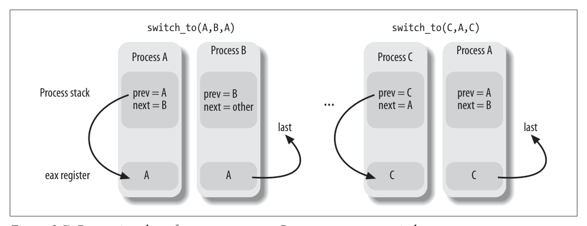

由于 `switch_to` 宏用扩展内联汇编编码，可读性差（实际用位置记数法选寄存器，编译器自由选通用寄存器），下面用标准汇编描述它在 80x86 上做的典型工作：

```asm
1. 在 eax 和 edx 中分别保存 prev 和 next 的值：
movl prev, %eax
movl next, %edx

2. 把 eflags 和 ebp 保存在 prev 内核栈（编译器认为 switch_to 结束前它们的值应不变）：
pushfl
pushl %ebp

3. 把 esp 保存到 prev->thread.esp，让该字段指向 prev 内核栈顶：
movl %esp, 484(%eax)      /* 484(%eax) 表示地址 = eax 内容 + 484 */

4. 把 next->thread.esp 装入 esp（从此内核在 next 的内核栈上操作，完成从 prev 到 next 的切换；
   由于描述符地址和内核栈地址紧挨着，改变内核栈意味着改变当前进程）：
movl 484(%edx), %esp

5. 把标记为 1 的地址存入 prev->thread.eip（被替换进程恢复执行时，执行标记为 1 的那条指令）：
movl $1f, 480(%eax)

6. 把 next->thread.eip 的值（绝大多数情况是被标记为 1 的地址）压入 next 的内核栈：
pushl 480(%edx)

7. 跳到 __switch_to() C 函数：
jmp __switch_to

8. 这里被进程 B 替换的进程 A 再次获得 CPU：执行保存 eflags/ebp 的指令（第一条被标记为 1）：
1:
popl %ebp
popfl

   注意这些 pop 指令引用的是 prev 进程的内核栈；调度程序选 prev 作为新进程运行时执行它们，
   此时 esp 指向 prev 的内核栈。

9. 把 eax（步骤 1 装入的）拷贝到第三个参数 last 标识的内存区：
movl %eax, last
   eax 指向刚被替换进程的描述符。
```

`__switch_to()` 执行进程切换的大部分工作，作用于参数 `prev_p`/`next_p`。它的调用不同于一般函数——它从 `eax`/`edx` 取参（前面已看到参数就保存在那里），而非从栈取。为强迫函数从寄存器取参，内核用 `gcc` 的非标准扩展 `__attribute__` 和 `regparm` 关键字，声明如下：

```c
__switch_to(struct task_struct *prev_p, struct task_struct *next_p)
	__attribute__(regparm(3));
```

函数执行的步骤：

1. 执行 `__unlazy_fpu()` 宏产生的代码，有选择地保存 `prev_p` 进程 FPU、MMX、XMM 寄存器内容：
   ```c
   __unlazy_fpu(prev_p);
   ```
2. 执行 `smp_processor_id()` 获得本地 CPU 下标（从当前进程 `thread_info` 的 `cpu` 字段取），存到 `cpu` 局部变量。
3. 把 `next_p->thread.esp0` 装入本地 CPU 的 TSS `esp0` 字段——以后任何由 `sysenter` 指令产生的用户态到内核态特权级转换，会把这个地址拷到 `esp`：
   ```c
   init_tss[cpu].esp0 = next_p->thread.esp0;
   ```
4. 把 `next_p` 进程的线程局部存储（TLS）段装入本地 CPU 的 GDT，三个段选择符保存在描述符的 `tls_array` 数组：
   ```c
   cpu_gdt_table[cpu][6] = next_p->thread.tls_array[0];
   cpu_gdt_table[cpu][7] = next_p->thread.tls_array[1];
   cpu_gdt_table[cpu][8] = next_p->thread.tls_array[2];
   ```
5. 把 `fs`/`gs` 段寄存器内容分别存到 `prev_p->thread.fs` / `prev_p->thread.gs`：
   ```asm
   movl %fs, 40(%esi)
   movl %gs, 44(%esi)     /* esi 指向 prev_p->thread */
   ```
6. 若 `fs`/`gs` 已被 `prev_p` 或 `next_p` 任一使用（值非 0），则把 `next_p` 的 `thread_struct` 里保存的值装入这些寄存器（逻辑上补充上一步）：
   ```asm
   movl 40(%ebx), %fs
   movl 44(%ebx), %gs     /* ebx 指向 next_p->thread */
   ```
   实际代码更复杂——检测到无效段寄存器值时 CPU 可能产生异常，代码采用"修正（fix-up）"路径处理这种可能。
7. 用 `next_p->thread.debugreg` 数组内容装载 `dr0`…`dr7` 中 6 个调试寄存器（仅当 `next_p->thread.debugreg[7]` 非 0 时才做）。这些寄存器不必保存，因为只有 debugger 想监控 `prev` 时 `prev_p->thread.debugreg` 才会被修改：
   ```c
   if (next_p->thread.debugreg[7]) {
   	loaddebug(&next_p->thread, 0);
   	loaddebug(&next_p->thread, 1);
   	loaddebug(&next_p->thread, 2);
   	loaddebug(&next_p->thread, 3);
   	/* 没有 4 和 5 */
   	loaddebug(&next_p->thread, 6);
   	loaddebug(&next_p->thread, 7);
   }
   ```
8. 必要时更新 TSS 里的 I/O 位图（`next_p` 或 `prev_p` 有自定义 I/O 权限位图时）：
   ```c
   if (prev_p->thread.io_bitmap_ptr || next_p->thread.io_bitmap_ptr)
   	handle_io_bitmap(&next_p->thread, &init_tss[cpu]);
   ```
   因为进程很少改 I/O 权限位图，它按"懒"模式处理：只有当进程在当前时间片内实际访问 I/O 端口时，真实位图才拷到本地 CPU 的 TSS。进程自定义位图存在 `thread_info` 的 `io_bitmap_ptr` 字段指向的缓冲区。`handle_io_bitmap()` 为 `next_p` 设置本地 CPU 的 TSS `io_bitmap` 字段：若 `next_p` 没有自己的位图则设为 `0x8000`，有则设为 `0x9000`。TSS 的 `io_bitmap` 应含一个 TSS 内偏移存放实际位图。无论何时用户态进程试图访问 I/O 端口，`0x8000`/`0x9000` 都指向 TSS 界限之外，从而引发 "General protection" 异常；`do_general_protection()` 检查 `io_bitmap`：`0x8000` 则向用户态发 `SIGSEGV`，`0x9000` 则把进程位图（`io_bitmap_ptr` 指示）拷到本地 TSS、把 `io_bitmap` 设为实际位图偏移（104），并强制重执行那条有缺陷的指令。
9. 终止。`__switch_to()` C 函数以 `return prev_p;` 结束，对应汇编：
   ```asm
   movl %edi, %eax
   ret
   ```
   `prev_p`（现在在 `edi`）被拷到 `eax`（C 函数返回值默认走 `eax`）。注意 `eax` 的值因此在 `__switch_to()` 调用期间被保护起来——这点很重要，因为 `switch_to` 宏假定 `eax` 总存被替换进程描述符地址。`ret` 把栈顶保存的返回地址装入 `eip`；因为是通过跳转调用 `__switch_to()` 的，所以 `ret` 在栈里找到标记为 1 的指令地址（由 `switch_to` 宏推入）。若 `next_p` 第一次执行、从未被挂起，`__switch_to()` 就找到 `ret_from_fork()` 的起始地址（见"创建进程"一节）。

> 2.6 → 5.15 更正：上面 15.4 两段汇编是 x86-32 的实现。5.15 x86_64 里，`switch_to` 宏（`arch/x86/include/asm/switch_to.h`）改为转调汇编例程 `__switch_to_asm()`，再由 `arch/x86/kernel/process_64.c` 的 `__switch_to()` 完成剩余工作：
>
> ```c
> #define switch_to(prev, next, last)				\
> do {								\
> 	((last) = __switch_to_asm((prev), (next)));		\
> } while (0)
> ```
>
> x86_64 的系统调用入口走 MSR（`MSR_LSTAR`/`MSR_KERNEL_GS_BASE`），不再靠 TSS 的 `esp0`；TSS 主要留给 I/O 位图和中断栈表（IST）。`__switch_to_asm()` 负责保存 callee 寄存器、切换 `RSP` 和内核栈，`__switch_to()` 负责更新 TSS、交换 `gs`、切 `fpu` 状态等。核心思想不变：**保存 prev 硬件上下文、装载 next 的，而"切内核栈"同时也就"切了当前进程"**。

### 15.5 保存和加载 FPU、MMX 及 XMM 寄存器

从 Intel 80486DX 起，算术浮点单元（FPU）被集成进 CPU。为兼容旧模式，浮点算术用 ESCAPE 指令执行（前缀字节在 `0xd8`~`0xdf` 之间），作用于 CPU 内的浮点寄存器集。显然，进程用 ESCAPE 指令时，浮点寄存器内容属于它的硬件上下文，应当被保存。

近来的 Pentium 引入了 MMX 指令集加速多媒体，MMX 指令复用 FPU 浮点寄存器——缺点是浮点和 MMX 指令不能混用，优点是 OS 设计者可以忽略新指令集（保存浮点状态的切换代码原样适用于保存 MMX 状态）。Pentium III 又引入 SSE 扩展，用 8 个 128 位 XMM 寄存器处理浮点值，不与 FPU/MMX 重叠，可随意混用；Pentium 4 再引入 SSE2（SSE 的扩展，支持高精度浮点，复用同一 XMM 寄存器集）。

80x86 并不在 TSS 里自动保存 FPU/MMX/XMM 寄存器，但提供硬件支持按需保存，靠 `cr0` 寄存器里的 **TS（Task-Switching）标志**：

- 每次执行硬件上下文切换时设置 TS 标志。
- TS 标志被设置时执行 ESCAPE/MMX/SSE/SSE2 指令，控制单元就产生 "Device not available" 异常。

TS 标志让内核只有真正需要时才保存/恢复这些寄存器。假设进程 A 用协处理器：切换时内核置 TS 并把浮点寄存器存进 A 的 TSS；若新进程 B 不用协处理器，就不必恢复浮点寄存器内容。只要 B 打算执行 ESCAPE/MMX 指令，CPU 就产生 "Device not available" 异常，异常处理程序用保存在 B 中的值装浮点寄存器。

为处理这些寄存器的选择性装入，数据结构存在进程描述符的 `thread.i387` 子字段里，格式由 `i387_union` 联合体描述：

```c
union i387_union {
	struct i387_fsave_struct fsave;
	struct i387_fxsave_struct fxsave;
	struct i387_soft_struct soft;
};
```

它只存三种结构之一：`i387_soft_struct` 由无数协处理器的老 CPU 用（内核软件模拟协处理器）；`i387_fsave_struct` 由有协处理器、可能有 MMX 的 CPU 用；`i387_fxsave_struct` 由有 SSE/SSE2 的 CPU 用。

进程描述符还含两个附加标志：

- `thread_info` 描述符 `status` 字段里的 **`TS_USEDFPU`** 标志：进程本次执行是否用过 FPU/MMX/XMM。
- `task_struct` 描述符 `flags` 字段里的 **`PF_USED_MATH`** 标志：`thread.i387` 子字段内容是否有意义。在两种情况下被清 0：① 进程调 `execve()` 开始执行新程序时（控制权不再返回旧程序，现存 `thread.i387` 数据没用）；② 用户态进程开始执行信号处理程序时（信号处理与执行流异步，浮点寄存器对处理程序可能无意义——不过内核开始执行信号处理前在 `thread.i387` 存浮点寄存器、结束后恢复，所以信号处理程序仍能用协处理器）。

`__switch_to()` 把被替换进程描述符 `prev` 传给 `__unlazy_fpu` 宏并执行它。该宏检查 `prev` 的 `TS_USEDFPU` 标志，若被设置说明 `prev` 本次执行用了 FPU/MMX/SSE/SSE2，必须保存相关硬件上下文：

```c
if (prev->thread_info->status & TS_USEDFPU)
	save_init_fpu(prev);
```

`save_init_fpu()` 依次：① 把 FPU 寄存器内容转储到 `prev` 进程描述符并重新初始化 FPU（若 CPU 用 SSE/SSE2 还要转储 XMM 并重新初始化）。CPU 用 SSE/SSE2 时：

```c
asm volatile("fxsave %0 ; fnclex" : "=m" (tsk->thread.i387.fxsave));
```

否则：

```c
asm volatile("fnsave %0 ; fwait" : "=m" (tsk->thread.i387.fsave));
```

② 重置 `prev` 的 `TS_USEDFPU` 标志：`prev->thread_info->status &= ~TS_USEDFPU;` ③ 用 `stts()` 宏设置 `cr0` 的 TS 标志，实际产生汇编 `movl %cr0, %eax; orl $8, %eax; movl %eax, %cr0`。

而 `next` 进程刚恢复执行时浮点寄存器内容还没恢复，不过 `cr0` 的 TS 标志已被 `__unlazy_fpu()` 设置。所以 `next` 第一次试图执行 ESCAPE/MMX/SSE/SSE2 指令时，控制单元产生 "Device not available" 异常，异常处理程序运行 `math_state_restore()`（把 `next` 当 `current`）：

```c
void math_state_restore()
{
	asm volatile ("clts");	/* 清 cr0 的 TS 标志 */
	if (!(current->flags & PF_USED_MATH))
		init_fpu(current);
	restore_fpu(current);
	current->thread.status |= TS_USEDFPU;
}
```

它清 `cr0` 的 TS 标志，让进程以后执行 FPU/MMX/SSE/SSE2 指令不再触发异常；若 `thread.i387` 内容无效（`PF_USED_MATH == 0`）就调 `init_fpu()` 重设并置 `PF_USED_MATH` 为 1；`restore_fpu()` 把 `thread.i387` 里的值装入 FPU 寄存器（按 CPU 是否支持 SSE/SSE2 用 `fxrstor` 或 `frstor`）；最后设 `TS_USEDFPU`。

内核也能用这些单元，但应避免干扰用户态进程的计算。因此：用协处理器之前，若用户态进程用了 FPU（`TS_USEDFPU` 标志），内核必须调 `kernel_fpu_begin()`（本质是 `save_init_fpu()` 保存寄存器内容，再重设 `cr0` 的 TS 标志）；用完调 `kernel_fpu_end()` 重新设置 `cr0` 的 TS 标志。之后用户态进程执行协处理器指令时，`math_state_restore()` 恢复寄存器内容（如同进程切换那样）。但注意，当前用户态进程正用协处理器时，`kernel_fpu_begin()` 执行时间相当长，甚至盖过用 FPU/MMX/SSE 带来的加速——所以内核只在有限场合用它，典型如移动/清除大内存区、计算校验和。

> 2.6 → 5.15 更正：`thread.i387` 联合体已重构为 **`struct fpu`**（`arch/x86/include/asm/processor.h` 里 `thread_struct` 的 `struct fpu fpu;`），用 `XSAVE`/`XSAVES` 指令，懒恢复机制交给 `kernel_fpu_begin()`/`kernel_fpu_end()`（仍存在）。`math_state_restore()`、`TS_USEDFPU` 这些 32 位老符号也已改名/重构（如 `switch_fpu_return()` 等）。

## 十六、运行队列：TASK_RUNNING 的进程去哪排队

当内核寻找新进程在 CPU 上运行时，只需考虑可运行进程（`TASK_RUNNING` 状态）。早期的 Linux 把所有可运行进程放同一个 **运行队列（runqueue）** 链表，因为维持链表按优先级排序开销太大，调度程序只好扫整个队列来选"最佳"进程。

Linux 2.6 改进了运行队列：让调度程序能在固定时间内选出最佳可运行进程，与队列中进程数无关。诀窍是建立多个可运行进程链表，每个优先权一条链表——每个 `task_struct` 含一个 `list_head` 类型的 `run_list` 字段，优先权为 k（0~139）的进程链入优先权为 k 的链表。多处理器系统里每个 CPU 有自己的运行队列（自己的链表集）。这是"用更复杂数据结构换性能"的典型：调度效率确实高了，运行队列却被拆成 140 个队列。所有这些链表都由一个 `prio_array_t` 结构实现，字段见下表：

| 字段 | 类型 | 描述 |
| --- | --- | --- |
| `nr_active` | `int` | 链表中进程描述符的数量 |
| `bitmap` | `unsigned long[5]` | 优先权位图：当且仅当某优先权进程链表非空时设置对应位 |
| `queue` | `struct list_head[140]` | 140 个优先权队列的头结点 |

`enqueue_task(p, array)` 把进程描述符插入某运行队列链表，代码本质等价于：

```c
list_add_tail(&p->run_list, &array->queue[p->prio]);
__set_bit(p->prio, array->bitmap);
array->nr_active++;
p->array = array;
```

`prio` 字段存放动态优先权，`array` 字段指向当前运行队列的 `prio_array_t`。`dequeue_task(p, array)` 则从运行队列删除描述符。

> 2.6 → 5.15 更正：这套 `prio_array_t`（140 队列 + 位图）在 2.6.23 之后被**完全公平调度器 CFS** 取代，5.15 里已找不到 `prio_array_t`、`run_list`、`p->array`。5.15 是每 CPU 一个 `struct rq`，内含 `struct cfs_rq` 等；`task_struct` 里是 `struct sched_entity se`（CFS）、`struct sched_rt_entity rt`（实时）、`struct sched_dl_entity dl`（deadline），CFS 用 `vruntime` 记账、红黑树按它排序，O(log n) 选出最小 `vruntime` 者运行。调度细节见调度器那章。

## 十七、核心总结

1. 内核代码要么跑在**进程上下文**（系统调用/异常，同步），要么跑在**中断上下文**（硬件中断，异步），二者性质截然不同；进程上下文里 `current` 宏有效。
2. 进程 VAS 由若干映射构成：Text（代码）、Data（已初始化/未初始化 bss/堆）、共享库映射、栈。堆和栈是动态段，栈朝低地址生长；它们的上限由资源限制（`RLIMIT_*`）约束。
3. **线程 = 进程内的一条执行路径**，共享进程全部资源，唯独栈私有。每个用户态线程有两条栈：用户态栈 + 内核态栈；纯内核线程只有内核态栈。
4. 看栈有三条路：读 `/proc/<PID>/stack` 看内核态栈、`gstack`/gdb 看用户态栈、eBPF（BCC/bpftrace）一次看两条。读回溯统一**自下而上**。
5. 每个线程在内核里对应一个 `struct task_struct`（进程描述符），是它的"根"元数据结构；5.15 x86_64 里 `sizeof(struct task_struct) ≈ 7 KB`（7104 字节），用 slab 分配，串成双向循环链表 task list。
6. 2.6 的 `thread_info` 躺在内核栈底、内含 `task` 指针；5.15 把它折叠进 `task_struct` 开头（`current_thread_info()` 就是 `(struct thread_info *)current`），内核栈改 16 KB 走 `VMAP_STACK`，`current` 改读 per-CPU 变量 `current_task`（ARM32 O(1) 算、AArch64/PowerPC 用专用寄存器）。
7. 进程有五种基本状态（`TASK_RUNNING`/`INTERRUPTIBLE`/`UNINTERRUPTIBLE`/`STOPPED`/`TRACED`）+ 两个终止态 `EXIT_ZOMBIE`/`EXIT_DEAD`；字段 2.6 叫 `state`、5.15 叫 `__state`，5.15 还加了 `TASK_WAKEKILL`/`KILLABLE`/`IDLE`/`NEW`；用 `set_current_state()`（带 `smp_store_mb` 屏障）设置。
8. 访问 task 成员优先用 helper 方法（如 `task_pid_nr()`、`from_kuid()`），而非直接 `current->pid`；`in_task()` 判断上下文，`likely()/unlikely()` 提示分支预测；打印地址用 `%pK`。
9. `insmod`/`rmmod` 时模块的 init/exit 代码由对应进程自己在进程上下文执行，这正是宏内核的体现。
10. 内核的双向链表原语是 `list_head`（循环）/`hlist`（非循环）；进程链表头是 `init_task`（5.15 是 `swapper/0`，pid 0），`for_each_process()` 遍历进程、`do_each_thread()/while_each_thread()` 遍历线程。
11. `tgid` 区分进程与线程：单线程 `tgid==pid`；多线程进程主线程 `tgid==pid`、其余线程共享主线程 tgid 但 pid 唯一。内核线程名字带方括号、栈地址页对齐。
12. 进程间关系由 `real_parent`/`parent`/`children`/`sibling` 表示，另靠 `group_leader`/`signal->pgrp`/`tgid`/`signal->session` 建立进程组、会话、线程组等非亲属纽带；顺 `parent` 爬到顶是 `swapper/0`。
13. PID 默认上限 32767、64 位可扩到 ~4M；2.6 的 `pidmap` 位图和 `pid_hash` 数组，5.15 分别换成每命名空间 `idr` 和 `struct pid`（内置 4 类 `tasks[]` 链）。
14. 进程创建走 `fork()` + `exec()`：`fork()` 用写时拷贝（COW）复制页表并建新描述符，5.15 里实现链路是 `fork/vfork/clone → kernel_clone() → copy_process()`（2.6 的 `do_fork` 已更名）；内核故意让子进程先跑省 COW 开销。
15. Linux 把线程当共享资源的进程实现，`clone()` 的 `CLONE_*` 标志决定共享哪些资源；内核线程靠 `kthread_create`/`kthread_run`/`kthread_stop` 管理，由 `kthreadd` 繁衍，`mm` 为 `NULL`；进程 0（swapper）创建进程 1（init）。
16. 进程由 `do_group_exit()`/`do_exit()` 收尾（释放 `mm`/`files`/`fs`、通知父进程、置 `EXIT_ZOMBIE`），描述符由 `release_task()` 最终释放；孤儿进程由 `find_new_reaper()` 在 5.15 里按"存活线程 → subreaper → init"的顺序重新找爹。
17. 等待队列上睡眠进程分互斥/非互斥，`wake_up*` 宏按 `nr`/`all`/`sync`/`interruptible` 区分；2.6 的 `sleep_on()` 家族已删，改用 `wait_event*`/`prepare_to_wait`/`finish_wait`，`wait_queue_t` 改名 `wait_queue_entry_t`。
18. 进程切换 = 保存 prev 硬件上下文、装载 next 的；2.6 x86-32 的 `switch_to`/`__switch_to` 汇编在 5.15 x86_64 变为 `__switch_to_asm()` + `__switch_to()`，FPU 惰性保存从 `thread.i387` 重构为 `struct fpu`（XSAVE）；2.6 早期的 140 优先级运行队列 `prio_array_t` 已被 CFS 红黑树取代。
