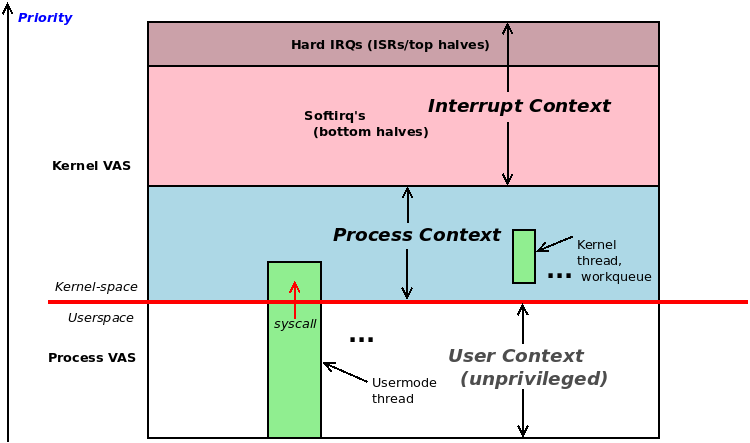
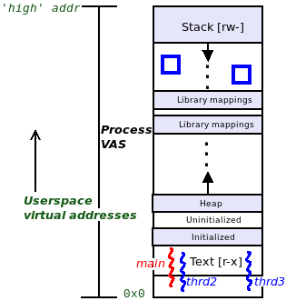
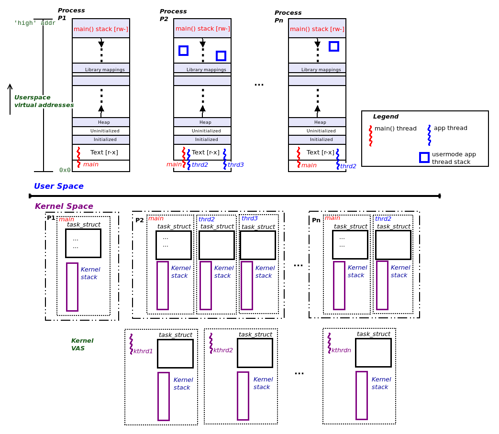
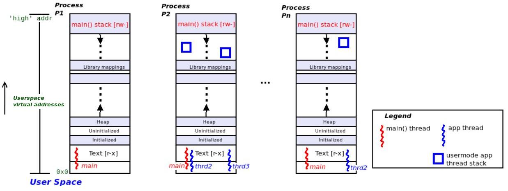
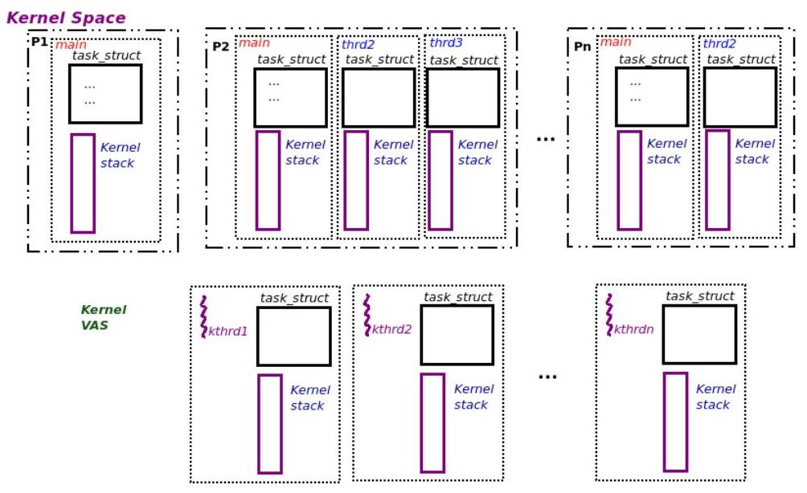
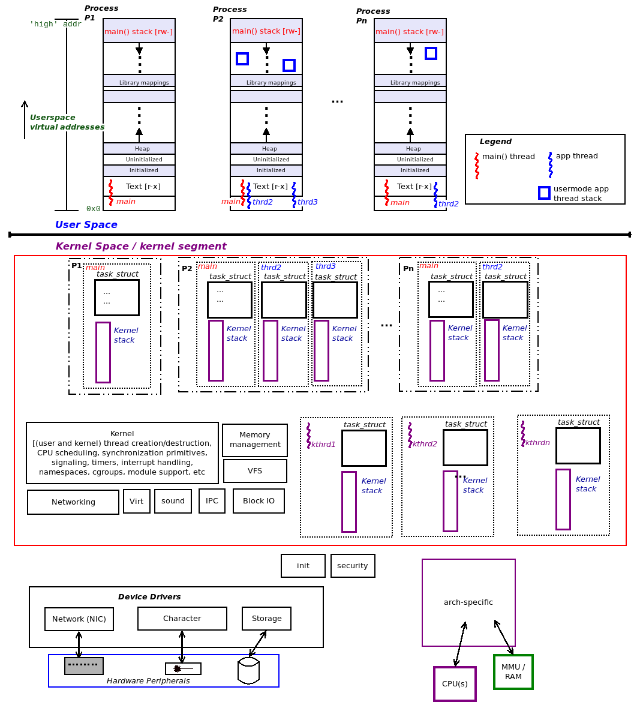
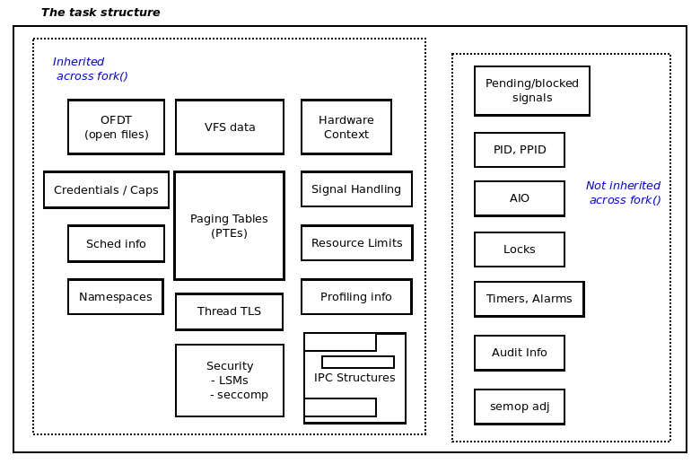

# 4 - 进程和线程

这一章讲三件事：内核代码运行在什么上下文（进程上下文 vs 中断上下文）、进程的虚拟地址空间（VAS）长什么样、进程/线程的栈在用户态和内核态如何组织。理解"一个线程有两条栈（用户态栈 + 内核态栈）"这条主线，是理解内核并发、内存管理和同步的基础。

## 一、进程上下文与中断上下文

进入内核态的方式不止系统调用一条。前面看到的都是进程**主动**发起系统调用、从用户态切进内核态；还有一条**异步**的通路——很多设备驱动的中断代码路径，就是由外部硬件中断触发、进入内核态执行的。这种情形下执行的内核代码处于**中断上下文（interrupt context）**。

因此，任何一段内核代码，要么从进程上下文进入、要么从中断上下文进入，只有这两种：

| 上下文 | 进入方式 | 特征 |
| --- | --- | --- |
| **进程上下文（Process context）** | 系统调用，或处理器异常（如缺页故障） | 同步的，自上而下 |
| **中断上下文（Interrupt context）** | 外设芯片的硬件中断 | 异步的，自下而上 |



图 6.1 给出了概念视图：用户态进程和线程在无特权的**用户上下文**里执行；用户态线程通过发起系统调用，切到特权级的**内核态**。图里还展示了 Linux 中的**纯内核线程**——它和用户态线程很像，关键区别在于它只在内核空间执行，看不到用户的虚拟地址空间。

- 通过系统调用（或处理器异常）**同步**切到内核态后，任务执行的是进程上下文里的内核代码（内核线程跑内核代码也属于进程上下文）。
- **硬件中断**则不同：它**异步**地进入内核，所执行的代码（通常是设备驱动的中断处理程序）运行在中断上下文里。

## 二、进程虚拟地址空间（VAS）基础

用户的 VAS 被划分成一段段同质的内存区域，称为**段（segment）**，更技术性的叫法是**映射（mapping）**。每个 Linux 进程至少有这么几段映射：



| 段 | 权限 | 说明 |
| --- | --- | --- |
| **Text 段** | `r-x` | 存放机器码，静态 |
| **Data 段** | `rw-` | 存放全局变量和静态变量，内部又分三小段（见下） |
| **库（text/data）** | `r-x` / `rw-` | 进程动态链接进来的所有共享库，由加载器在运行时映射进 VAS |
| **栈（Stack）** | `rw-` | 后进先出（LIFO），实现高级语言的函数调用机制 |

Data 段内部还细分成三个不同的段：

1. **已初始化数据段**：存放预先初始化过的变量，静态；
2. **未初始化数据段**：存放未初始化的变量（运行时自动清零），这块区域常被称为 **bss**，静态；
3. **堆段（Heap）**：`malloc` 一族的内存分配/释放 API 从这里取内存。不过这话不完全对——现代系统上，只有小于 `MMAP_THRESHOLD`（默认 128 KB）的 `malloc()` 才从堆里分配；更大一点的，则改为通过 `mmap` 系统调用，在进程 VAS 里单独开一块"映射"。堆是**动态**段，可伸缩，堆上最后一个合法可引用的位置称为**程序断点（program break）**。

栈是另一个**动态**段：用后进先出（LIFO）语义实现函数调用，涵盖参数传递、局部变量的创建与销毁、返回值的传递。在所有现代处理器（包括 x86 和 ARM 家族）上，栈都朝**低地址**方向"生长"（称为完全递减栈）；每次函数调用都会分配并初始化一个**栈帧**，其精确布局高度依赖 CPU（需查阅对应 CPU 的 ABI 文档）。`SP` 寄存器（或等价物）总是指向当前帧，也就是栈顶；因为栈朝低虚拟地址生长，栈顶反而是**最低**的虚拟地址——反直觉，但确实如此。

## 三、进程、线程及其栈的组织：用户态与内核态

传统的 UNIX 进程模型是"**一切皆文件**"的反面——"一切皆进程；不是进程就是文件"。

**线程是进程内的一条执行路径**。线程共享进程的所有资源（包括用户 VAS），唯独栈除外——每个线程都有自己私有的栈区域。

下一个关键点：**CPU 支持的每个特权级别，每条线程都要有一条栈**。现代操作系统（如 Linux）支持两级特权——无特权的用户态（用户空间）和有特权的内核态（内核空间）。因此，Linux 上每个存活的用户态线程都有**两条栈**：

| 栈 | 何时使用 |
| --- | --- |
| **用户空间栈** | 线程执行用户态代码路径时 |
| **内核空间栈** | 线程通过系统调用或异常切到内核态、在内核里执行代码（进程上下文）时 |



图 6.3 把地址空间切成两半——用户空间和内核空间。图上半部分是用户空间：若干进程和它们各自的用户 VAS；下半部分是内核空间：每个用户态线程都对应一个内核元数据结构（`task_struct`）和该线程的内核态栈。此外，最底部还有三个内核线程（`kthrd1`、`kthrd2`、`kthrdn`），它们同样各有一个 `task_struct` 和一条内核态栈。

用下面这个 Bash 脚本（`ch6/countem.sh`）数一下当前存活的进程和线程：

```shell
cd ../ch6
./countem.sh
```

```text
stem release info:
Distributor ID: Ubuntu
Description:    Ubuntu 24.04.5 LTS
Release:        24.04
Codename:       noble

Total # of processes alive              =       525
Total # of threads alive                =      1631
Total # of kernel threads alive         =       311
Thus, total # of usermode threads alive =      1320
```

### 3.1 用户空间的组织

每个进程至少有一条执行线程（`main()` 线程）。下面这张图展示了三个进程 P1、P2、Pn，分别含 1、3、2 条线程（均含 `main()`）。对照前面 `countem.sh` 的输出，Pn 的 n = 525。



每个进程由若干段（技术上叫映射）组成。概括地说，用户态段（映射）如下：

- **Text**：代码，`r-x`；
- **Data 段**：`rw-`，由三个不同的映射组成——已初始化数据段、未初始化数据段（bss）、以及一个"向上生长"的堆；
- **库映射**：进程动态链接的每个共享库的 text 和 data；
- **向下生长的栈**。

上面样例运行显示系统里当前有 1320 个用户态线程存活，对应也就有 1320 条用户空间栈（每条用户态线程一条）。这些用户空间栈可分两类：

- **单线程进程**：`main()` 线程永远有一条用户空间栈，位于用户 VAS 的最顶端（最高地址处）。若进程单线程（只有 `main()`），就只这一条用户态栈；图 6.4 里的 P1 就是这种情形。
- **多线程进程**：每条存活线程（含 `main()`）各有一条用户态线程栈；图 6.4 里的 P2 和 Pn 属于这种情形。这些栈要么在调用 `fork` 时分配（给 `main()`），要么在调用 `pthread_create` 时分配（给进程内其余线程），后者在内核里走的是进程上下文中的这条路径：

```text
sys_fork() --> do_fork() --> _do_fork()
```

另外，Linux 上的 `pthread_create` 库 API 调用的是 `clone` 系统调用，最终落到 `_do_fork`；传入的 `clone_flags` 参数告诉内核如何创建这个"定制进程"——也就是一条线程。

这些用户空间栈也是动态的：它们可以伸缩，上限是栈大小资源限制（`RLIMIT_STACK`，通常 8 MB，可用 `prlimit` 工具查看）。

### 3.2 内核空间的组织



当前系统里有 1320 个用户态线程和 311 个内核线程存活，一共就有 1631 条内核空间栈。前面说过，每个用户态线程有两条栈——一条用户态栈、一条内核态栈。因此，1320 条用户态线程对应 1320 条内核态栈，311 个纯内核线程又各有一条内核态栈（内核线程只有内核态栈，完全看不到用户空间）。内核态栈的特征如下：

- 每个存活的应用（用户态）线程（含 `main()`）都有一条内核态栈；
- 内核态栈**大小固定**且**很小**，32 位系统上是 2 页、64 位系统上是 4 页（一页通常 4 KB）；
- 它在创建线程时分配（通常都归结到 `_do_fork()`）。

每个用户态线程都有两条栈——一条用户态栈、一条内核态栈。例外是内核线程：它们只有内核态栈（因为不持有用户映射，也就没有用户空间的"段"）。图 6.5 的下半部分画了三个内核线程——`kthrd1`、`kthrd2`、`kthrdn`（对照样例运行，kthrdn 的 n = 311）。每个内核线程创建时也各分配一个 task 结构和一条内核态栈。

内核态栈在多数方面和用户态栈类似——每次函数调用都会建一个栈帧，CPU 用一个寄存器跟踪当前栈位置（通常叫栈指针 SP），栈朝低虚拟地址"生长"。区别在于，用户态栈是动态的，内核态栈大小固定且很小。

另外，很多架构（包括 x86 和 ARM64）还支持一条**独立的中断处理栈（per-CPU）**。外部硬件中断发生时，CPU 控制单元立即把控制权转交给（很可能是设备驱动里的）中断处理代码；这条独立的中断栈用于承载中断代码路径的栈帧，避免给被中断进程/线程那条本就很小的内核态栈增加负担。

### 3.3 查看用户态栈与内核态栈

栈怎么"看"？内核通过它暴露内部信息的惯用机制——强大的 **proc 文件系统**——把栈展示给用户空间。

#### 传统方法：分两个工具看

**看某线程/进程的内核态栈**

Linux 内核通过 proc 接口把内核态栈暴露出来，直接读 `/proc/<PID>/stack` 即可。先在本机演示：`/proc/self/stack` 里的 `self` 指向当前进程，即这个 `cat` 命令本身：

```shell
sudo cat /proc/self/stack
```

```text
[<0>] proc_pid_stack+0xed/0x170
[<0>] proc_single_show+0x56/0xe0
[<0>] seq_read_iter+0x132/0x4b0
[<0>] seq_read+0x11c/0x160
[<0>] vfs_read+0xb4/0x3a0
[<0>] ksys_read+0x73/0x100
[<0>] __x64_sys_read+0x19/0x30
[<0>] x64_sys_call+0x1bf0/0x25a0
[<0>] do_syscall_64+0x7f/0x180
[<0>] entry_SYSCALL_64_after_hwframe+0x78/0x80
```

（注意：读 `/proc/<PID>/stack` 需要 root 权限，普通用户会被拒绝。）

输出里每一行都代表栈上的一个**调用帧**。读懂内核栈回溯，要记住几个要点：

- 要**自下而上**读（从底部第一行读到顶部最后一行）——底部通常是系统调用入口（`entry_SYSCALL_64_...`），越往上越接近此刻正在执行的函数，最顶行是调用链最深处；
- 每一行是一个调用帧，也就是调用链里的一个函数；
- 函数名显示为 `??`，表示内核对这一帧拿不准——这是无效的栈帧（残留的"杂音"），不用管它，内核的回溯代码基本是对的；
- 在 Linux 上，`foo()` 系统调用在内核里通常对应一个 `SyS_foo()` 函数；并且（常见但非必然）`SyS_foo()` 只是个包装，真正干活的是 `do_foo()`。内核代码里的 `SYSCALL_DEFINEn(foo, ...)` 宏就展开成 `SyS_foo()` 例程，后缀 `n` 取值 [0, 6]，表示该系统调用从用户空间传给内核的参数个数。

对照上面的真实输出，调用链就能读通：`cat` 进程正在读 `/proc/self/stack`，于是 `do_syscall_64()` 进入系统调用分发，`x64_sys_call` 命中 `read`，再到 `__x64_sys_read()` → `ksys_read()` → `vfs_read()` → `seq_read()` → `seq_read_iter()`，最后由 `proc_single_show()` → `proc_pid_stack()` 把 `/proc/<PID>/stack` 这个 seqfile 的内容读出来。

> 注意：最左列每个栈帧的 `[<0>]` 是该函数代码（text）地址的占位符。出于安全考虑（防止信息泄露），现代内核一律把它置零，所以这里显示的总是 `0`。
>
> 另一处新旧差异：原书里系统调用入口写的是 `SyS_foo()`，而 5.x 的 x86-64 内核（开了 `CONFIG_ARCH_HAS_SYSCALL_WRAPPER`）里已经变成 `__x64_sys_foo()` 的形式，如上面输出里的 `__x64_sys_read`。名字变了，但"一系统调用对应一个内核入口函数"的规律不变。

再看本机真实 Bash 进程。先 `ps -eo pid,comm,args | grep -w bash` 找到那个交互式 shell 的 PID（这里是 9914），再看它的内核态栈：

```shell
sudo cat /proc/9914/stack
```

```text
[<0>] do_wait+0x5c/0x110
[<0>] kernel_wait4+0xbd/0x170
[<0>] __do_sys_wait4+0xad/0xc0
[<0>] __x64_sys_wait4+0x1c/0x30
[<0>] x64_sys_call+0x1fbf/0x25a0
[<0>] do_syscall_64+0x7f/0x180
[<0>] entry_SYSCALL_64_after_hwframe+0x78/0x80
```

这样就清楚了：这个 Bash 此刻正在执行 `do_wait()`，它是经 `wait4()` 系统调用进来的，中间由 `x64_sys_call` 分发命中 `__x64_sys_wait4`。这很合理——shell 的工作方式就是 `fork` 出子进程，再调 `wait4(2)` 等它结束。

**看某线程/进程的用户态栈**

有点反讽的是，在典型 Linux 发行版上，看进程/线程的**用户态**栈反而更麻烦。有个工具能干这个：`gstack(1)`。它其实是个小脚本包装，让 `gdb(1)` 以批处理模式跑 `thread apply all bt`（对每个线程做全回溯），再过滤掉 gdb 的杂音，只留干净的回溯。Ubuntu 仓库里没有 gstack 这个包，本机就装了个等价的小脚本（内容就是上述 gdb 包装），装好后直接：

```shell
sudo gstack 9914
```

```text
Thread 1 (Thread 0x7889fc18c740 (LWP 9914) "bash"):
#0  0x00007889fbf108d7 in __GI___wait4 (pid=-1, stat_loc=0x7fffa5892ae0, options=0, usage=0x0) at ../sysdeps/unix/sysv/linux/wait4.c:30
#1  0x00005d65208436f3 in ?? ()
#2  0x00005d6520790f38 in wait_for ()
#3  0x00005d6520773a62 in execute_command_internal ()
#4  0x00005d6520773c6e in execute_command ()
#5  0x00005d6520773272 in execute_command_internal ()
#6  0x00005d6520773c6e in execute_command ()
#7  0x00005d6520773e0f in ?? ()
#8  0x00005d652077106a in execute_command_internal ()
#9  0x00005d6520773c6e in execute_command ()
#10 0x00005d652076610c in reader_loop ()
#11 0x00005d6520759efb in main ()
```

它和 gdb 的 `bt` 输出其实是一回事，只是 gstack 滤掉了 `[Thread debugging...]` 那类杂音，并带上线程名 `"bash"`。同样自下而上读：Bash 执行这条命令的链路是 `main()` → `reader_loop()` → 层层 `execute_command()` → `wait_for()`，最终落到 `wait4(2)` 系统调用（帧 `#0`）——和上面内核态栈里的 `do_wait/wait4` 对得上。帧 `#1`、`#7` 显示 `??`，对应前面说的"内核对这一帧拿不准"，无需理会。

#### 现代方法：[e]BPF 一次性看两条栈

**[e]BPF**（extended Berkeley Packet Filter）是 4.x 内核才引入的技术，让用户、工具或脚本能安全地把一小段字节码注入内核运行——不只用于抓网络包，也用于大规模的性能观测和追踪。上面的"传统方法"要用两个工具分别看内核态和用户态栈；用 BPF 一个工具就能同时显示两条栈。

围绕 eBPF 的两套常用前端是 **BCC** 和 **bpftrace**，都很实用。这里只用 BCC 里的 `stackcount` 做个快速演示——它对命中某个事件的调用栈计数。本机装的是 Ubuntu 的 `bpfcc-tools` 包，装好后命令名带 `-bpfcc` 后缀：`stackcount-bpfcc`。它默认持续采样、按 Ctrl-C 收尾打印，所以演示时用 `-D 6` 指定只采 6 秒，`-d` 会在内核态栈和用户态栈之间打一个 `--` 分隔符：

```shell
sudo stackcount-bpfcc -D 6 -d 'ksys_read'
```

```text
Tracing 1 functions for "ksys_read"... Hit Ctrl-C to end.

  ksys_read
  x64_sys_call
  do_syscall_64
  entry_SYSCALL_64_after_hwframe
    --
  [unknown]
  [unknown]
  ...（若干行 [unknown]）
    1
```

`-d` 打出的 `--` 就是内核态栈与用户态栈的分界线：上面四行是内核侧（`entry_SYSCALL_64_after_hwframe` → `do_syscall_64` → `x64_sys_call` → `ksys_read`，与 `/proc/<PID>/stack` 里看到的是同一条链路），下面本该是用户侧。用户侧之所以全是 `[unknown]`，是因为这台机器上执行 `read` 的进程没带帧指针（默认编译会省略），BCC 无法回溯用户栈；要解析出用户侧符号，得给进程加 `-fno-omit-frame-pointer` 重新编译，或用 `-v` 看原始地址。

原书那条 `stackcount -r ".*malloc.*"` 是用正则匹配 malloc 调用；注意这个模式既能匹配用户态的 `malloc`/`mmap`，也能命中内核里名字带 `kmalloc`/`vmalloc` 的函数（本机实测 `.*malloc.*` 匹配到了 75 个内核函数），不加别的过滤会输出一大片。

### 3.4 进程 VAS 的全局视图

除了前面看到的进程用户空间段、（用户态和内核态）线程、内核态栈，内核里还有大量元数据：task 结构、内核线程、内存描述符元数据结构等。它们都是内核 VAS（常叫**内核段**）的一部分。内核段里远不止 task 和栈，还有静态的内核（核心）代码和数据，也就是内核所有大大小小的子系统。

下面这张图把上述信息汇总在一起：



图里内核段中的红框圈住的是**核心内核代码与数据**——各大内核子系统，同时画出了 task 结构和内核态栈。红框之外算是"非核心"部分，主要是设备驱动。

## 四、理解并访问内核 task 结构

前几节提到的"内核给每个线程都配的元数据"，就是这一节的 **task 结构**（`include/linux/sched.h:struct task_struct`）。每个进程由一条或多条线程组成，每条线程都对应一个这样的内核数据结构。

它常被叫做"进程描述符（process descriptor）"，容易造成混乱；"task 结构"这个叫法更准确——它描述的是一个**可运行的任务（runnable task）**，也就是一条线程。

task 结构是线程的"根"元数据结构，保存了 OS 为这条线程维护的全部信息：内存（段、页表、用量等）、CPU 调度细节、当前打开的文件、凭据、能力位掩码、定时器、锁、异步 I/O（AIO）上下文、硬件上下文、信号、IPC 对象、资源限制，以及（可选的）审计/安全/性能剖析信息等。



从图 6.8 能看到，task 结构装下了系统里每个存活任务（进程/线程，包括内核线程）的海量信息，图里用分格形式展示了它封装的各类属性。另外，有些属性会在 `fork(2)`（或 `pthread_create(3)`）时被子进程/子线程**继承**，有些则不会被继承、而是直接**重置**（内核态栈就是单独分配的）。内核能"识别"一个任务是进程还是线程，后面的内核模块（`ch6/foreach/thrd_showall`）会演示判断方法。

### 4.1 看看 task 结构里装了什么

task 结构定义在内核头文件 `include/linux/sched.h` 里。下面是从本机 5.15 源码 `struct task_struct` 摘出的几组关键成员（字段行号均对得上，注释为后加），涉及内存管理（`mm`）、PID/TGID、凭据结构、打开的文件、信号处理等，这里不逐个讲透，合适之处后面章节再展开：

```c
struct task_struct {
    [...]
    struct mm_struct		*mm;		/* 内存管理信息 */
    struct mm_struct		*active_mm;
    [...]
    pid_t				pid;
    pid_t				tgid;		/* PID 和 TGID，见下 */
    [...]
    /* 上下文切换计数： */
    unsigned long			nvcsw;
    unsigned long			nivcsw;
    [...]
    /* 生效（可覆盖）的主观 task 凭据（COW）： */
    const struct cred __rcu		*cred;
    [...]
    char				comm[TASK_COMM_LEN];	/* task 名字 */
    [...]
    /* 打开文件的信息： */
    struct files_struct		*files;	/* 指向"打开文件"数据结构的指针 */
    [...]
    /* 信号处理程序： */
    struct signal_struct		*signal;
    struct sighand_struct __rcu		*sighand;
    sigset_t			blocked;
    sigset_t			real_blocked;
    [...]
#ifdef CONFIG_VMAP_STACK
    struct vm_struct		*stack_vm_area;
#endif
    [...]
#ifdef CONFIG_SECURITY
    /* 供 LSM 模块做访问限制： */
    void				*security;
#endif
    [...]
    /* 该 task 的 CPU 相关状态： */
};
```

几个最常用的成员单独说明如下：

| 成员 | 含义 |
| --- | --- |
| `pid` / `tgid` | task 的 PID 与 TGID（线程组 ID），后文细讲 |
| `comm[]` | 任务名，长度上限 `TASK_COMM_LEN`（16 字节） |
| `mm` / `active_mm` | 地址空间描述符；内核线程的 `mm` 为 NULL，用 `active_mm` 借用 |
| `cred` | 任务的客观凭据（权限、UID/GID 等） |
| `files` | 打开的文件描述符表 |
| `signal` / `sighand` / `blocked` | 信号相关（共享信号结构、信号处理程序 `__rcu`、阻塞位掩码） |
| `stack_vm_area` | 只有 `CONFIG_VMAP_STACK` 时才有，指向 vmalloc 内核栈的 vm 区域 |

### 4.2 用 current 访问 task 结构

内核内存里所有的 task 结构对象，都串在一条**循环双向链表**上，叫 task list。这样各种内核代码（常见如 procfs）才能遍历它们。但问题来了：当某个进程或线程正在内核里跑（进程上下文）时，面对内存里成百上千个 `task_struct`，它怎么知道哪个是自己的？

答案就是 **`current`**：

- 取 `current` 得到的是"此刻正在这块 CPU 核上执行内核代码的那条线程"的 `task_struct` 指针，也就是当前运行中的那个进程上下文。
- `current` 类似于面向对象语言里的 `this` 指针（但不完全等同）。

`current` 宏的实现高度依赖架构，这里不深入细节，只说一点：它被精心设计得极快（通常 O(1)）。比如在通用寄存器较多的一些 RISC 架构（PowerPC、AArch64）上，干脆专门用一个寄存器来存 `current`。

建议自行查阅内核源码中 `current` 的实现（在 `arch/<arch>/asm/current.h`）。本机 5.15 源码里三个典型实现，差异一目了然：

```c
// arch/arm64/include/asm/current.h —— 专门存进 sp_el0 寄存器，极快
static __always_inline struct task_struct *get_current(void)
{
	unsigned long sp_el0;

	asm ("mrs %0, sp_el0" : "=r" (sp_el0));

	return (struct task_struct *)sp_el0;
}
#define current get_current()
```

```c
// arch/x86/include/asm/current.h —— 用 per-CPU 变量保存（免去代价高昂的锁）
DECLARE_PER_CPU(struct task_struct *, current_task);

static __always_inline struct task_struct *get_current(void)
{
	return this_cpu_read_stable(current_task);
}
#define current get_current()
```

```c
// arch/arm/include/asm/thread_info.h —— ARM32 用 O(1) 计算从栈指针推出
static inline struct thread_info *current_thread_info(void)
{
	return (struct thread_info *)
		(current_stack_pointer & ~(THREAD_SIZE - 1));
}
```

总结各架构的做法：

| 架构 | current 的实现 |
| --- | --- |
| ARM32 | O(1) 计算：从当前栈指针按 `THREAD_SIZE` 对齐，推出 `thread_info`（内含 task） |
| AArch64 / PowerPC | 专门用一个寄存器（如 `sp_el0`）存 `current`，查询快如闪电 |
| x86_64 | 用 per-CPU 变量 `current_task` 保存，避开昂贵的锁 |

代码里只要 `#include <linux/sched.h>`，就能用 `current` 解引用 task 结构、从中读取信息。比如取当前进程/线程的 PID 和名字：

```c
#include <linux/sched.h>
current->pid;     // PID
current->comm;    // 名字（char [TASK_COMM_LEN]）
```

### 4.3 判断代码跑在什么上下文

前面已经知道，内核代码要么跑在进程上下文、要么跑在中断（原子）上下文——二者互斥，任一时刻只能取其一。

写内核/驱动代码时，第一步往往要弄清这段代码跑在哪个上下文，可用这个宏：

```c
#include <linux/preempt.h>
in_task()
```

它返回布尔值：`True` 表示跑在进程（task）上下文，此时通常**可以安全睡眠**；返回 `False` 说明代码处于某种原子/中断上下文里，那里**绝不能睡眠**。

本机 5.15 的实现（`include/linux/preempt.h`）是一整套宏，`in_task()` 只是其中一个：

```c
/*
 * 获取当前执行上下文的宏：
 * in_nmi()             - NMI 上下文
 * in_hardirq()         - 硬中断上下文
 * in_serving_softirq() - 软中断上下文
 * in_task()            - 进程（task）上下文
 */
#define in_nmi()		(nmi_count())
#define in_hardirq()		(hardirq_count())
#define in_serving_softirq()	(softirq_count() & SOFTIRQ_OFFSET)
#define in_task()		(!(in_nmi() | in_hardirq() | in_serving_softirq()))

/* 以下宏已废弃，新代码别用：
 * in_irq()       - in_hardirq() 的过时别名
 * in_softirq()   - BH 被禁用或正在处理软中断
 * in_interrupt() - 处于 NMI/IRQ/软中断上下文，或 BH 被禁用
 */
```

`in_task()` 就是"既不在 NMI、不在硬中断、不在软中断"的补集——排除所有原子上下文后，剩下的就是可睡眠的进程上下文。这也是判断"此处能否睡眠"的常用工具。

## 五、用 current 操作 task 结构：current_affairs 模块

上面只是零散地看 `current`，下面用一个完整的内核模块 `ch6/current_affairs` 演示怎么通过 `current` 直接解引用 task 结构的各个成员，并把它们打印到内核日志缓冲。核心是 `show_ctx()` 函数：

```c
// ch6/current_affairs/current_affairs.c（节选）
#include <linux/sched.h>	/* current() */
#include <linux/preempt.h>	/* in_task() */
#include <linux/cred.h>		/* current_{e}{u,g}id() */
#include <linux/uidgid.h>	/* {from,make}_kuid() */

static inline void show_ctx(char *nm)
{
	/* 用 helper 方法取 UID/EUID */
	unsigned int uid = from_kuid(&init_user_ns, current_uid());
	unsigned int euid = from_kuid(&init_user_ns, current_euid());

	pr_info("%s:%s():%d ", nm, __func__, __LINE__);
	if (likely(in_task())) {
		pr_info("%s: in process context ::\n"
			" PID         : %6d\n"
			" TGID        : %6d\n"
			" UID         : %6u\n"
			" EUID        : %6u (%s root)\n"
			" name        : %s\n"
			" current (ptr to our process context's task_struct) :\n"
			"               0x%pK (0x%px)\n"
			" stack start : 0x%pK (0x%px)\n", nm,
			/* 推荐用 helper 方法 */
			task_pid_nr(current), task_tgid_nr(current),
			/* ...而不是直接 current->pid, current->tgid */
			uid, euid,
			(euid == 0 ? "have" : "don't have"),
			current->comm,
			current, current,
			current->stack, current->stack);
	} else
		pr_alert("%s: in interrupt context [Should NOT Happen here!]\n", nm);
}

static int __init current_affairs_init(void)
{
	pr_info("%s: inserted\n", OURMODNAME);
	pr_info(" sizeof(struct task_struct)=%zd\n", sizeof(struct task_struct));
	show_ctx(OURMODNAME);
	return 0;		/* success */
}

static void __exit current_affairs_exit(void)
{
	show_ctx(OURMODNAME);
	pr_info("%s: removed\n", OURMODNAME);
}

module_init(current_affairs_init);
module_exit(current_affairs_exit);
```

`init`/`exit` 里都调 `show_ctx()`，所以插入和卸载时各打印一次。上面代码也确实演示了：有些成员可以直接 `current` 解引用拿到；但不是所有成员都该这么直接访问，内核给了一组 helper 方法来安全地取它们，下面接着讲。

### 5.1 内置 helper 方法与 likely/unlikely 优化

上面的代码用了几个内核内置 helper 来提取 task 结构成员，这也是**推荐做法**——比如用 `task_pid_nr(current)` 而不是直接 `current->pid`。同理，task 结构里的进程凭据被抽象进 `struct cred`，访问它们也走 helper 例程，例如上面用到的 `from_kuid()`。类似的 helper 还有很多，都在 `include/linux/sched.h` 里 `struct task_struct` 定义的正下方，需要时去查即可。

另外，代码里用 `in_task()` 宏就能判断内核模块代码是跑在进程上下文还是中断上下文——`True` 表示进程（task）上下文，`False` 则相反。

还有个值得注意的细节：`likely()` 宏（展开成编译器内建 `__builtin_expect`）给编译器的分支预测一个提示，让指令序列更贴合 CPU 流水线，让代码始终走在"快路径"上。你在内核代码里会经常看到 `likely()`/`unlikely()` 成对出现——开发者"知道"某条路径大概率/小概率走时，就用它来提示编译器的分支预测（这个微优化的细节见本章的 Further reading）。`likely(in_task())` 的意思是：大多数情况下都处于进程上下文，把这条路径当作默认的"快路径"。

### 5.2 运行模块：打印进程上下文信息

模块用 `build.sh` 编译出的 5.15 内核树来编译（`out/x86_64`，版本 5.15.0+），`KDIR` 指向它即可：

```shell
$ make KDIR=/home/linxi/DevKit/Projects/github_learning/linux-5.15/out/x86_64
$ modinfo current_affairs.ko | grep vermagic
vermagic:       5.15.0+ SMP mod_unload
```

编译出的 `.ko` 版本必须和运行它的内核一致，才能真正跑起来；本机是 6.8，所以把 `.ko` 放进 QEMU 的共享目录，用 `run_qemu.sh --debug` 启动 5.15 内核来加载。这个共享目录在宿主机是 `~/kernel-lab-x86_64/`（`run_qemu.sh` 里 `host-shared` 这个 9p tag 对应的目录），进 QEMU 后挂载到 `/mnt`，所以下面写 `/mnt/current_affairs.ko`（换个环境就换成你自己的共享目录/挂载点）。进 shell 后先挂载虚拟文件系统和共享目录，再 `insmod`：

```shell
$ cd linux-5.15 && ./shell_scripts/run_qemu.sh --debug
# mount -t proc proc /proc
# mount -t sysfs sysfs /sys
# mount -t 9p -o trans=virtio,version=9p2000.L host-shared /mnt
# insmod /mnt/current_affairs.ko
# dmesg | grep -A9 "process context"
[ 19.741064] current_affairs: inserted
[ 19.741886]  sizeof(struct task_struct)=7104
[ 19.742883] current_affairs: in process context ::
                PID         :    105
                TGID        :    105
                UID         :      0
                EUID        :      0 (have root)
                name        : insmod
                current (ptr to our process context's task_struct) :
                              0x00000000789ec63d (0xffffa27f0195eac0)
                stack start : 0x00000000cb464fb0 (0xffffb4ab80194000)
```

卸载（QEMU 里需先挂好 `/proc`、`/sys`，否则 kmod 库读不到 `/proc/modules`、`/sys/module/...` 会报错）：

```shell
# rmmod current_affairs
# dmesg | grep -A9 "process context"
[ 24.749540] current_affairs: in process context ::
                PID         :    109
                TGID        :    109
                UID         :      0
                EUID        :      0 (have root)
                name        : rmmod
                current (ptr to our process context's task_struct) :
                              0x00000000f52f4d7b (0xffffa27f0195cc40)
                stack start : 0x0000000074750966 (0xffffb4ab80184000)
[ 24.758907] current_affairs: removed
```

输出说得很清楚：运行 `current_affairs.ko:current_affairs_init()` 这段代码的进程上下文，是 **insmod 进程**（看 `name : insmod`）；而执行清理代码 `current_affairs_exit()` 的进程上下文，是 **rmmod 进程**。顺带看到 `sizeof(struct task_struct)=7104`——5.15 里这个结构有 7 KB 出头。

#### 看到 Linux 是宏内核

除了练习 `current` 的用法，`current_affairs` 这个模块还想说明一点——**Linux 是宏内核**。上面看到，`insmod(8)` 把模块文件 `current_affairs.ko` 插进内核、init 代码随之运行，那这段代码是谁跑的？答案就在输出里：**就是 insmod 进程自己在进程上下文里跑的**——模块的代码直接并入内核、由现有进程执行，这正是宏内核的特征（`rmmod` 同理，清理代码由 rmmod 进程在进程上下文执行）。

当然，这种"由进程执行内核代码"就是我们说的进程上下文，区别于中断上下文。不过 Linux 也并非"纯粹"的宏内核（那样它就该是一整块硬编码的内存），和所有现代 OS 一样，Linux 同样支持模块化。

#### 用 printk 安全打印地址：%pK

上面 `current_affairs.c` 里打印指针用了 `%pK` 这个"特殊"格式符，相关代码再贴一次：

```c
pr_info(
	[...]
	" current (ptr to our process context's task_struct) :\n"
	" 0x%pK (0x%px)\n"
	" stack start : 0x%pK (0x%px)\n",
	[...]
	current, (long unsigned)current,
	current->stack, (long unsigned)current->stack); [...]
```

打印地址时（首先，生产环境本就不该打印内核地址），别用普通的 `%p` 或 `%px`，而要用 `%pK`——出于安全，防止内核信息泄露。在安全调优过的系统上，`%pK` 只会显示一个哈希值而非真实地址；代码里同时用 `0x%px` 显示真实地址，纯粹是为了对比。

看 5.2 的真实输出就一目了然：`%pK` 打出的 `0x00000000789ec63d` 是**哈希值**，而 `%px` 打出的 `0xffffa27f0195eac0` 才是**真实内核地址**——两者不同，说明这个 5.15 内核默认启用了 `kptr_restrict`，`%pK` 做了地址哈希。对比之下，书里用的 Ubuntu 18.04 桌面系统上 `%pK` 却没生效，和 `%px` 打印出一模一样的值，那是因为它的 `kptr_restrict=0`。所以 `%pK` 到底出不出哈希，取决于内核的 `kptr_restrict` 配置。

## 六、遍历内核的 task 列表

前面说过，所有 task 结构在内核内存里组织成一条链表，叫 **task list**（这样才能遍历它们）。这个链表数据结构演化成了 Linux 里非常常用的**循环双向链表**；处理链表的核心代码被抽到了 `list.h` 头文件里，任何基于链表的工作都该用它。

遍历 task 相关链表的便捷宏，在 `include/linux/sched/signal.h` 里提供。

### 6.1 遍历所有进程：for_each_process

内核提供了 `for_each_process()` 宏，让你轻松遍历 task list 里的每一个进程：

```c
// include/linux/sched/signal.h
#define for_each_process(p) \
for (p = &init_task ; (p = next_task(p)) != &init_task ; )
```

宏展开成一个 `for` 循环，在循环链表上转圈。`init_task` 是个方便的"头"/起始指针——指向第一个用户空间进程的 task 结构，传统上是 init(1)，现在是 systemd(1)（本机 QEMU 用 `init=/bin/sh`，所以第一个用户进程是 `sh`）。

`ch6/foreach/prcs_showall` 模块用它遍历所有进程并打印。本机 5.15 QEMU 实际运行：

```shell
# insmod /mnt/prcs_showall.ko
# dmesg | grep prcs_showall -A4
[   19.729239] prcs_showall: inserted
[   19.730061]      Name       |  TGID  |   PID  |  RUID |  EUID
[   19.731395] sh              |       1|       1|      0|      0
[   19.732735] kthreadd        |       2|       2|      0|      0
[   19.734085] rcu_gp          |       3|       3|      0|      0
...
[   19.827309] insmod          |     105|     105|      0|      0
[   19.828528] prcs_showall: total # of processes on system: 76
```

遍历出 76 个进程：从 PID 1 的 `sh`（QEMU 的 init），到一堆内核线程（`kthreadd`、`rcu_gp`、`kworker/*`…），再到 `insmod` 自己（PID 105）。每个进程的 TGID 都等于 PID——因为这里都是单线程进程，TGID/PID 的区别下面再讲。

### 6.2 遍历所有线程：do_each_thread

要遍历系统里每一条存活的线程，用 `do_each_thread() { ... } while_each_thread()` 这对宏。`ch6/foreach/thrd_showall` 就是干这个的。本机 5.15 QEMU 运行的关键片段（完整输出太长，只摘头和尾）：

```shell
# insmod /mnt/thrd_showall.ko
# dmesg | grep thrd_showall -A6
[   19.752244] thrd_showall: inserted
------------------------------------------------------------------------------------------
    TGID     PID         current           stack-start         Thread Name     MT? # thrds
------------------------------------------------------------------------------------------
        0        0   0xffffffffa8414940  0xffffffffa8400000 [       swapper/0]
        1        1   0xffff891f802a8000  0xffff9b72c0010000                sh 
        2        2   0xffff891f802a8f40  0xffff9b72c0018000 [        kthreadd]
        3        3   0xffff891f802a9e80  0xffff9b72c0020000 [          rcu_gp]
...
      105      105   0xffff891f80935b80  0xffff9b72c0194000            insmod 
[   19.894501] thrd_showall: total # of threads on the system: 77
```

几个观察点：

- **内核态栈起始地址都以 0 结尾**（第四列，如 `0xffffffffa8400000`、`0xffff9b72c0010000`），说明栈区总是页对齐（0x1000 = 4096）。
- 按惯例，**内核线程的名字用方括号括起来**（`[swapper/0]`、`[kthreadd]`），用户态线程不加（`sh`、`insmod`）。
- 第一条是 CPU 0 的 idle 线程 `swapper/0`（PID 0）；`do_each_thread` 的循环不从它开始遍历，所以模块单独用 `init_task` 把它打出来（`init_task` 永远指向第一个 CPU 即 core 0 的 idle 线程）。

#### 区分进程与线程：TGID 与 PID

内核用唯一的 task 结构表示每条线程，每条线程又有唯一的 PID，那同一个进程的多条线程怎么共享一个 PID？这违反了 POSIX.1b（pthreads）标准，早期 Linux 确实不合规，造成了移植问题。

为解决这个问题，Red Hat 的 Ingo Molnar 在 2.5 内核系列合入了一个补丁——往 task 结构里加了 **TGID（Thread Group IDentifier，线程组 ID）**。规则是：

| 场景 | tgid 与 pid 的关系 |
| --- | --- |
| 单线程进程 | `tgid == pid` |
| 多线程进程的主线程 | `tgid == pid`（自己的 pid） |
| 多线程进程的其余线程 | 继承主线程的 tgid，但保留各自唯一的 pid |

QEMU 输出里全是单线程，所以每行的 TGID 和 PID 都相等。要看多线程进程的 TGID/PID 差异，在 QEMU 里跑一个用 Python `threading` 开了 4 个子线程的进程（`python3 /mnt/mt.py &`），再用 `thrd_showall` 观察，摘出它的 5 条线程：

```text
 TGID   PID   current             stack-start        Thread Name  MT?# thrds
  105   105   0xffff959700888000  0xffffb8cc00194000  python3       5
  105   106   0xffff9597003c1e80  0xffffb8cc002d0000  python3
  105   107   0xffff9597003c2dc0  0xffffb8cc0016c000  python3
  105   108   0xffff9597003c3d00  0xffffb8cc001a4000  python3
  105   109   0xffff9597003c4c40  0xffffb8cc001ac000  python3
```

第一列 TGID 全是 105，第二列 PID 各不相同（105 是主线程，106~109 是 4 个子线程）。怎么一眼认出主线程？**TGID == PID 的那行就是主线程**；TGID 重复出现说明是多线程进程，其余行的 PID 是子线程的唯一 ID。最右列 `5` 表示这个进程一共有 5 条线程（主线程 + 4 个子线程）。

用户空间用 `ps -LA` 也能看到内核的 TGID/PID 表示。

### 6.3 代码：thrd_showall.c

`ch6/foreach/thrd_showall/thrd_showall.c` 的几个要点：

- 用 `LINUX_VERSION_CODE()` 宏来条件包含头文件（`> KERNEL_VERSION(4,10,0)` 时加 `linux/sched/signal.h`）；
- 锁相关先忽略——`tasklist_lock`、`task_[un]lock()` 这些 API 的用法（这里改用 RCU read lock，因为 `tasklist_lock` 不导出给模块）；
- 别忘了 CPU 的 idle 线程。每个核都有专门的 idle 线程（名叫 `swapper/n`，n 是核号，从 0 开始），`do..while` 循环不从它开始遍历（`ps` 也不显示它），模块单独用 `init_task` 把它打出来（`init_task` 始终是 core 0 的 idle 线程）。

核心的遍历循环长这样：

```c
static inline void disp_idle_thread(void)
{
	struct task_struct *t = &init_task;

	/* 已知 swapper 是内核线程，名字用方括号 */
	pr_info("%8d %8d   0x%px  0x%px [%16s]\n",
		t->pid, t->pid, t, t->stack, t->comm);
}

static int showthrds(void)
{
	struct task_struct *g = NULL, *t = NULL; /* g: 进程指针；t: 线程指针 */
	[...]
	rcu_read_lock();
	do_each_thread(g, t) {           /* 遍历全部 task 结构 */
		task_lock(t);

		snprintf(buf, BUFMAX-1, "%8d %8d ", g->tgid, t->pid);
		[...]
		if (!g->mm) {                /* 内核线程：没有用户映射 */
			snprintf(tmp, TMPMAX-1, " [%16s]", t->comm);
		} else {
			snprintf(tmp, TMPMAX-1, "  %16s ", t->comm);
		}
		[...]
		/* 是多线程进程的主线程吗？看 (a) 是用户态、(b) TGID==PID、(c) 线程数>1 */
		nr_thrds = get_nr_threads(g);
		if (g->mm && (g->tgid == t->pid) && (nr_thrds > 1)) {
			snprintf(tmp, TMPMAX-1, " %3d", nr_thrds);
			snprintf(buf, BUFMAX-1, "%s%s", buf, tmp);
		}
		[...]
		pr_info("%s", buf);
		total++;
		task_unlock(t);
	} while_each_thread(g, t);
	rcu_read_unlock();

	return total;
}
```

关键逻辑：`g` 是进程（线程组）指针、`t` 是线程指针；`g->tgid` 给第一列、`t->pid` 给第二列，就能同时看清"属于哪个进程"和"是哪条线程"。用 `!g->mm` 判断是不是内核线程（内核线程没有用户地址空间映射），据此决定名字要不要加方括号。

关于这段代码，再补充几点：

- **拼接策略**：用临时变量 `tmp` 取一项数据，再用 `snprintf` 追加到结果缓冲 `buf`，每轮循环打印一次 `buf`（原文用 `strncat` 拼接，但 flawfinder 提示它有风险，且 `strlcat` 会因 `might_sleep()` 不能在原子上下文用，所以统一改用 `snprintf`）。
- **取 TGID/PID/`task_struct`/栈地址很简单**：这里直接用 `current` 解引用；当然也可以用本章前面讲的 helper 方法，这里图省事保持简单。
- **故意用 `%px` 而非 `%pK`**：这里想显示 task 结构和内核态栈的**真实**内核虚拟地址（做对照），所以刻意不用更安全的 `%pK`，而用通用的 `%px`。
- **内核线程判断**：`!g->mm`——主线程的 `current->mm` 是指向 `mm_struct` 的指针，代表整个进程的用户空间映射；为 NULL 就说明是内核线程（内核线程没有用户空间映射）。
- **为什么不用 `get_task_comm()` 取线程名**：它会死锁！所以直接读 `comm` 成员（死锁问题及规避留到内核同步章节展开）。
- **线程数**：用 `get_nr_threads()` 宏取进程的总线程数。
- **清理**：每轮结束前递增总数计数器、把 `tmp`/`buf` 用 `memset` 清零，最后返回遍历的总线程数。

## 七、核心总结

1. 内核代码要么跑在**进程上下文**（系统调用/异常，同步），要么跑在**中断上下文**（硬件中断，异步），二者性质截然不同。
2. 进程 VAS 由若干映射构成：Text（代码）、Data（已初始化/未初始化 bss/堆）、共享库映射、栈。堆和栈是动态段，栈朝低地址生长。
3. **线程 = 进程内的一条执行路径**，共享进程全部资源，唯独栈私有。每个用户态线程有两条栈：用户态栈 + 内核态栈；纯内核线程只有内核态栈。
4. 看栈有三条路：读 `/proc/<PID>/stack` 看内核态栈、`gstack`/gdb 看用户态栈、eBPF（BCC/bpftrace）一次看两条。读回溯统一**自下而上**。
5. 每个线程在内核里对应一个 `struct task_struct`，是它的"根"元数据结构，装着内存、调度、文件、凭据、信号等属性；内核用 `current` 取当前线程的它。
6. `current` 的实现按架构而异：ARM32 用 O(1) 计算、AArch64/PowerPC 用专用寄存器、x86_64 用 per-CPU 变量。
7. 访问 task 成员优先用 helper 方法（如 `task_pid_nr()`、`from_kuid()`），而非直接 `current->pid`；`in_task()` 判断上下文，`likely()/unlikely()` 提示分支预测。
8. `insmod`/`rmmod` 时模块的 init/exit 代码由对应进程自己在进程上下文执行，这正是宏内核的体现；打印地址用 `%pK`，安全系统上它只显示哈希值。
9. 所有 task 结构串成循环双向链表 task list，`for_each_process()` 遍历进程、`do_each_thread()/while_each_thread()` 遍历线程。
10. `tgid` 区分进程与线程：单线程 `tgid==pid`；多线程进程主线程 `tgid==pid`、其余线程共享主线程 tgid 但 pid 唯一。内核线程名字带方括号、栈地址页对齐。

